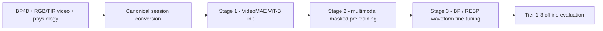

# KISMED Multimodal Physiological Waveform Recovery

[](https://www.python.org/)
[](https://pytorch.org/)
[](code/tests/)
[](data/README.md)

Research code for reconstructing contact-based physiological waveforms from
contactless RGB and thermal-infrared (TIR) facial video. The project combines
VideoMAE-style visual initialization with MultiMAE-style multimodal masked
pre-training on BP4D+, followed by task-specific waveform fine-tuning under a
simulated contact-sensor-failure setting.

The downstream branches target:

- **BP** — blood-pressure (pulse) waveform reconstruction
- **RESP** — respiration waveform reconstruction

Optional add-ons include an action-unit (AU) occurrence probe, a thermal-ROI
respiration pipeline, and RGB face-ROI / 2D-texture experiments.



> **Data and research status:** BP4D+ data and model checkpoints are not stored
> in this repository. Obtain access through the appropriate dataset and model
> providers before running the pipelines. See
> [License and data use](#license-and-data-use).

## Why this project is useful

- **Three-stage progressive pipeline** — VideoMAE-style visual initialization,
  MultiMAE-style multimodal masked pre-training, and task-specific waveform
  fine-tuning, orchestrated through one CLI.
- **Flexible modality contract** — any combination of video streams (`rgb`,
  `tir`) and 1-D signals (`bp`, `resp`) through `--streams`; ablations
  are a YAML change.
- **Asymmetric per-stream masking** — independent mask ratios per modality
  (50–75 % for video, 90 %+ for 1-D signals) with span-based signal masking.
- **Multi-tier waveform evaluation** — Tier 1 temporal metrics (MAE/RMSE/
  Pearson), Tier 2 Welch PSD consistency, and Tier 3 clinical HRV metrics for
  the BP branch via NeuroKit2.
- **ROI-aware pipelines** — thermal mouth/nose ROI crops, RGB face-ROI crops,
  offline ROI/2D-texture and respiration caches, and session-level
  preprocessing.
- **Honest evaluation protocols** — subject-disjoint splits, leave-one-subject-
  out sweeps, and k-fold evaluation runners.
- **DDP- and HPC-ready** — distributed training under `torch.distributed` or
  Slurm, with local single-GPU smoke scripts for every major stage.
- **Evidence-based project context** — generated specifications, design
  decisions, experiment plans, and measured evaluation verdicts live in
  [`code/notes/`](code/notes/).

## What is included

| Path | Purpose |
| --- | --- |
| [`code/core/`](code/core/) | Models, adapters, losses, registry, and waveform heads |
| [`code/data/`](code/data/) | BP4D+ conversion, video/physiology loading, ROI datasets, masking, and caches |
| [`code/engines/`](code/engines/) | Training, validation, inference, and visualization loops |
| [`code/evaluation/`](code/evaluation/) | Temporal, spectral, clinical, and assembled session metrics |
| [`code/runners/`](code/runners/) | Command-line entry points |
| [`code/configs/pretrain/`](code/configs/pretrain/) | Stage-2 YAML configurations |
| [`code/configs/finetune/`](code/configs/finetune/) | Stage-3 YAML configurations |
| [`code/scripts/local/`](code/scripts/local/) | Single-GPU smoke wrappers |
| [`code/scripts/hpc/`](code/scripts/hpc/) | Slurm launch and preprocessing jobs |
| [`code/tests/`](code/tests/) | Pytest coverage for data, models, losses, and runners |
| [`code/notes/spec/`](code/notes/spec/) | Generated architecture, data, and training contracts |
| [`notebooks/`](notebooks/) | Thermal-ROI pipeline notebook and guide |
| [`report/`](report/) | LaTeX thesis source |
| [`presentation/`](presentation/) | Presentation source and figures |

## Requirements

- Linux or WSL with Python **3.10 or newer**
- Python packages listed in [`code/requirements.txt`](code/requirements.txt)
- A CUDA-capable GPU for practical training (`torch>=2.1`)
- `ffmpeg` / `decord` support for thermal `.wmv` decoding
- BP4D+ raw data for preprocessing and training
- Optional: NeuroKit2 for Tier-3 clinical metrics (listed in the requirements
  file and imported lazily)
- Optional: a Slurm cluster for multi-GPU/HPC experiments

The repository does not package or download BP4D+ automatically. Raw data and
trained checkpoints are excluded by [`.gitignore`](.gitignore), so keep them
outside version control.

## Installation

```bash
git clone https://github.com/LeqiaoP1/MA-project-KISMED.git
cd MA-project-KISMED

python3 -m venv .venv
source .venv/bin/activate
python -m pip install --upgrade pip
python -m pip install -r code/requirements.txt
```

Tier 1/2 evaluation only needs NumPy and SciPy; the Tier-3 clinical metrics use
NeuroKit2 when available and report a clear error if it is missing.

For local runs, configure the environment from the `code/` directory:

```bash
cd code
source scripts/env_local.sh
```

The local profile defaults to:

- raw BP4D+ data: `../data/raw/BP4D`
- canonical processed data: `../data/processed/bp4d_canonical`
- outputs: `../output`
- initial model cache: `../models/initial`

Override these locations before sourcing the profile when needed:

```bash
export RAW_DATA_PATH=/path/to/BP4D
export DATA_PATH=/path/to/bp4d_canonical
export OUTPUT_DIR=/path/to/output
source scripts/env_local.sh
```

## Quick start

All Python entry points are intended to be run from [`code/`](code/).

### 0. Download Stage-1 encoder weights (once)

Stage 2 starts from a published VideoMAE ViT-Base checkpoint. Download it on a
machine with internet (on a cluster, use a login node):

```bash
cd code
python runners/run_download_weights.py --list
python runners/run_download_weights.py videomae:k400   # Kinetics-400
python runners/run_download_weights.py videomae:ssv2   # optional A/B
```

Weights are cached under `models/initial/`; override the location with
`--weights_dir` or `$INITIAL_MODELS_DIR`. The VideoMAE checkpoints are
CC-BY-NC 4.0 — review their terms before use.

### 1. Prepare and inspect the data

The converter expects the raw BP4D+ trees `2D+3D/`, `Thermal/`, and
`Physiology/`. It writes one synchronized canonical directory per session.

```bash
python data/prepare_bp4d.py \
  --raw_root ../data/raw/BP4D \
  --out_root ../data/processed/bp4d_canonical \
  --limit_sessions 8

python runners/run_inspect_data.py \
  --data_path ../data/processed/bp4d_canonical \
  --clip_duration 2 \
  --input_size 64 \
  --plot
```

Remove `--limit_sessions` for a complete conversion. Use
`run_inspect_physio.py` to inspect raw physiology channels before training.

### 2. Run multimodal masked pre-training

Configs are loaded as argument defaults, and explicit command-line arguments
override YAML values. Start with the local wiring smoke, then the VideoMAE
inheritance run:

```bash
python runners/run_pretrain.py -c configs/pretrain/stage2_local.yaml
python runners/run_pretrain.py -c configs/pretrain/stage2_local_pretrained.yaml
```

Other Stage-2 entry points:

- `configs/pretrain/stage2_local_pretrained_ssv2.yaml` — SSV2 twin for the
  K400-vs-SSV2 comparison.
- `configs/pretrain/stage2_multimodal.yaml` — canonical multi-stream run.
- `configs/pretrain/stage2_*_tir_roi_resp*.yaml` — thermal-ROI + respiration
  datasets, including the asymmetric multimodal masking (AMMM) variants.

The local configurations are intentionally small smoke or milestone runs.
Before a long experiment, check the data path, output directory, streams, model
geometry, and pretrained encoder checkpoint.

### 3. Fine-tune a waveform branch

Fine-tuning requires a compatible Stage-2 checkpoint. The Stage-3 geometry and
ROI settings must match the checkpoint’s recorded configuration; mismatches
abort the run.

```bash
python runners/run_waveform.py -c configs/finetune/bp.yaml
python runners/run_waveform.py -c configs/finetune/resp.yaml
```

For the thermal-ROI respiration branch:

```bash
python runners/run_waveform.py \
  -c configs/finetune/resp_tir_roi_local.yaml \
  --val_subject F004
```

### 4. Evaluate saved predictions

The offline evaluator accepts `.npy` or `.npz` prediction and target arrays.

```bash
python runners/run_evaluate.py \
  --pred_path predictions.npy \
  --target_path targets.npy \
  --fs 100 \
  --tier 1,2,3 \
  --waveform bp \
  --out metrics.json
```

Tier 1 reports temporal MAE/RMSE/Pearson metrics, Tier 2 reports Welch PSD
consistency, and Tier 3 reports clinical HRV metrics (BP branch only). For
subject-level, session-level, and k-fold summaries, use
`runners/run_evaluate_subject.py`, `runners/run_evaluate_session.py`, and
`runners/run_evaluate_kfold.py`.

### 5. Optional add-on workflows

```bash
# Thermal-ROI -> respiration pre-training and fine-tuning
python runners/run_pretrain.py \
  -c configs/pretrain/stage2_local_tir_roi_resp.yaml
python runners/run_waveform.py \
  -c configs/finetune/resp_tir_roi_local.yaml --val_subject F004

# AU-occurrence probe on a frozen Stage-2 encoder
python runners/run_au_probe.py -c configs/finetune/au_local.yaml

# Reconstruction inspection and pretraining visualization
python runners/run_eval_recon.py --help
python runners/run_visualize_pretrain.py --help
```

## HPC and multi-GPU runs

Edit [`code/scripts/env_hpc.sh`](code/scripts/env_hpc.sh) for the cluster’s
virtual environment, data paths, output location, partition, account, and GPU
resource specification. Then submit the relevant Slurm job from `code/`:

```bash
cd code
source scripts/env_hpc.sh
bash scripts/hpc/download_weights.sh   # once, on a login node
EXP_ROOT=$WORK_SCRATCH/protocol_v1 sbatch scripts/hpc/submit_sweep.sbatch
```

The sweep is the only Stage-2/Stage-3 path: per fold it runs partition →
Stage 2 → Stage 3 → test scoring, sequentially, in one allocation. Its inputs
are env vars (`EXP_ROOT` required; also `FOLDS`, `CFG2`, `CFG3`, `RAW_ROOT`,
`SPLIT_SEED`, `SPLIT_STRATIFY`) — read `scripts/hpc/submit_sweep.sh`. The HPC
profile is a template and contains site-specific values that must be reviewed
before submission. Local scripts under `code/scripts/local/` are single-process
smoke wrappers; they do not require a
DDP launcher.

## Testing

Run the test suite from `code/`:

```bash
cd code
python -m pytest
python -m pytest tests/test_waveform_losses.py -q   # targeted
python -m pytest --cov=data --cov=evaluation --cov=runners --cov=utils
```

For a syntax-only check:

```bash
python -m compileall .
```

## Where to get help

- [`code/README.md`](code/README.md): implementation layout and experiment
  commands
- [`code/notes/spec/`](code/notes/spec/): generated architecture, data, and
  training contracts
- [`code/notes/design/`](code/notes/design/): design decisions and review
  verdicts
- [`code/notes/plan/`](code/notes/plan/): current experiment plans
- [`code/notes/eval/`](code/notes/eval/): measurements and evaluation verdicts
- [`code/notes/explanation/`](code/notes/explanation/): result interpretations
- [`notebooks/TirROI_Resp_Guide.md`](notebooks/TirROI_Resp_Guide.md): thermal-ROI
  respiration workflow
- [`report/TUDaThesis/`](report/TUDaThesis/): thesis source and bibliography
- [`docs/`](docs/): project and literature reference material
- [`AGENTS.md`](AGENTS.md): repository-wide development conventions

If a command or configuration is unclear, first check its `--help` output and
the corresponding YAML file. For reproducible bugs or proposed improvements,
open an issue at <https://github.com/LeqiaoP1/MA-project-KISMED/issues> with the
command, configuration, environment, and concise error output. Do not attach
BP4D+ data or private checkpoints.

## Who maintains and contributes

This is a research/thesis repository maintained by the KIS*MED project team at
TU Darmstadt. The primary maintainer is Leqiao Peng
(<leqiao.peng@stud.tu-darmstadt.de>).

Contributions should remain focused and reproducible:

1. Create a branch for the change.
2. Keep runtime code changes under [`code/`](code/).
3. Update directly related configuration or documentation.
4. Add or update tests under [`code/tests/`](code/tests/) when behavior changes.
5. Run the relevant pytest tests and a local smoke command.
6. Open a pull request describing the data/configuration assumptions and
   validation performed.

Architecture changes should also update the relevant specification, design, or
evaluation note. Never commit BP4D+ data, private checkpoints, credentials, or
cluster-specific paths.

## License and data use

No standalone `LICENSE` file is bundled with this repository. Unless a separate
agreement applies, all rights are reserved; contact the maintainers before
redistributing the code or derived artifacts. BP4D+ data and published model
checkpoints are governed by their own access and use terms. In particular, the
VideoMAE weights downloaded by `run_download_weights.py` are CC-BY-NC 4.0.

## Project structure

```text
.github/       Agent instructions and reusable prompt files
code/          Python package, runners, configs, tests, scripts, and notes
data/          Raw, interim, and processed datasets (not committed)
docs/          Reference PDFs and literature
models/        Initial and trained model weights (not committed)
notebooks/     Thermal-ROI notebook and exploratory analysis
output/        Training outputs and evaluation artifacts (not committed)
presentation/  Presentation source and generated figures
report/        LaTeX thesis source
```
