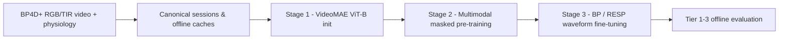
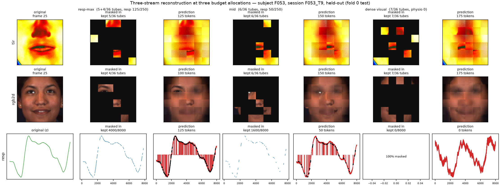

# KISMED Multimodal Physiological Waveform Recovery

[](https://www.python.org/)
[](https://pytorch.org/)
[](code/tests/)
[](data/README.md)

Research software for reconstructing contact-based physiological waveforms from
contactless RGB and thermal-infrared (TIR) facial video on BP4D+. The pipeline
combines VideoMAE-style visual initialization (Stage 1) with MultiMAE-style
multimodal masked pre-training (Stage 2) and task-specific waveform fine-tuning
(Stage 3) under a simulated contact-sensor failure setting.

Downstream branches target two 1-D physiological waveforms:

- **BP** (`bp`) — continuous blood-pressure (pulse) waveform reconstruction
- **RESP** (`resp`) — continuous respiration waveform reconstruction

Optional workflows include a frozen-encoder action-unit (AU) occurrence probe,
offline ROI and physiological cache builders, TIR-ROI respiration experiments,
and zero-shot cross-modal reconstruction probes.



> **Data and research status:** BP4D+ data and model checkpoints are not stored
> in this repository. Obtain access through the appropriate dataset and model
> providers before running the pipelines. See
> [License and data use](#license-and-data-use).

## Why this project

- **Three-stage progressive pipeline** — VideoMAE-style 3-D tubelet
  initialization, MultiMAE-style multimodal masked pre-training, and
  visual-only waveform fine-tuning orchestrated through a unified YAML + CLI
  interface.
- **Flexible modality contract** — select visual streams (`rgb`, `tir`, `rgb2d`)
  and 1-D physiological signals (`bp`, `resp`) via `--streams`; ablations are a
  YAML change. `rgb2d` is the 2D-texture face-ROI stream that shares the `tir`
  patch grid, making `tir,rgb2d,resp` (and `tir,rgb2d,bp,resp`) the supported
  visible+TIR fusion configurations.
- **Constant-budget masking (ADR-002 / ADR-005 / ADR-006)** — one masking
  policy keeps the encoder sequence length fixed at `n_budget` tokens (default
  350) on every step with no `[MASK]` tokens or padding in the encoder. It
  supports waveform inpainting, bi-visual virtual sensing (zero physiological
  tokens), a two-phase virtual-sensing curriculum (ADR-005), and a
  single-carrier virtual-sensing regime where one visual stream holds all 350
  tokens while the other keeps zero (ADR-006). Mask placement (`scattered` or
  contiguous `span`) is an independent layer.
- **Multi-tier waveform evaluation** — Tier 1 temporal metrics (MAE, RMSE,
  Pearson, band-limited Pearson, amplitude, breath-rate MAE), Tier 2 Welch PSD
  spectral consistency, and Tier 3 clinical HRV metrics for the BP branch via
  NeuroKit2.
- **ROI-aware preprocessing & immutable caches** — TIR mouth/nose ROI crops,
  `rgb2d` face-ROI caches, and quality-gated respiration (`resp_cache`, ADR-003)
  and blood-pressure (`bp_artefact`, ADR-004) session artefacts.
- **Reproducible evaluation protocols** — subject-disjoint fold plans
  (`protocol.FoldPlan` with write-once `partition.json`, ADR-001) plus
  clip-, session-, subject-, and k-fold evaluation runners.
- **Local smoke & HPC DDP workflows** — single-GPU smoke configs and scripts
  for local development, alongside Slurm multi-GPU DDP sweeps and auto-resuming
  30-minute pre-training chains.
- **Code-grounded documentation** — generated contracts, ADRs, experiment
  plans, terminology glossary, and measured evaluation records live under
  [`code/notes/`](code/notes/).

## Included components

| Path | Purpose |
| --- | --- |
| [`code/core/`](code/core/) | Models (`MultiModalMAE`, `MultiModalWaveformRegressor`), adapters, constant-budget masking, losses, and registry |
| [`code/data/`](code/data/) | BP4D+ conversion, video/physiology I/O, ROI datasets, and offline cache/artefact readers |
| [`code/models/`](code/models/) | Model factory (`create_model`) and Stage-1 VideoMAE weight downloader |
| [`code/engines/`](code/engines/) | Training, validation, inference, and visualization loops |
| [`code/evaluation/`](code/evaluation/) | Temporal, spectral, clinical, and Hann-assembled session metrics |
| [`code/runners/`](code/runners/) | CLI entry points for caching, partitioning, training, probing, and evaluation |
| [`code/protocol/`](code/protocol/) | Subject-disjoint fold plans, write-once `partition.json`, and run guards |
| [`code/utils/`](code/utils/) | Slurm/DDP bootstrap, AMP scaler, checkpoints, LR schedules, and metric logging |
| [`code/configs/pretrain/`](code/configs/pretrain/) | Stage-2 YAML configurations |
| [`code/configs/finetune/`](code/configs/finetune/) | Stage-3 and AU-probe YAML configurations |
| [`code/scripts/local/`](code/scripts/local/) | Single-GPU local smoke wrappers |
| [`code/scripts/hpc/`](code/scripts/hpc/) | Slurm launch, sweep, chain, and preprocessing jobs |
| [`code/tests/`](code/tests/) | Pytest suite covering data, caches, masking policies, models, losses, and runners |
| [`code/analysis/`](code/analysis/) | Standalone measurement scripts (e.g. respiration source-rate probe) |
| [`code/notes/`](code/notes/) | Glossary, generated specs, ADRs, experiment/feature plans, and eval verdicts |
| [`notebooks/`](notebooks/) | TIR-ROI respiration notebook and guide |
| [`report/`](report/) | LaTeX thesis source |
| [`presentation/`](presentation/) | Presentation source and slide builder |

## Requirements

- Linux or WSL with Python **3.10 or newer**
- Dependencies listed in [`code/requirements.txt`](code/requirements.txt)
- A CUDA-capable GPU for practical training (`torch>=2.1.0`)
- `ffmpeg` / `decord` support for TIR `.wmv` decoding
- BP4D+ raw dataset for preprocessing and training
- Optional: `neurokit2>=0.2.13` for Tier 3 clinical HRV metrics on the BP branch
  (listed in [`code/requirements.txt`](code/requirements.txt) and imported
  lazily; requires `pandas<3.0`)
- Optional: a Slurm cluster for multi-GPU HPC experiments

The repository does not package or download BP4D+ automatically. Raw data and
trained checkpoints are excluded by [`.gitignore`](.gitignore); keep them
outside version control.

## Installation

```bash
git clone https://github.com/LeqiaoP1/MA-project-KISMED.git
cd MA-project-KISMED

python3 -m venv .venv
source .venv/bin/activate
python -m pip install --upgrade pip
python -m pip install -r code/requirements.txt
```

Tier 1 and Tier 2 evaluation require only NumPy and SciPy. Tier 3 clinical
metrics use NeuroKit2 when installed and raise a clear `ImportError` otherwise.

For local runs, load the environment profile from [`code/`](code/):

```bash
cd code
source scripts/env_local.sh
```

The local profile defaults to:

- Raw BP4D+ data (`RAW_DATA_PATH`): `../data/raw/BP4D`
- Canonical processed data (`DATA_PATH`): `../data/processed/bp4d_canonical`
- Outputs (`OUTPUT_DIR`): `../output`
- Initial Stage-1 weight cache (`INITIAL_MODELS_DIR`): `../models/initial`

Override any path before sourcing the profile:

```bash
export RAW_DATA_PATH=/path/to/BP4D
export DATA_PATH=/path/to/bp4d_canonical
export OUTPUT_DIR=/path/to/output
source scripts/env_local.sh
```

## Quick start

Run all Python entry points from [`code/`](code/). YAML configs provide
`argparse` defaults; explicit CLI flags always override them.

### 0. Download Stage-1 encoder weights (once)

Stage 2 typically initializes from a published VideoMAE ViT-Base checkpoint.
Download on a machine with internet access (on HPC, use a login node):

```bash
cd code
python runners/run_download_weights.py --list
python runners/run_download_weights.py videomae:k400   # Kinetics-400 (default)
python runners/run_download_weights.py videomae:ssv2   # Something-Something-v2
```

Weights are cached under `models/initial/` (override via `--weights_dir` or
`$INITIAL_MODELS_DIR`). The built-in Stage-1 table serves **ViT-Base only**
(`videomae:k400` and `videomae:ssv2`, licensed under CC BY-NC 4.0).

### 1. Prepare and inspect the data

The canonical converter expects the raw BP4D+ directory trees `2D+3D/`,
`Thermal/`, and `Physiology/` and writes one synchronized directory per session:

```bash
python data/prepare_bp4d.py \
  --raw_root ../data/raw/BP4D \
  --out_root ../data/processed/bp4d_canonical \
  --limit_sessions 8

python runners/run_inspect_data.py \
  --data_path ../data/processed/bp4d_canonical \
  --clip_duration 2 \
  --input_size 64 \
  --plot
```

Omit `--limit_sessions` to convert the complete corpus. Use
`runners/run_inspect_physio.py` to inspect raw physiology channels before
training.

### 2. Run multimodal masked pre-training (Stage 2)

Start with a local wiring smoke test, then run with VideoMAE initialization:

```bash
python runners/run_pretrain.py -c configs/pretrain/stage2_local.yaml
python runners/run_pretrain.py -c configs/pretrain/stage2_local_pretrained.yaml
```

Key Stage-2 configurations under [`code/configs/pretrain/`](code/configs/pretrain/):

- `stage2_local_pretrained_ssv2.yaml` — SSV2 twin for K400-vs-SSV2 comparison.
- `stage2_multimodal.yaml` — canonical multi-stream HPC template.
- `stage2_{local,hpc}_tir_roi_resp.yaml` — TIR-ROI + respiration pipelines.
- `stage2_budget_tir_roi_resp_rgb2d.yaml` — three-stream (`tir,rgb2d,resp`)
  constant-budget baseline (no curriculum).
- `stage2_budget_3stream_curriculum.yaml` — ADR-005 three-stream arm with a
  two-phase virtual-sensing curriculum (`p_warm = 0.10` → `p_target = 0.50`).
- `stage2_budget_3regime_single_modality.yaml` — ADR-006 three-regime arm
  adding single-carrier virtual sensing (`tir`-only or `rgb2d`-only steps).
- `stage2_fourstream_tir_rgb2d_bp_resp_small_random.yaml` — four-stream
  (`tir,rgb2d,bp,resp`) arm on a randomly initialized ViT-Small.

Pre-training does not require downloaded weights: set
`pretrained_encoder: none` (or `--pretrained_encoder none|random|scratch|c0`) to
train from `trunc_normal_` random initialization. This is required for
`project_multimae_small`, since the built-in Stage-1 table only provides
VideoMAE ViT-Base checkpoints:

```bash
python runners/run_pretrain.py \
  -c configs/pretrain/stage2_fourstream_tir_rgb2d_bp_resp_small_random.yaml
```

An unknown `--pretrained_encoder` spec fails loudly instead of silently falling
back to random initialization.

### 3. Fine-tune a waveform branch (Stage 3)

Fine-tuning requires a compatible Stage-2 checkpoint. Encoder geometry and ROI
settings must match the checkpoint record; mismatches abort the run:

```bash
python runners/run_waveform.py -c configs/finetune/bp.yaml
python runners/run_waveform.py -c configs/finetune/resp.yaml
```

For the TIR-ROI respiration branch, point to a Stage-2 checkpoint and select
the fold evaluation role:

```bash
python runners/run_waveform.py \
  -c configs/finetune/resp_tir_roi_local.yaml \
  --finetune "$MODEL_PATH" --eval_role test
```

### 4. Evaluate saved predictions

The offline evaluator scores prediction and target arrays (`.npy` or `.npz`):

```bash
python runners/run_evaluate.py \
  --pred_path predictions.npy \
  --target_path targets.npy \
  --fs 100 \
  --tier 1,2,3 \
  --waveform bp \
  --out metrics.json
```

Tier 1 reports temporal metrics (MAE, RMSE, Pearson), Tier 2 reports Welch PSD
spectral consistency, and Tier 3 reports clinical HRV metrics for the BP branch.
For assembled session-level, subject-level, and pooled k-fold summaries, use
`runners/run_evaluate_session.py`, `runners/run_evaluate_subject.py`, and
`runners/run_evaluate_kfold.py`.

### 5. Optional add-on workflows

```bash
# Build offline caches/artefacts once (see --help for frozen cache keys)
python runners/run_build_resp_cache.py --init --build \
  --out_root "${WORK_SCRATCH:-../output}/resp_cache" --raw_root "$RAW_DATA_PATH"
python runners/run_build_bp_artefact.py --help
python runners/run_build_roi_cache.py --help
python runners/run_build_2d_roi_cache.py --help

# AU-occurrence probe on a frozen Stage-2 encoder
python runners/run_au_probe.py -c configs/finetune/au_local.yaml

# Zero-shot reconstruction probe and pre-training visualization
python runners/run_eval_recon.py --help
python runners/run_visualize_pretrain.py --help
```

## HPC and multi-GPU runs

Edit [`code/scripts/env_hpc.sh`](code/scripts/env_hpc.sh) to configure the
cluster virtual environment, dataset paths, scratch output root, Slurm
partition, account, and GPU resources, then launch from `code/`:

```bash
cd code
source scripts/env_hpc.sh
bash scripts/hpc/download_weights.sh   # once, on a login node

# Combined Stage-2 + Stage-3 ADR-001 fold sweep
EXP_ROOT=$WORK_SCRATCH/protocol_v1 sbatch scripts/hpc/submit_sweep.sbatch

# Stage-2 pretrain-only sweep or 30-minute auto-resuming Slurm chain
EXP_ROOT=$WORK_SCRATCH/pretrain_v1 FOLDS=0 \
  bash scripts/hpc/submit_pretrain_chain.sh
```

- [`submit_sweep.sh`](code/scripts/hpc/submit_sweep.sh) sequentially runs
  partitioning (`run_partition.py`), Stage 2, Stage 3, and one-shot test
  scoring per fold (`EXP_ROOT` required; configurable via `FOLDS`, `CFG2`,
  `CFG3`, `RAW_ROOT`, `SPLIT_SEED`, `SPLIT_STRATIFY`).
- [`submit_pretrain_sweep.sh`](code/scripts/hpc/submit_pretrain_sweep.sh) and
  [`submit_pretrain_chain.sh`](code/scripts/hpc/submit_pretrain_chain.sh) run
  Stage-2-only sweeps and chained `--dependency=afterany` 30-minute allocations
  that resume automatically from periodic checkpoints. See
  [`adr005_pretrain_fold.sbatch`](code/scripts/hpc/adr005_pretrain_fold.sbatch)
  for a single-fold 4-GPU template.
- Local wrappers under [`code/scripts/local/`](code/scripts/local/) run
  single-process smoke tests without DDP.

## Latest baseline results

### Three-stream Stage-2 (`tir`, `rgb2d`, `resp`), fold 0 — ADR-005

Pre-trained `project_multimae_base` (VideoMAE `k400` → `tir` adapter,
random-init `rgb2d` adapter, 350-token constant budget, curriculum
`p = 0.10 → 0.50` at epoch 50) for **150 epochs** on fold 0 (6,762 train / 1,128
val clips) via a 13-link 4×A100 chain. Records:
[`README.md`](code/notes/eval/baselines/tir_rgb2d_resp/README.md),
[`fold0_pretrain_150ep.md`](code/notes/eval/baselines/tir_rgb2d_resp/fold0_pretrain_150ep.md),
[`resp_recon_arms_ab.md`](code/notes/eval/baselines/tir_rgb2d_resp/resp_recon_arms_ab.md),
[`multimae_style_panel.md`](code/notes/eval/baselines/tir_rgb2d_resp/multimae_style_panel.md).



*MultiMAE-Figure-6-style panel for the frozen fold-0 checkpoint (`checkpoint-0149.pth`)
on a held-out test clip (subject `F053`, session `F053_T9`). The visible budget
is fixed at 350 tokens across three allocations: 4+5 visual tubes + 50% RESP →
6+6 tubes + 20% RESP → 7+7 tubes + 0% RESP (virtual sensing).*

Key zero-shot findings on fold-0 held-out `test` (1,594 clips / 27 subjects):

- **RESP inpainting** (125/250 tokens visible, 210 clips): `r_masked`
  **+0.996** (MSE 0.009).
- **RESP virtual sensing** (0 RESP tokens visible): `r_masked` **+0.109**
  (subject median +0.113 [+0.078, +0.136]) under TIR-max vs **+0.080** under
  `rgb2d`-max (paired Δ = −0.0292 ± 0.0044, t = −6.62) — a weak, real lead
  rather than a usable waveform.
- **Content ablation**: rolling `tir` drops `r_masked` by **−0.0539**
  (t = −9.96), whereas rolling or zeroing `rgb2d` has no measurable effect
  (−0.0012 / −0.0028), motivating ADR-006's single-carrier regime.

### Four-stream Stage-2 (`tir`, `rgb2d`, `bp`, `resp`), fold 0 — ADR-002 comparator

A randomly initialized ViT-Small (`stage2_fourstream_tir_rgb2d_bp_resp_small_random.yaml`,
350-token budget, 150 epochs, `val/loss` 3.5040 → 2.1051) held its budget on
all 31,050 steps, while zero-shot RESP reconstruction remained at the noise
floor (`r_masked` +0.006 TIR-max vs +0.014 `rgb2d`-max). See
[`fold0_pretrain_150ep.md`](code/notes/eval/baselines/tir_rgb2d_bp_resp/fold0_pretrain_150ep.md)
and [`resp_recon_arms_ab.md`](code/notes/eval/baselines/tir_rgb2d_bp_resp/resp_recon_arms_ab.md).

## Testing

Run the pytest suite from [`code/`](code/):

```bash
cd code
python -m pytest
python -m pytest tests/test_waveform_losses.py -q   # targeted
python -m pytest --cov=data --cov=evaluation --cov=runners --cov=utils
```

For a syntax-only check:

```bash
python -m compileall .
```

## Support and references

- [`code/README.md`](code/README.md) — implementation layout and experiment
  commands
- [`code/notes/GLOSSARY.md`](code/notes/GLOSSARY.md) — canonical terminology,
  shapes, and notation
- [`code/notes/spec/`](code/notes/spec/) — generated architecture, data,
  engine, and execution contracts
- [`code/notes/design/`](code/notes/design/) — ADRs and architectural design
  decisions
- [`code/notes/plan/`](code/notes/plan/) — training-run protocols
  ([`experiments/`](code/notes/plan/experiments/)) and implementation plans
  ([`features/`](code/notes/plan/features/))
- [`code/notes/eval/`](code/notes/eval/) — measured evaluation records and
  baselines
- [`code/notes/explanation/`](code/notes/explanation/) — result and cluster
  explanations
- [`notebooks/TirROI_Resp_Guide.md`](notebooks/TirROI_Resp_Guide.md) — TIR-ROI
  respiration workflow guide
- [`report/TUDaThesis/`](report/TUDaThesis/) — LaTeX thesis source
- [`docs/`](docs/) — project and literature reference material
- [`AGENTS.md`](AGENTS.md) — repository-wide engineering guardrails

If a command or flag is unclear, check its `--help` output and YAML config
first. For reproducible bugs or proposed improvements, open an issue at
<https://github.com/LeqiaoP1/MA-project-KISMED/issues> with the command,
configuration, environment, and concise error output. Do not attach BP4D+ data
or private checkpoints.

## Maintainers and contributions

Maintained within the KIS*MED project at TU Darmstadt. Primary maintainer:
Leqiao Peng (<leqiao.peng@stud.tu-darmstadt.de>).

No standalone `CONTRIBUTING.md` is bundled; follow [`AGENTS.md`](AGENTS.md) and
keep contributions focused and reproducible:

1. Create a branch and keep runtime source edits under [`code/`](code/).
2. Update related configs, specs, or notes alongside behavioral changes.
3. Add or update pytest tests under [`code/tests/`](code/tests/) and verify
   with `python -m pytest` plus a local smoke run.
4. Open a pull request describing data/config assumptions and validation
   performed. Never commit BP4D+ data, private checkpoints, credentials, or
   cluster-specific paths.

## License and data use

No standalone `LICENSE` file is bundled with this repository. Unless a separate
agreement applies, all rights are reserved; contact the maintainer before
redistributing code or derived artifacts. BP4D+ data and published checkpoints
are governed by their respective terms — in particular, the VideoMAE ViT-Base
weights downloaded by `run_download_weights.py` are licensed under CC BY-NC 4.0.

## Project structure

```text
.github/       Agent instructions and reusable prompt files
AGENTS.md      Repository-wide engineering guidelines
Makefile       Slide-deck build shortcut (presentation)
code/          Python package, runners, configs, tests, scripts, and notes
data/          Raw, interim, and processed datasets (not committed)
docs/          Reference PDFs and literature (read-only)
models/        Initial and trained model weights (not committed)
notebooks/     TIR-ROI notebook and exploratory analysis
output/        Training outputs and evaluation artifacts (not committed)
presentation/  Presentation source and generated figures
report/        LaTeX thesis source
```
