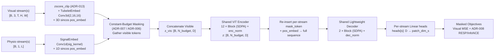

# ADR-014: Stage-2 MultiModalMAE Early-Token-Mixing Architecture, Space-Time Alignment, and Pretrained Initialization

- **Status**: Accepted
- **Date**: 2026-09-20 (revised 2026-11-25; codified as ADR-014 on 2026-11-26)
- **Author**: KISMED MA research team
- **Related Spec/Plan**: Pre-existing baseline (`code/notes/spec/02_model_architecture.md` §1–§7, `code/core/multimae.py`, `code/core/blocks.py`, `code/models/pretrained.py`); masking policy governed by `ADR-007` (Phase-1) / `ADR-006` (Phase-2); Stage-2 composite objective & alignment governed by `ADR-008`; visual input norm governed by `ADR-013`; Stage-3 downstream transfer governed by `ADR-015`
- **Supersedes**: `SolutionC_EarlyTokenMixing_stage2.md` (retired stale 224 px / 90%–75% random-mask PlantUML sketch; updated to live `MultiModalMAE` architecture)

> **Scope.** This ADR governs one research aspect: **the Stage-2 multimodal masked autoencoder
> backbone (`MultiModalMAE`) — its early-token-mixing ViT topology, per-stream tubelet/signal
> tokenization, hard space-time alignment invariant, decoder conditioning contract, and Stage-1
> VideoMAE weight initialization**. Per-step token budgeting and masking (`ADR-006`, `ADR-007`),
> composite physiological loss / InfoNCE (`ADR-008`), visual clip normalization (`ADR-013`), and
> Stage-3 fine-tuning (`ADR-015`) are governed by their respective ADRs.

---

## 1. Context & Problem Statement

### 1.1 Objective and Scope
To learn cross-modal representations linking facial video (`tir`, `rgb2d`, `rgb`) and 1-D physiological waveforms (`resp`, `bp`) under contact-sensor failure, Stage-2 pre-training must fuse visible tokens from heterogeneous modalities inside a single shared Vision Transformer encoder while preserving exact temporal correspondence and cleanly transferring encoder weights to Stage 3.

### 1.2 Design Pressures
1. **Modality heterogeneity.** Visual streams are 5-D spatiotemporal clips `[B, 3, T, H, W]`, while physiological signals are 3-D waveforms `[B, 1, L]`. Both must project into a shared token width $D$ (`768` for ViT-Base) on a synchronized time grid.
2. **Early cross-modal interaction.** Late-fusion encoders keep visual and physiological streams isolated until the final head, preventing self-attention layers from learning fine-grained spatiotemporal correspondences between nostril thermal dynamics and respiratory phase.
3. **Zero-visible-token conditioning (Mode 1 virtual sensing).** When a physiological stream (or zeroed visual stream under `ADR-006`) keeps $K_m = 0$ visible tokens, a decoder that operates only on that stream's own tokens cannot condition on the visual latents, yielding $\partial \mathcal{L}_m / \partial z = 0$.
4. **Cold-start data scarcity.** Training a 768-d ViT visual tokenizer from scratch on ~140 subjects under-converges; the visual tubelet geometry must admit published Stage-1 VideoMAE weights verbatim.
5. **Memory scaling.** Naive quadratic attention materializes `[B, heads, N, N]`; PyTorch SDPA (`F.scaled_dot_product_attention`) is required for scalable training.

### 1.3 Requirements
- **R1 — Mandatory cross-modal contract.** Stage-2 requires $\ge 1$ visual stream from `('rgb', 'tir', 'rgb2d')` **and** $\ge 1$ physiological stream from `('bp', 'resp')`; all-visual or all-signal lists fail fast at construction.
- **R2 — Hard space-time alignment invariant.** One visual temporal tubelet must tile an exact integer number $R \ge 1$ of 1-D physiological tokens, enforced at model build time.
- **R3 — Early token mixing with shared encoder & lightweight shared decoder.** Visible tokens from all active streams are concatenated into one dense sequence `[B, N_budget, D]` and processed jointly by `enc_blocks`; mask tokens are re-inserted per stream before `dec_blocks` so every stream's reconstruction conditions on all encoded cross-modal latents.
- **R4 — Verbatim Stage-1 VideoMAE initialization.** `load_pretrained_encoder` must load published VideoMAE-Base (`videomae:k400`, `videomae:ssv2`) weights into `enc_blocks`, `enc_norm`, and one explicitly designated visual `TubeletEmbed` (`Conv3d(3, 768, (2, 16, 16))`) without temporal surgery when tubelets match.
- **R5 — Key-name stability for Stage-3 transfer.** Encoder module names (`adapters.*`, `positions.*`, `enc_blocks.*`, `enc_norm`) must remain verbatim identical to `MultiModalWaveformRegressor` (`ADR-015`).

---

## 2. Decision & Parameter Exposure

**Adopt the early-token-mixing `MultiModalMAE` architecture (`project_multimae_base`: 768-d, 12-layer shared ViT encoder + 2-layer shared ViT decoder) with per-stream `TubeletEmbed` / `SignalEmbed` adapters, 3-D/1-D sinusoidal positional embeddings, a construction-time integer space-time alignment check, full-sequence shared-decoder conditioning for zero-token streams, and explicit VideoMAE Stage-1 initialization.**

### 2.1 Architecture & Tensor Flow

### 2.2 Sub-Module Topology & Tokenization
1. **Closed stream set & channels (`STREAM_CHANNELS`):** Visual `('rgb', 'tir', 'rgb2d')` (3 channels default; legacy `tir_channels=1` only for pre-2026-09 checkpoints); physiological `('bp', 'resp')` (1 channel). One global `input_size` applies to all visual streams in a run.
2. **Input adapters (`adapters.<stream>`):**
   - `TubeletEmbed`: `nn.Conv3d(C, D, kernel_size=(t, p_h, p_w), stride=(t, p_h, p_w))` mapping `[B, C, T, H, W] → [B, G_t·G_h·G_w, D]`, flattened in `(g_t, g_h, g_w)` order.
   - `SignalEmbed`: `nn.Conv1d(1, D, kernel_size=sig_kernel, stride=sig_kernel)` mapping `[B, 1, L] → [B, N_s, D]`.
3. **Positional & mask embeddings (`positions.<stream>`):** Per-stream `_PosMask` holding learnable `pos_embed [1, N, D]` (initialized via 3-D sincos for video with $d_t = d_h = 2\lfloor D/6 \rfloor, d_w = D - 2d_t$, and the matching temporal sincos block for 1-D signals) and `mask_token [1, 1, D]`.
4. **Shared encoder (`enc_blocks`, `enc_norm`):** Pre-norm ViT `Block` stack (`Attention` using `F.scaled_dot_product_attention` + `Mlp` with GELU, `mlp_ratio=4.0`). Registered model factory variants via `@register_model` (`small`: 384-d/6h, `base`: 768-d/12h, `large`: 1024-d/16h, `huge`: 1280-d/16h); **`project_multimae_base`** is the thesis standard.
5. **Shared decoder & conditioning (`dec_blocks`, `dec_norm`, `heads.<stream>`):** `dec_depth = 2` shared ViT blocks operating over the concatenated full token sequences of all declared streams (visible encoder latents placed at unmasked positions, learnable `mask_token` at masked positions). Because every stream attends to the joint sequence, a stream with $K_m = 0$ visible tokens conditions directly on the other modalities' encoder latents (**Mechanism (a) prefixing**, guaranteeing $\partial \mathcal{L}_m / \partial z \neq 0$). Per-stream linear heads project `D → C·t·p_h·p_w` (visual) or `D → sig_kernel` (physiological).
6. **Optional Stage-2-only heads:** `align_proj` (`ADR-008`) is instantiated only when `align_weight > 0` and stays outside the Stage-3 weight-transfer whitelist.

### 2.3 Hard Space-Time Alignment Invariant (`_check_space_time_alignment`)
Validated at model construction (raising `ValueError` on violation):
$$R = \frac{N_{\text{signal}}}{G_t} \in \mathbb{Z}_{>0} \quad \text{and} \quad R \cdot \frac{\texttt{sig\_kernel}}{f_s} = \frac{\texttt{tubelet}_t \cdot \texttt{temporal\_stride}}{\texttt{fps}}.$$
- Classic 100 Hz ROI lineage: `tubelet=(2,16,16)`, `temporal_stride=2`, `fps=25` (160 ms/tubelet), `fs=100`, `sig_kernel=16` (160 ms/token) $\Rightarrow R = 1$.
- Active 1000 Hz `ADR-007`/`ADR-008` lineage: `tubelet=(2,16,16)`, `temporal_stride=4`, `fps=25` (320 ms/tubelet), `fs=1000`, `sig_kernel=32` (32 ms/token) $\Rightarrow R = 10$.

### 2.4 Stage-1 Pretrained Encoder Initialization
- `pretrained_encoder` in `{'', 'videomae:k400', 'videomae:ssv2'}` (or local `.pth`) loads `enc_blocks.*`, `enc_norm.*`, and `patch_embed.proj` into one explicitly designated visual adapter (`pretrained_visual_recipient`, default `tir` on multi-visual runs).
- Published VideoMAE checkpoints carry `[768, 3, 2, 16, 16]` kernels; matching `tubelet=(2,16,16)` transfers weights bit-for-bit without surgery. `pos_embed` and `cls_token` are **never** imported (rebuilt for the target spatial-temporal grid).

### 2.5 Logical Parameter Surface

| Parameter | Type | Default | Constraints | Role |
|---|---|---|---|---|
| `model` | str | `project_multimae_base` | registered in `core/registry.py` | Selects ViT backbone width/depth |
| `streams` | CSV | *(required)* | $\ge 1$ visual AND $\ge 1$ physio | Active modalities for Stage-2 pre-training |
| `tubelet` | 3-int CSV | `2,16,16` | divides `(num_frames, input_size, input_size)` | 3-D Conv3d tubelet kernel & stride |
| `input_size` | int | `96` (HPC ROI) / `64` (local) | divisible by `tubelet_h, tubelet_w` | Shared spatial grid for all visual streams |
| `num_frames` / `temporal_stride` | int | `50` / `4` (`ADR-007`); `100` / `2` (legacy) | `num_frames % tubelet_t == 0` | Decimated clip frames entering encoder |
| `sig_kernel` / `fs` / `seq_len` | int / float | `32` / `1000` / `0` (`ADR-007`) | satisfies alignment invariant | 1-D waveform tokenization (`0` = auto from `clip_duration * fs`) |
| `pos_init` | str | `'sincos3d'` | `'sincos3d' \| 'random'` | Positional embedding initialization |
| `target_norm` | str | `'none'` (ROI pinned) | `'token' \| 'clip' \| 'none'` | 1-D target norm (`pin_roi_target_norm` forces `'none'` on ROI datasets) |
| `pretrained_encoder` | str | `''` / `'videomae:k400'` | VideoMAE alias or `.pth` | Stage-1 initialization source |

### 2.6 Rejected Alternatives
- **Separate per-modality encoders with late fusion**: Rejected because cross-modal self-attention is needed throughout encoder depth to map visual cues to physiological dynamics.
- **Per-stream isolated decoders (no shared latent sequence)**: Rejected because a fully masked stream ($K_m = 0$) loses its gradient path into the shared encoder.
- **Per-stream independent `input_size`**: Rejected in favor of one global visual grid (`rgb2d` shares `96 × 96` with `tir` per `ADR-012`), keeping positional geometry and tube budgets interchangeable.

---

## 3. Falsifiable Criteria

- **Criterion 1 (Construction-time invariants)**: Model build raises `ValueError` on all-visual/all-signal stream lists, non-divisible `input_size`/`num_frames`, or violated space-time alignment ($R \notin \mathbb{Z}_{>0}$ or duration mismatch).
- **Criterion 2 (Mode-1 gradient flow)**: Under $K_{\text{resp}} = 0$, backpropagating $\mathcal{L}_{\text{resp}}$ yields strictly non-zero gradient norms on shared encoder weights `enc_blocks` and visual adapter `adapters.tir`.
- **Criterion 3 (Module self-tests & transfer parity)**: `python -m core.multimae` passes all internal self-tests, and every Stage-2 encoder key (`adapters.*`, `positions.*`, `enc_blocks.*`, `enc_norm`) loads cleanly into `MultiModalWaveformRegressor` (`ADR-015`).

- **Acceptance Artifacts**: `code/tests/test_budget_masking.py`, `code/tests/test_two_stream_anatomy_masking.py`, `code/tests/test_multimae_rgb2d.py`, `code/tests/test_video_input_norm.py`, `code/tests/test_adr008_composite_objective.py`.

---

## 4. Consequences & Trade-offs

- **Positive**: Unified cross-modal token space; verbatim Stage-1 VideoMAE compatibility; guaranteed zero-token conditioning for virtual sensing; seamless Stage-2 → Stage-3 encoder transfer.
- **Negative / Technical Debt**:
  - One global `input_size` prevents mixing 224 px full-frame `rgb` with 96 px `tir` in one run (`rgb2d` resolves this for fusion).
  - Learned `pos_embed` locks checkpoints strictly to their `(input_size, num_frames, tubelet)` geometry.
  - Only one visual adapter can receive the single published VideoMAE 3-channel patch kernel; any second visual stream starts from random tokenizer weights.

---

## 5. Reproducibility Record

- **Run / Job IDs**: Core Stage-2 backbone used across all pre-training experiments (`stage2_hpc_tir_roi_resp`, `stage2_budget_*`).
- **Evidence Artifacts**: `code/notes/spec/02_model_architecture.md`, `code/notes/eval/baselines/`.
- **Tests / Smoke Checks**: `python -m core.multimae` and `code/tests/` suite.
- **Rollback / Rejection Condition**: Architectural foundation of record; structural modifications require a superseding ADR.
