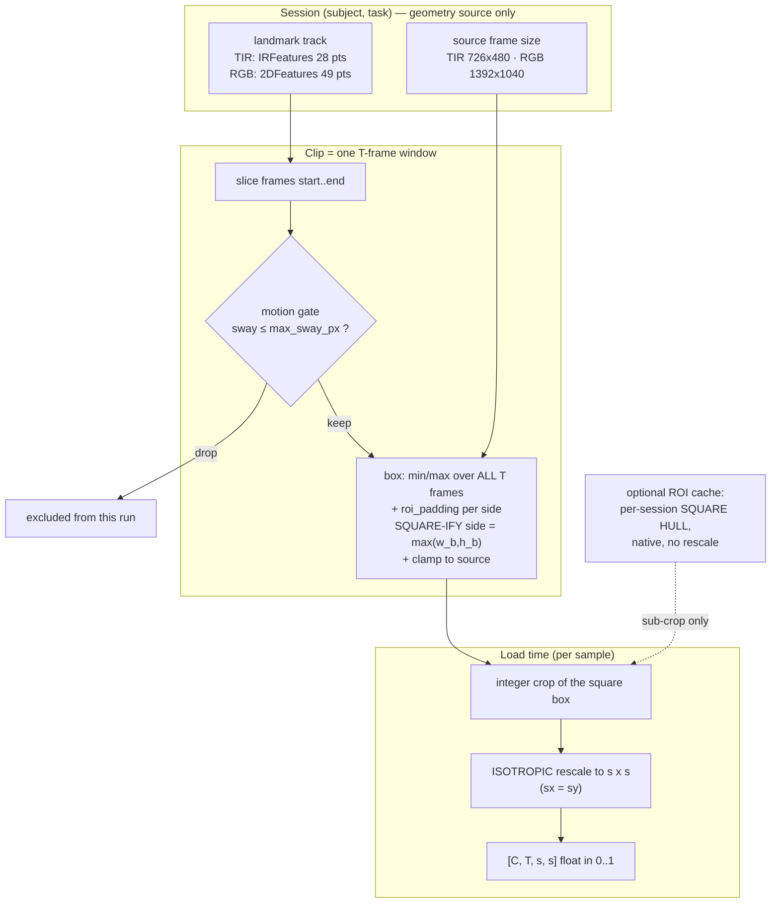

# Feature Design — Landmark ROI Extraction and Rescale to a Fixed Square

**Status**: implemented 2026-10-29 in the TIR lineage (`data/tir_resp_dataset.py`,
`data/roi_cache.py`); contract moved to `roi_padding 0.10` + `input_size 96` on
2026-10-30 (the pairing argument is §4.1). Implementation plan: `code/notes/plan/ROI_crop_implementation_plan.md`.
The RGB lineage keeps the legacy geometry and is bound to the same contract when it
is ported.
**Owners of the behaviour**: `data/tir_resp_dataset.py` (thermal), `data/rgb_roi_dataset.py` (visible), `data/rgb_features.py` (49-pt track), `data/roi_cache.py` (storage).
**Contract of record**: `notes/spec/01_data_pipeline.md` §3.2–3.3.
**Measured behaviour**: `notes/eval/tir_resp/` (`roi_sweep.py`, `roi_box_impact.py`, `frame_argmax.py`, `native_resolution_gate.py`).

This document specifies **what the ROI stage must do and why**, not how the code is
written. Function names appear only as anchors for the reader; any re-implementation
that satisfies §5 is conformant.

Paths are relative to `code/`, except `notebooks/…`, which is repo-root relative.

## Measurement basis

Numbers quoted here are measured over the **21 231 emitted clips** (union of the
five subject-disjoint Stage-3 fold dumps = 1260 sessions / 138 subjects), recomputed
with the production box function on the cache's landmark tracks (verified
byte-identical to the `IRFeatures` track). Reproduce them with
`notes/eval/tir_resp/roi_geometry_ledger.py` (verdict and tables documented in
`notes/eval/tir_resp/roi_geometry_ledger.md`).

---

## 1. Problem and requirements

The two visual streams of BP4D+ are full-room frames: thermal `726 x 480`, visible
`1392 x 1040`. The signal of interest (perinasal airflow, lip motion) occupies a
few percent of the area, and the encoder's token budget is small — at patch 16 and
`input_size = 96` there are `6 x 6 = 36` spatial tokens per frame, at `64` only
`4 x 4 = 16`, at `112` 49. Feeding the full frame spends most attendable tokens on
background.

| ID | Requirement |
|----|-------------|
| R1 | The encoder must see a **face-localised** crop, not the full frame. |
| R2 | The crop must be **derived from the tracked landmarks**, not hand-tuned per session, so it generalises over 140 subjects × 10 tasks. |
| R3 | The crop must be **spatially static within a clip**, so a token index means the same anatomy at every `t` (the model consumes space-time tubelets, §3.3). |
| R4 | The crop must be **deterministic and reproducible** from (landmark file, frame size, padding, landmark set) alone. |
| R5 | The output must be a **fixed `s x s` square** regardless of subject size, head distance, or crop aspect — produced by rescaling, **never by squashing** (R9). |
| R6 | The spatial geometry must be **one shared contract across the two modalities**, so TIR-ROI and RGB-ROI lineages differ only in their landmark track, not in their crop semantics. |
| R7 | Crop + rescale must be cheap enough to run **per sample, per epoch, per rank**, and must not force a full-frame decode when a cached crop exists. |
| R8 | Clips in which the head travels too far inside the window must be **excluded explicitly**, not absorbed into an ever-larger crop (§3.4). |
| R9 | Any resample must be **isotropic**: the crop is square, so `sx = sy` and the anatomy's aspect ratio is preserved exactly. |

Non-requirements (explicitly out of scope): pose normalisation / face alignment,
per-frame stabilisation, colour or intensity normalisation (the TIR stream is a
false-colour rendering that is *not* radiometrically meaningful — see
`data/video_io.py`), any geometric augmentation beyond the static box, and a
**fixed 1:1 native field of view** — it would satisfy "no resampling" but gives up
anatomy-scale normalisation and spends most of the token budget on background (§7, A8).

---

## 2. Design overview

Two **independent** decisions, deliberately separated:

| Decision | Question it answers | Knob | Consequence |
|---|---|---|---|
| **Selection** | *which clips* | `max_sway_px` + the validity gates (§3.4) | changes the corpus, never a stored pixel |
| **Box** | *which pixels* | `roi_landmarks`, `roi_padding`, `crop_rule` | changes the data |
| **Rescale** | *how many pixels* | `input_size`, interpolation policy | changes only the tensor shape |

That separation is the load-bearing idea of the design: the stored pixels are a
function of the box only, so **one crop artifact serves every `input_size` lineage
and every clip hop** — and the motion gate is a pure *selection* filter that can be
retuned without rebuilding anything.



Three granularities exist in the system; only the middle one reaches the encoder:

| Granularity | Artifact | Reaches encoder? | Purpose |
|---|---|---|---|
| **Frame** | box from one frame's landmarks | never (production) | diagnostics only (`notes/eval/tir_resp/roi_sweep.py`, `frame_argmax.py`) |
| **Clip** | one box per `T`-frame window | **yes** | the ROI contract (§3) |
| **Session** | square hull over all valid windows of a subject-task | never | storage container in the ROI cache (`notes/eval/tir_resp/hpc_precomputation.md` §9) |

---

## 3. The ROI contract

### 3.1 Landmark source and label space

Each modality supplies a per-frame, per-landmark `(x, y)` track in **source pixel
coordinates, origin top-left**:

| Modality | File | Points | Frame | Indexing convention |
|---|---|---|---|---|
| TIR | `IRFeatures/<S>_<T>.txt` | 28 | `726 x 480` | user-guide **Figure 3** |
| RGB | `2DFeatures/<S>_<T>.mat` | 49 | `1392 x 1040` | user-guide **Figure 1** |

The two indexings are **unrelated** (`data/rgb_features.py` module docstring): the
28-pt numbering over the same anatomy would select brow + eyes. Therefore:

> **I1 — Label space is a boundary type.** Every public knob
> (`roi_landmarks`, `target_landmarks`, cache parameters) speaks **1-indexed**
> user-guide labels; conversion to numpy indices happens exactly once, at the
> entry to array code. A label/indices mix-up is not cosmetic: the first cache
> build used 1-indexed values as indices, selected `9..13/20..26` instead of
> `8..12/19..25`, and produced a union box 1.8× too large (`roi_cache.py`
> `CACHE_FORMAT_VERSION` note).

Landmark sets are **named presets** resolved on both streams, so the *same* clip
can be cropped identically from either modality:

| Preset | Thermal (Fig 3) | 2D (Fig 1) | Anatomy | Box character |
|---|---|---|---|---|
| `nose_mouth` | 9–13, 20–26 | 13–14, 15–19, 32–49 | lower bridge + nose base + mouth | the ROI default, roughly square, order 10² px at native |
| `nostrils` | 10, 21 | 16, 18 | nares wings only | small |
| `nostril_mouth` | 10, 11, 21, 22 | 16, 18, 32, 38 | nostrils + mouth corners | medium |
| `nose_tip` | 9, 10, 20, 21 | 15–19 | whole nose-base row | **near-collinear**, thin strip |
| `face` (RGB only) | — | 1–49 | whole face | large; used by the RGB-BP lineage |

Thin sets are handled **structurally** by the square rule (§3.2, P3): a
near-collinear set yields a wide box with almost no height, and the square rule
grows that height instead of stretching the strip (§7, A9).

### 3.2 Box algebra — envelope, padding, then SQUARE

For a clip covering frames $[f_0, f_0+T)$ and a chosen landmark set $L$, the
envelope is the min/max over frames **and** points:

$$
x_{\min}=\min_{t\in[f_0,f_0+T),\ i\in L} x_{t,i},\qquad
x_{\max}=\max_{t,\ i} x_{t,i},
$$

and likewise for $y$. With padding $p$ (`roi_padding`, a fraction of **that axis'
own extent**):

$$
\tilde{x}_0 = x_{\min} - p\,(x_{\max}-x_{\min}),\qquad
\tilde{x}_1 = x_{\max} + p\,(x_{\max}-x_{\min}),
$$

and the same for $y$. **Then the box is squared** (R9): with centre
$c=(c_x,c_y)$ and

$$
\ell=\max\big(\tilde{x}_1-\tilde{x}_0,\ \tilde{y}_1-\tilde{y}_0\big),
\qquad
x_0'=c_x-\ell/2,\quad x_1'=c_x+\ell/2,\quad
\text{likewise for } y,
$$

so **the same side $\ell$ on both axes**. Finally the box becomes integer and
**half-open** per axis, $[\,\lfloor x_0'\rfloor,\ \lceil x_1'\rceil+1\,)$,
clamped into $[0,W)$ and widened to a minimum of 2 px if it collapsed. If clamping
the square into the frame would **cut the landmark envelope**, the clip is dropped
— the square never silently clips data.

Four properties follow directly and are normative:

* **P1 — `p` is per side.** `p = 0.10` yields **1.2×** the landmark extent (not
  1.1×). Every shipped TIR-ROI config uses `0.10`; documented in those terms so the
  "expand by 10 %" reading cannot recur. Because the side is $\ell$, the margin
  `p` is realised exactly on the **longer** axis and is larger on the shorter one.
* **P2 — the crop is square, so the rescale can be isotropic.** Growing the short
  axis adds **background only, never data loss**. Measured cost on 21 231 clips:
  median **+13 px of width, +0 px of height** (boxes are taller than wide).
* **P3 — thin/degenerate sets are handled here.** A collinear set (`nostrils`,
  `nose_tip` ≈ 108 × 13 px) is grown to 108 × 108 by the square rule, so it is no
  longer stretched 8× vertically. The unused `roi_box_2d(..., min_extent=)` guard
  in `data/rgb_features.py` is **retired** by this — one mechanism, not two.
* **P4 — the square never loses landmark data by construction**, because
  $\ell \ge$ both padded extents. The only ways to lose data are frame clamping
  and integer rounding; clamping is an explicit drop, rounding is ⌈·⌉-biased, i.e.
  always outward.

Measured square side (21 231 clips), at the shipped `p = 0.10` and at the retired
`p = 0.20`:

| `roi_padding` | pre-gate median / p95 / max | after `max_sway_px = 40` |
|---|---|---|
| **0.10 (shipped)** | **95 / 131 / 353** px | **95 / 125 / 174** px |
| 0.20 (retired) | 111 / 153 / 413 px | 110 / 145 / 202 px |

The gate removes the 2× tail that the rescale would otherwise have to absorb, in
both cases. What the smaller padding removes is the *typical* 15 px of margin, which
lifts the nose+mouth envelope from 30.3 % to **41.1 %** of the patch (p5 25.5 %,
p95 52.6 %; only 0.9 % of clips below 20 % of the patch, against 6.8 % at `p = 0.20`).

### 3.3 Granularity decision

**The box is computed once per clip, over all `T` frames of the window.**

Rationale, in the order the decisions were made:

1. **Temporal token semantics (drives R3).** A tubelet token aggregates a
   `1 x 16 x 16` (or `2 x 16 x 16`) spatio-temporal brick. That is only meaningful
   if the brick is a fixed patch *of the face*. With a per-frame box the brick
   traces a moving path through the image and through the anatomy, so the model
   can no longer attribute a token to "the nose at all times" — the target
   structure of the task (perinasal airflow) stops being a fixed token.
2. **No interpolation beat (drives R4).** A per-frame box changes these
   quantities every frame: the crop extent, hence the resize ratio, hence the
   effective spatial frequency of the sampled grid. A static box makes both the
   crop and the interpolation mode constant over the clip, so a temporal
   difference between two frames is a *photometric* difference, not a
   resampling artifact.
3. **Robustness is bought upstream, not here.** A min/max box is fragile to one
   corrupt frame — which is exactly why the *clip validity* gate exists
   (§3.4) instead of a per-frame box or a percentile rule.
4. **Cost (drives R7).** One box per clip ≈ one landmark slice; a per-frame box
   adds per-frame clamping work and forbids reusing a single stored hull crop
   for several overlapping windows.

The accepted price: as the head moves inside the window, the box is a **loose**
envelope and the face occupies a *varying* fraction of the `s x s` patch. This is
the documented reason `roi_padding` exists at all, and why it is a *contract*
constant between Stage 2 and Stage 3 rather than a per-run experiment. **The motion
gate bounds this price** by excluding the windows where the looseness becomes
pathological (§3.4) instead of letting them define the crop: after the gate, the
worst box is 202 px rather than 413 px.

**Box scope vs window scope.** The box spans all `T` source frames of the
window, i.e. **before** any temporal decimation (`temporal_stride`). A decimated
run therefore crops the same pixels as an undecimated one, and the two lineages
differ only in which of those frames reach the encoder.

### 3.4 Validity gates (what makes the box well-defined)

R4 requires that the box be a function of *clean* landmarks, and R8 that a clip be
excluded when the head travels too far. Three gates guarantee it.

**TIR — sentinel gate.** `IRFeatures` writes `(0, 0)` for every landmark of a
frame the tracker lost (the head is turned away); the count per frame is only ever
0 or 28. A frame is unusable when it is such a row, is unparseable, **or** misses
*any* target landmark. A clip whose range touches such a frame is **dropped
entirely** — the alternative is a box stretched to the image corner.

**RGB — count gate.** A `(subject, task)` whose `2DFeatures` frame count differs
from its JPEG count is marked `unusable` and excluded at discovery, before any
signal file is opened: a mis-aligned crop would silently corrupt the label.
Windows containing a non-finite landmark are dropped per window
(`clips_dropped_nan` in the dataset report).

Consequence, normative: **inside a live clip every frame has finite target
landmarks**, so the box is computed over exactly `T × |L|` points and the
"filter non-finite" step in the box function is defensive, never load-bearing.

**Both modalities — motion gate (R8).** A clip is dropped when the head travels
further than `max_sway_px` inside the window:

$$
\text{sway}=\max_{t\in[f_0,f_0+T)}\big\lVert c_t-\operatorname{median}_{\tau}(c_\tau)\big\rVert_2,
\qquad c_t=\frac{1}{|L|}\sum_{i\in L}\big(x_{ti},\,y_{ti}\big)
$$

*Why this statistic.* It is exactly the quantity that inflates a clip-static
min/max box and moves the anatomy inside the crop, and it is measured from the
landmark track — no decode, no pixels, no cache dependency. It is deliberately
**not** box width: width conflates *face size* (a subject close to the camera)
with *motion*, and the two are nearly independent (Spearman(sway, per-frame face
width) = **+0.15**). A width-based rule would discard large-faced subjects; this
one does not — **no subject loses all clips** (0 / 138).

Measured attrition on the emitted corpus:

| `max_sway_px` | clips kept | sessions kept | subjects kept | worst task |
|---|---|---|---|---|
| 30 | 94.0 % | 1227 | 138 | T4 71 % |
| **40 (proposed)** | **96.8 %** | **1238** | **138** | **T4 80 %** |
| 60 | 98.9 % | 1252 | 138 | T4 92 % |
| 100 | 99.9 % | 1260 | 138 | T4 99 % |

Per-task attrition at the proposed 40 px — T1 94 · T2 98 · T3 100 · T5 99 · T6 95 ·
T7 94 · T8 98 · T9 97 · T10 96 · **T4 80**. The skew toward the high-motion tasks is
real and must be reported with any per-task result: the gate **changes the corpus**,
it does not merely clean it.

Scale-free variant, if absolute pixels prove too strict after a corpus change:
`infl =` (unpadded box side) / (median per-frame envelope side), with `infl ≤ 1.6`
keeping 94.1 %. It correlates ρ = **+0.86** with sway, i.e. it is the same filter
expressed in units of face size — pick one, do not stack them.

Normative consequences:

* the gate is a **selection** filter: **not** in the cache key, changes no stored
  pixel, removes whole clips only (§2);
* it is applied **before** the box is sized, so the side distribution it leaves
  behind is the one the rescale policy must serve (§4.1);
* it decides which clips exist, hence it must be identical in Stage 2 and Stage 3
  and belongs in `ROI_CONTRACT_KEYS` even though it changes no tensor shape.

### 3.5 The session-level storage crop: a SQUARE HULL

The ROI cache stores, per subject-task, one native crop — integer-sliced, never
rescaled, never interpolated — together with the crop box and the landmark track.
That crop is the **square hull**

> `stored = bounding box over all SENTINEL-VALID windows of that window's square
> box`, computed at stride 1 for the exact clip length, then clamped to the source
> frame.

The rule is exact rather than padded: the hull *is* the bounding box of those boxes,
so containment holds by construction and no safety margin is needed. Cost, measured
on the shipped `p = 0.10` build: **73.0 GiB (78.4 GB)** for 1385 subject-tasks at
native resolution — the tighter box is ~25 % smaller than the `p = 0.20` artifact
(97 GiB).

Two invariants make it safe:

> **I2 — Containment.** The stored crop provably contains the square box of every
> window the loader can emit: it is the bounding box of exactly those boxes,
> computed at stride 1, so every hop is a subset. If a clip box still escapes it
> (a longer clip than the hull was built for, a corrupt shard), the loader
> **raises** — never wraps, never clamps silently, never falls back to a decode.

> **I3 — Independence.** `input_size`, `clip_stride`, `task_set`, the cleaning
> filters **and the motion gate** stay out of the cache key: they select or rescale,
> they never change which pixels are stored. One artifact still serves the 64 px and
> 112 px lineages and every hop. **Accepted coupling:** the hull depends on the
> *clip length*, so `clip_seconds`, `fps` and `crop_rule` are frozen cache
> parameters.

Data-provenance note: the loader reconstructs the square box from the landmarks at
load time and subtracts the stored crop origin — a pure integer translation of the
original pixels, so the parity between cached and decoded paths stays exact
(`notes/eval/tir_resp/cache_parity_probe.py`).

---

## 4. The rescale contract

### 4.1 Mapping — one isotropic scale

The crop is square with side $\ell$ (§3.2), so there is exactly **one** scale
factor:

$$
\sigma = \frac{s}{\ell}, \qquad
\text{output}(u,v) = \mathrm{interp}\!\left(I\!\left(x_0 + u/\sigma,\ y_0 + v/\sigma\right)\right).
$$

> **R9 — the aspect ratio is exact.** `sx = sy = σ`, so the anatomy is scaled,
> never deformed. This is precisely why the box is squared first: a per-axis
> scale makes the distortion a function of box shape, and box shape is not
> stable — median 95 × 110 (aspect 0.86), the widest clip 413 × 252 (1.64), and a
> `nostrils` set 108 × 13 (8.3).

Measured on the 20 558 clips that survive `max_sway_px = 40`:

| `p` | `s` | median $\ell$ | median σ | downscaled | upsample > 1.25 | verdict |
|---|---|---|---|---|---|---|
| 0.20 | 112 | 110 | 1.02 | 44.0 % | 6.3 % | retired: 15 px of avoidable margin in every box |
| 0.20 | 96 | 110 | 0.87 | 82.8 % | 0.1 % | rejected: a 1.15× downsample of nearly every clip |
| 0.10 | 112 | 95 | 1.18 | 13.7 % | 33.8 % | rejected: 84.9 % of clips upsampled |
| **0.10** | **96** | **95** | **1.01** | **44.4 %** | **5.3 %** | **shipped** |
| 0.10 | 64 | 95 | 0.67 | 98.8 % | 0.0 % | rejected: ~1.5× downsample |

**σ is a density, not a size, and it is fixed by the ratio `s / ℓ` — so `roi_padding`
and `input_size` are ONE decision, not two.** Padding sets $\ell$; `input_size` then
has to follow it if σ is to stay near 1. The `p = 0.10, s = 112` row is exactly what
happens when they are moved independently: the box tightens to 95 px while the grid
stays at 112, so every clip is upsampled 1.18× and a third of the corpus past
1.25× — the same photons spread over 650 extra tokens.

**Therefore: `roi_padding = 0.10` with `input_size = 96`.** The median clip lands at
σ = 1.01 — the same sampling *character* as the retired `0.20 / 112` pair — on a
smaller box (41.1 % of the patch is face instead of 30.3 %) and 36 tokens instead of
49 per frame.

Reading the density correctly retires an older claim: the box is "natively ~112 px"
only in the sense that it *contains* a ~60 px mouse plus head travel plus padding.
σ measures the density, and at `0.10 / 96` one sensor pixel maps to 1.01 grid points,
so the mouse spans ~61 grid points either way. Nothing is being resampled to preserve
a box size that is mostly background.

Residual, stated plainly: ~44 % of clips downsample and ~53 % upsample slightly,
because the box side still spreads from 79 to 174 px around a single `s`. That spread
is what a clip-static box costs (§3.3); collapsing it entirely requires a fixed 1:1
window, rejected in §7 (A8). What the pairing guarantees is that the *median* clip is
at native resolution and the tail is bounded — 5.3 % of clips pass 1.25× upsampling.

The mapping is **per frame but frame-independent**: the same $(x_0,x_1,y_0,y_1)$
and the same σ are applied to every frame of the clip. Identity of the sampling
grid across `t` is invariant **I4**.

### 4.2 Interpolation policy

The kernel is chosen from the **geometry**, not from configuration or from the
lineage — and the comparison is against the single side $\ell$:

| Condition | Kernel | Reading |
|---|---|---|
| $s \le \ell$ | area-average (`INTER_AREA`) | the output is coarser than the crop: average, never point-sample |
| $s > \ell$ | bilinear (`INTER_LINEAR`) | the output is finer than the crop: interpolate smoothly |

Because the crop is static and square, **the kernel and σ are constant over the
clip** (I4). The policy is deliberately *not* "bilinear always": at the shipped
median box (95 px) `96` is ≈1:1 (bilinear); the 64 px lineage on the same box is a
0.67× downsample, where point-sampling would alias the thermal texture and
area-averaging does not. Measured evidence that
 the resample size is not neutral lives in
`notes/eval/tir_resp/native_resolution_gate.py` and `gate_model_input.py`.

Two stream-specific notes:

* **RGB decode scale.** With `decode_scale ∈ {2,4,8}` the JPEG is decoded at
  1/scale via libjpeg DCT scaling. The box stays in **source** pixels and is
  mapped per frame by `(s_x, s_y) = (w_dec/w_src, h_dec/h_src)` before the
  integer crop. This is a *coordinate transform*, not a second resampling
  decision: geometry is defined once, in source pixels.
* **Thin sets** need no special case any more: the square rule (§3.2, P3) is the
  single mechanism, and `min_extent` is retired.

### 4.3 When the rescale happens

**Load time, per sample, after the crop — never in storage.**

* The cache holds native, unscaled pixels; the encoder-side square is produced
  by the loader (I3).
* This is what makes a single artifact serve multiple `input_size` lineages, and
  what keeps the cache key honest: a change to `input_size` cannot invalidate
  pixels it never touched.
* TIR decodes the window and crops it (or sub-crops the stored hull crop); RGB
  decodes **frame by frame**, computing the box from landmarks *before* any pixel
  is read, so the large visible frames are never all resident at once.

> **I5 — The tensor is exactly the rescale of the crop.** No second resample, no
> pre-resize, no crop-after-resize may be inserted anywhere in the chain. Both
> datasets ship a `_check_clip` self-test that asserts tensor equality against
> `resize(frame[box])`, and the RGB one additionally asserts that the box lies
> inside the source frame and contains every target landmark
> (`data/tir_resp_dataset.py::_check_clip`, `data/rgb_roi_dataset.py::_check_clip`,
> `tests/test_rgb_zip_source.py`).

### 4.4 Output type and range

Per clip: `uint8 [T, s, s, 3]` RGB (TIR: the false-colour rendering, 3-channel by
construction) → transposed to `[3, T, s, s]`, cast to float, divided by 255 →
`[0, 1]`. Channel order is RGB for both streams (BGR→RGB is undone at decode).
TIR planes are **not** radiometric; no per-channel standardisation is applied
here (that is a model-side / target-side concern, `physio_norm`).

### 4.5 `input_size` lineages and model coupling

`input_size` is not free: with patch 16 it fixes the spatial token grid, it is part
of the Stage-2/Stage-3 geometry contract, and it is one of `ROI_CONTRACT_KEYS`. It is
also **lineage-locked by the position embedding**: `positions.<stream>.pos_embed` is
a learned parameter shaped `[1, Gt·Gh·Gw, D]`, initialised from a 3-D sincos grid
built for *this* model's grid (`core/multimae.py::_init_pos_embeds`). The
VideoMAE/MAE loader never imports `pos_embed` or `cls_token` from the checkpoint
(`core/multimae.py::load_pretrained_encoder`), and
`utils/pos_embed.py::interpolate_pos_embed` exists but is called nowhere. So a
different `input_size` is a **different model**, not a resize — while the patch
embed, being a `Conv3d(2,16,16)` convolution, transfers verbatim at any grid.

| Lineage | `input_size` | Grid @ patch 16 | tokens/frame | median σ | Why |
|---|---|---|---|---|---|
| TIR-ROI local / smoke | 64 | 4 × 4 | 16 | 0.67 | single-GPU prototyping; a deliberate 1.5× downsample |
| **TIR-ROI HPC (Stage 2 → Stage 3)** | **96** | 6 × 6 | **36** | **1.01** | pairs with `p = 0.10` ($\ell$ = 95 px), so the median clip is 1:1 |
| TIR-ROI HPC, retired | 112 | 7 × 7 | 49 | 1.02 | paired with `p = 0.20`: the same density on a box with 15 px of extra margin |
| TIR-ROI alternative (rejected) | 112 @ `p=0.10` | 7 × 7 | 49 | 1.18 | σ rises to 1.18: 84.9 % of clips upsampled, nothing bought |
| TIR-ROI alternative (rejected) | 128 | 8 × 8 | 64 | 1.15 @ `p=0.2` | +78 % tokens over 96 for interpolation only |
| RGB-ROI local | 64 | 4 × 4 | 16 | — | the all-49-point face box is far larger than 64, so always a downsample |
| Full-frame (`stage2_multimodal`) | 224 | 14 × 14 | 196 | — | *not* an ROI geometry (no landmark crop) |

Checkpoints are **lineage-locked**: 64, 96, 112 and 128 are different front-ends and
cannot be mixed; the abort is intentional.

---

## 5. Normative invariants (conformance checklist)

| # | Invariant | Enforced by | Verified by |
|---|---|---|---|
| I1 | 1-indexed labels at every boundary; one conversion point | `target_idx`, `landmark_indices` | cache `--check`, `tests/test_roi_cache.py` |
| I2 | clip **square** box ⊆ stored hull; violation raises | origin-subtracted crop with an explicit bounds check | `cache_parity_probe.py`; new hull test |
| I3 | stored pixels independent of `input_size`, hop, splits, cleaning filters **and** the motion gate | cache key + writer | key-diff diagnostics; `tests/test_roi_cache.py` |
| I4 | one box, one σ, one kernel per clip | one box per entry, one side, one kernel choice | `_check_clip` |
| I5 | tensor = rescale(crop), exactly | no intermediate resample | `_check_clip`, `tests/test_rgb_zip_source.py` |
| I6 | the crop is **square** and the scale **isotropic** (`sx = sy`) | `side = max(w_b,h_b)` set before the resize | new square-rule test (`x1-x0 == y1-y0` at resize time) |
| I7 | the square never clips the landmark envelope | explicit drop instead of clamping through data | the `_check_clip` landmark-containment assertion |
| I8 | a clip never contains a sentinel / non-finite landmark | clip drop rules | `tests/test_tir_resp_sentinel.py` |
| I9 | box spans all `T` source frames (pre-decimation) | window → box → decimate order | geometry assertions in the runners |
| I10 | `sway > max_sway_px` ⇒ clip absent, and the count is reported | motion gate in entry building | new motion-gate test; `describe()` |
| I11 | the crop is deterministic from (track, frame size, set, padding, crop_rule) | pure function of inputs | reproducibility of a rebuild |

---

## 6. Failure modes and their detection

| Failure | Symptom | Detection / guard |
|---|---|---|
| Label space mixed up (1 vs 0 index) | silently larger or shifted box | I1, cache name+hash; `--check` |
| Tracker sentinel inside a window | box jumps to image corner → almost all of the patch is background and the face degenerates to a few pixels | clip drop (I8) |
| Head travels far inside the window | the crop is dominated by background and is downscaled 2–4×, so the anatomy is sampled coarsely | motion gate (I10); worst box 413 → 202 px at 40 px |
| **Motion gate set too tight** | corpus silently loses its most expressive sessions; T4 shrinks first (80 % kept at 40 px) | per-task attrition printed by `describe()`; must accompany any per-task result |
| **Squashing reintroduced** (a per-axis scale) | anatomy silently deformed, distortion varies with box shape | assert `x1-x0 == y1-y0` before the resize (I6) |
| Landmark set becomes collinear | was an 8× vertical stretch; the square rule grows the short axis instead | I6; box-aspect statistics in reports |
| `roi_padding` / `input_size` / `max_sway_px` differs between Stage 2 and 3 | silent domain shift, plausible-looking but wrong metrics | geometry contract abort in `run_waveform.py`; cache key |
| `2DFeatures` vs JPEG count mismatch | crop/label misalignment | `unusable` gate (discovery-time) |
| Cache built with a stale code version | correct-looking but wrong pixels | `format_version` in the key (bumped when stored pixels change) |
| Stored hull built for a shorter clip length | a longer window's square box escapes it | explicit `IndexError`, never a silent clamp (I2) |
| Wrong `origin` reused for a longer track | clipped or shifted crop | explicit `IndexError` on frame/box overflow |

---

## 7. Alternatives considered and rejected

| # | Alternative | Why rejected |
|---|---|---|
| A1 | **Per-frame tracking box** (re-centre each frame) | breaks tubelet semantics (R3): the token path wanders through the anatomy; also varies the resample ratio per frame, so temporal differences are contaminated by resampling (see §3.3, and `roi_sweep.py` results showing whole-frame maxima outside every face box) |
| A2 | **Percentile (outlier-robust) box** | the fragility is a corrupt frame, and that is guarded upstream by the clip validity gate (§3.4); a percentile knob would be a second, weaker guard |
| A3 | **Per-session static box** | a moving head would leave the box; the box must cover a window, and a window is the unit the loss is computed on |
| A4 | **Letterbox with synthetic (zero/edge) border pixels** | the chosen rule (§3.2) is the same idea but grows the short axis with **real** background pixels; synthetic borders also inject a constant into the thermal statistics |
| A5 | **Resize at build/cache time** | couples the artifact to `input_size`, duplicating a 91 GB-class cache per lineage, and freezes an encoder-side decision into stored data |
| A6 | **Full-frame centre crop + bigger model** | the token-budget argument for R1; the full-frame path remains available (`stage2_multimodal`) as the reference geometry |
| A7 | **Pose/roll alignment before cropping** | out of scope by requirement; would add a second interpolation and a second failure mode |
| A8 | **Fixed `S x S` native window, 1:1, no resampling at all** | satisfies "no resampling" but loses anatomy-scale normalisation (envelope spans 47–295 px), fills only **44 %** of the patch with anatomy (median face width 56 px in a 128 window), and drops 4.8–11.9 % of clips on geometry alone. The ROI's founding purpose — spend tokens on the face — is what it gives up |
| A9 | **`roi_padding = 0.10` with `input_size` pinned at 112** | with isotropic scaling it *increases* interpolation: median σ goes 1.02 → 1.18 and 84.9 % of clips upsample, so there is nothing to buy. Rejected **in that pairing only** — moving `s` down with `p` (96) restores σ = 1.01, and that pairing *is* the shipped contract (§4.1). The lesson is that `p` and `s` are one decision |
| A10 | **Drop clips by box width** ("too wide ⇒ too much motion") | width conflates face size with motion (ρ(sway, face width) = +0.15); 17 % of width-based drops are simply large-faced subjects. `sway` / `infl` measure motion directly (§3.4) |

---

## 8. Configuration surface

| Knob | Effect | Default | Constraint |
|---|---|---|---|
| `roi_landmarks` | which points define the box | `''` = 12-pt `nose_mouth` (TIR); `face` = all 49 (RGB) | must be identical in Stage 2 and Stage 3 |
| `crop_rule` | `'square'` (grow the short axis to `max(w_b,h_b)`) | `'square'` | frozen cache parameter; `'box'` is the legacy unsquared geometry and exists only for A/B |
| `roi_padding` | per-side margin, fraction of that axis' extent | `0.10` in every shipped TIR-ROI config (and the base-class default); the RGB-ROI configs still ship `0.2` and are contract-locked until ported | contract constant; part of the cache key; realises the margin exactly on the longer axis (§3.2, P1); must be moved **with** `input_size` (§4.1) |
| `max_sway_px` | motion gate, max head excursion inside a window | 40 (TIR source px) | selection filter — **not** in the cache key, but in `ROI_CONTRACT_KEYS` |
| `input_size` | square side after rescale | 64 in the local smoke configs; **96** for the TIR HPC Stage-2/3 lineage (class defaults: 64 TIR base, 224 RGB base) | patch-size multiple; part of the geometry contract; must be moved **with** `roi_padding` (§4.1) |
| `decode_scale` (RGB) | JPEG DCT downscale; box remapped per frame | `1` | a *different front-end*, not a speed-only knob |
| `clip_seconds` / `clip_stride` | window length and hop (hence the box's temporal span) | class default 8.0 s, non-overlapping unless `clip_stride` is set; shipped: 8.0 s / 1.0 s hop (TIR), 5.0 s (RGB-BP) | **clip length is now in the cache key** (the hull is built for it); the hop still is **not** |
| `temporal_stride` | decimation *inside* the window | 2 in both shipped Stage-2 configs (local and HPC) | applied **after** the box (I9) |
| `roi_cache` | attach a pre-built hull cache | unset | parameters must match, or it raises |

---

## 9. Open items (accepted risks, not decided here)

1. **The box side still spreads ~2×** (up to 174 px after the gate) around the single
   `s = 96`, so ~44 % of clips downsample and ~53 % upsample slightly (5.3 % past
   1.25×). That is the price of a clip-static box (§3.3); collapsing it requires A8,
   which costs more than it buys. Recorded, not solved.
2. **The motion gate is task-biased.** At `max_sway_px = 40` the corpus loses
   3.2 % of clips — but 20 % of T4 and 5–6 % of T1/T6/T7. Any per-task comparison in
   `notes/eval/tir_resp/` must state whether it was computed before or after the
   gate. A per-tier threshold would reduce the skew at the cost of a second knob.
3. **`roi_padding` semantics become indirect.** It is an exact per-side margin on
   the *longer* axis and an implicit, larger one on the short axis. It must be
   documented as "margin on the longer axis" or it will be mis-tuned.
4. **The stored hull depends on clip length.** `clip_seconds` is a frozen cache
   parameter, so a clip-length change forces a rebuild. Mitigation if it bites:
   build the hull for the longest clip length the study will ever use.
5. **The ROI is a skin-region prior, not a signal prior.** `roi_sweep.py` measured
   the *whole-frame* statistic beating every landmark box on a thermal session, and
   `frame_argmax.py` exists to locate the winning pixel (off-face ⇒ artifact; on
   the exhaled-air plume ⇒ the landmark box is the wrong region). The design
   deliberately keeps the landmark box and treats that as an open research
   question, not a preprocessing bug.
6. **No per-frame fallback.** If a subject's tracker drifts but stays finite and
   slow, the motion gate passes and the box is wrong by an unknown amount. Only
   offline inspection (`run_inspect_tir_resp.py`, ROI overlays) can catch it —
   address the window with `--t_start`/`--frame_start`, not by entry index, since
   the gate renumbers the entry list.

---

## 10. Verification strategy

| Layer | Check | Location |
|---|---|---|
| Unit | label conversion, valid-row selection, hull containment, key fields | `tests/test_roi_cache.py` |
| Unit | **square rule**: `x1-x0 == y1-y0`, envelope never clipped, degenerate set grown rather than stretched | new `tests/test_roi_square_rule.py` |
| Unit | **motion gate**: exact clip counts at a threshold, scale-free variant, no subject entirely lost, counter reported | new motion-gate test |
| Unit | sentinel/clip-drop semantics | `tests/test_tir_resp_sentinel.py` |
| Integration | "the tensor IS the resize of the crop" **and `sx == sy`** | `_check_clip` in both datasets; `tests/test_rgb_zip_source.py` |
| Integration | cached vs decoded pixels byte-identical | `notes/eval/tir_resp/cache_parity_probe.py` |
| Measurement | box size / detection vs region choice | `notes/eval/tir_resp/roi_sweep.py`, `roi_box_impact.py`, `roi_contrast_scan.py` |
| Measurement | does `input_size` itself attenuate the signal | `native_resolution_gate.py`, `gate_model_input.py` |
| Measurement | **geometry ledger**: side distribution, σ / down- vs up-sample share, per-task attrition — a gate (non-zero on drift), not a printout | `notes/eval/tir_resp/roi_geometry_ledger.py` |

---

## 11. Appendix: BDD-style test cases

These scenarios map directly to the invariants (I1–I11) and are designed to be implemented in `pytest`.

### Feature 1: Square Box Algebra (Invariants I6, I7)
```gherkin
Feature: Square-ify the landmark bounding box
  As a data pipeline
  I want the ROI box to be perfectly square before resizing
  So that the anatomy is never deformed by anisotropic scaling

  Scenario: Elongated landmark set (taller than wide)
    Given a clip's padded landmark envelope is 80px wide and 120px tall
    When the square crop rule is applied
    Then the resulting box width and height must both be exactly 120px
    And the box must be grown by 20px on the left and 20px on the right
    And the center of the box must remain unchanged

  Scenario: Degenerate collinear landmark set (e.g., nostrils)
    Given a landmark set that is 100px wide but only 5px tall
    When the square crop rule is applied
    Then the resulting box must be 100x100px
    And the height must be symmetrically expanded around the centroid

  Scenario: Square box hits the frame boundary safely
    Given a 100x100px square box whose left edge calculates to -10px
    And the original landmark envelope's left edge is at +5px
    When the box is clamped to the source frame [0, W)
    Then the box's left edge must be clamped to 0
    And the clip must NOT be dropped (envelope is intact)

  Scenario: Square box clamping cuts into the landmark envelope
    Given a 100x100px square box whose left edge calculates to -10px
    And the original landmark envelope's left edge is at -2px (out of bounds)
    When the box is clamped to the source frame [0, W)
    Then the clip must be explicitly dropped
    And it must not silently return a truncated face
```

### Feature 2: Head Motion Gate (Invariant I10)
```gherkin
Feature: Motion-based clip exclusion
  As a dataset loader
  I want to drop clips where the subject moves too much
  So that the static ROI box does not become mostly background

  Scenario: Head sway exceeds the maximum threshold
    Given a clip where the target landmarks' centroid travels 45px from the median
    And the `max_sway_px` is configured to 40
    When the dataset entries are built
    Then this clip must be excluded from the final entry list
    And the `clips_dropped_motion` counter must be incremented by 1

  Scenario: Head sway is within the threshold
    Given a clip where the target landmarks' centroid travels 35px from the median
    And the `max_sway_px` is configured to 40
    When the dataset entries are built
    Then this clip must be included in the final entry list
```

### Feature 3: Cache Square Hull Containment (Invariants I2, I3)
```gherkin
Feature: Session-level cache hull
  As a cache loader
  I want the stored session crop to contain every possible clip box
  So that I never have to fall back to a full video decode

  Scenario: Generating the storage hull
    Given a session with 500 valid stride-1 windows
    When the cache hull is computed for `clip_seconds=8.0`
    Then the hull must be the exact bounding box of all 500 individual square boxes
    And the `crop_rule` and `clip_seconds` must be written to the cache key

  Scenario: Loader requests a box outside the hull
    Given a cached session hull
    And a clip whose square box extends 5px beyond the hull's right edge
    When the loader attempts to sub-crop the clip from the hull
    Then an explicit `IndexError` or `ValueError` must be raised
    And the loader must not silently clamp the box to the hull's edges
```

### Feature 4: Isotropic Rescale Integration (Invariants I4, I5)
```gherkin
Feature: Isotropic tensor rescaling
  As a model encoder
  I want the input tensor to be exactly the rescaled crop
  So that no secondary resampling artifacts are introduced

  Scenario: Downscaling a large square crop
    Given a square crop box of 150x150px
    And the `input_size` is configured to 112
    When the tensor is generated
    Then the interpolation kernel used must be `cv2.INTER_AREA`
    And the scale factors must be exactly `sx = 112/150` and `sy = 112/150`
    And the output tensor must exactly match `cv2.resize(crop, (112, 112))`

  Scenario: Upscaling a small square crop
    Given a square crop box of 90x90px
    And the `input_size` is configured to 112
    When the tensor is generated
    Then the interpolation kernel used must be `cv2.INTER_LINEAR`
    And the scale factors must be exactly `sx = 112/90` and `sy = 112/90`
```

