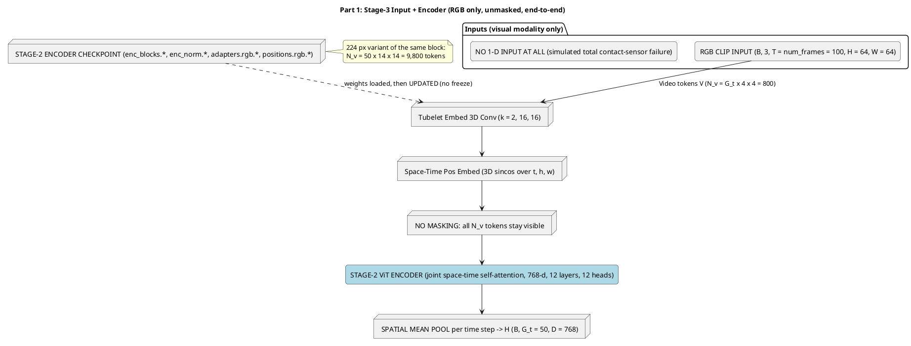
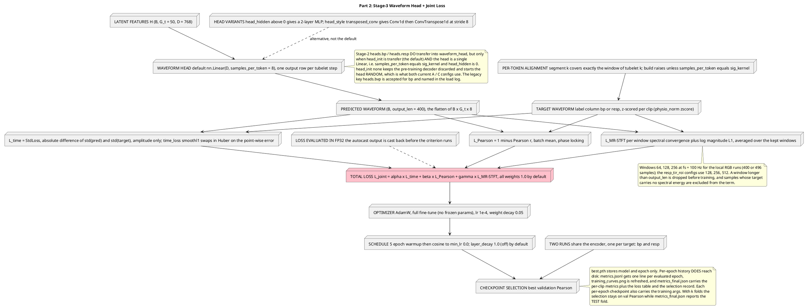
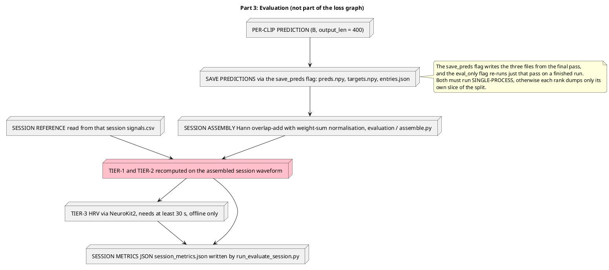

# Fine-Tuning (stage-3 in pipeline) to reconstruct the targeted waveform

> Stage 3 is the deployment condition: the contact sensor is assumed to have failed
> completely, so only RGB video enters the model. The Stage-2 encoder is fine-tuned
> end to end (nothing is frozen) and one lightweight regression head emits the whole
> waveform window. Two independent runs share that encoder, one per target waveform
> (`bp`, `resp`). No masking is applied anywhere in this stage.
>
> Companion documents: `code/notes/design/SolutionC_EarlyTokenMixing_stage2.md` holds the
> Stage-2 pre-training diagrams (input + encoder, decoder + loss);
> `code/notes/plan/local_downstream_plan.md` is the setup record for
> the two local 64 px runs. Numbers below are the **local 64 px** geometry with the
> 224 px variant called out in a note.

## Input + Encoder

## Head + Joint Loss

## Evaluation (in-training per clip, offline per session)

## Notes on correctness

* **RGB only.** `streams: rgb` plus `use_tir: false`, so the dataset yields a
  `[B, 3, T, H, W]` clip and `MultiModalWaveformRegressor` tokenizes that one stream.
  The 1-D waveform exists solely as the regression target, which is how the
  "complete contact-sensor failure" is simulated (by omission, not by masking).
* **No masking.** `forward(self, x)` has no mask argument and raises unless the
  tokenized count equals `n_visual`, i.e. the full token grid is always fed, in both
  training and evaluation.
* **End-to-end.** `freeze_encoder()` exists but is never called; the optimizer covers
  every parameter, so `enc_blocks`, `enc_norm`, `adapters.rgb` and `positions.rgb` are
  all updated alongside the head.
* **What is persisted.** `checkpoints/checkpoint-NNNN.pth`, `latest_checkpoint.txt` and
  `best.pth` (model + epoch only). Each per-epoch checkpoint also carries the training
  `args`. Per epoch the run appends one line to `metrics.jsonl` and refreshes
  `training_curves.png`; at the end it writes `metrics_final.json` with the per-clip
  Tier-1/2 metrics plus the loss and selection provenance. `--save_preds` adds
  `preds.npy`, `targets.npy` and `entries.json`, which `runners/run_evaluate_session.py`
  turns into `session_metrics.json` offline, Tier-3 included.
* **Formerly pending, now implemented.** The Stage-2 head transfer
  (`load_stage2_encoder`, `head_init: transfer` by default), the warmup + cosine LR
  schedule (`cosine_scheduler` with `warmup_epochs`), the prediction dump
  (`--save_preds`), the session-level evaluation runner
  (`runners/run_evaluate_session.py`) and the Tier-3 30 s guard
  (`evaluation/clinical.py`, `min_samples = 30 * fs`) all exist in the code.
* **Rendering.** Labels avoid the creole traps known in
  `code/notes/design/SolutionC_EarlyTokenMixing_stage2.md`: no `--`
  pairs, no `>>`, no angle brackets. Validate with
  `java -jar /tmp/plantuml.jar -checkonly <file>.puml` (silent means OK).
