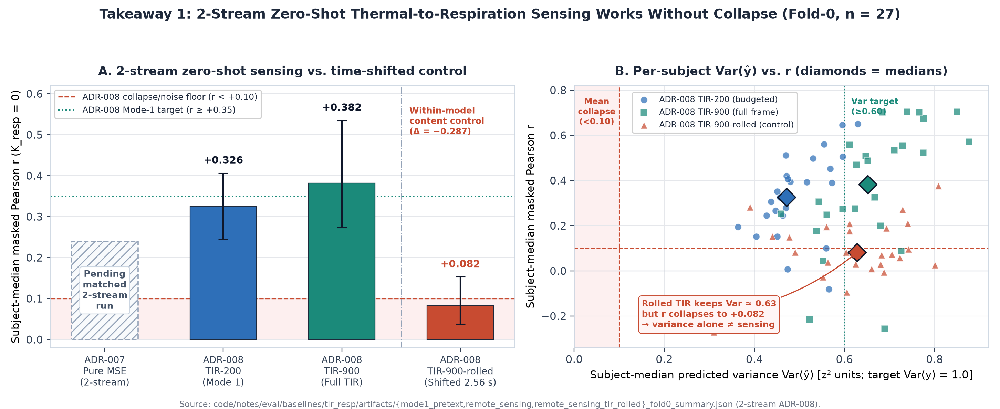

# Takeaway 1: 2-Stream Zero-Shot Thermal-to-Respiration Sensing Works Without Collapse

*Plain-English briefing note (2026-11-28) for study stakeholders. Summarizes the Fold-0 2-stream (`tir, resp`) Stage-2 zero-shot evaluation in `code/notes/eval/baselines/tir_resp/mode1_pretext_fold0.md` and `code/notes/eval/baselines/tir_resp/multimae_style_panel.md`, governed by `code/notes/design/ADR-008-composite-objective-and-cross-modal-alignment.md` and `code/notes/design/ADR-007-two-stream-anatomy-aware-constant-budget-masking.md`. Nothing here overrides the ADRs or code.*

---

## The short version

On 27 unseen Fold-0 test subjects with **zero** respiration sensor input (`K_resp = 0`), the frozen 2-stream ADR-008 Stage-2 model reconstructs breathing waveforms without collapsing to a flat mean: subject-median masked Pearson correlation reaches **`+0.326`** under the 200-token training budget (`TIR-200`) and **`+0.382`** with the full thermal frame (`TIR-900`), with healthy output variance (`0.47–0.65` of target variance). Time-shifting the thermal video by `2.56 s` breaks correlation down to **`+0.082`**, proving the model reads aligned facial thermal content rather than a learned prior. A **matched 2-stream pure-MSE baseline (`ADR-007`)** has not been trained to 150 epochs yet and is the next required comparator to isolate the exact contribution of the ADR-008 loss.

*Figure generated from archived 2-stream Fold-0 summary JSONs via `code/notes/explanation/figures/generate_stage2_takeaway_figures.py`. For qualitative waveform panels on individual held-out clips, see `code/notes/eval/baselines/tir_resp/artifacts/multimae_style_kept_density.png` and `resp-reconstruction-mode1-fold0.png`.*

---

## 1. Why pure pixelwise MSE is risky for masked respiration (and what MultiMAE originally did)

In the original **MultiMAE** paper (Bachmann et al., 2022; `docs/references/MultiMAE.pdf`, §3.2, §3.4, Appendix A), pre-training did **not** use pure MSE everywhere — it used **modality-specific masked-token reconstruction losses** with equal task weights:
- **RGB** (raw + per-patch standardized): **MSE (L2)**
- **Scene depth** (robustly standardized): **L1 loss**
- **Semantic segmentation** (133 classes): **Cross-entropy loss**

MultiMAE used no contrastive alignment loss and no correlation/spectral loss. Crucially, the authors explicitly noted a known limitation of local L1/L2 losses in §5 (*"Probabilistic or generative modeling"*, p. 10): when multiple reconstructions are plausible for a masked region, pixelwise L1/L2 losses predict blurry averages.

For a **1-D periodic respiration waveform** when all respiration tokens are hidden (`K_resp = 0`), phase uncertainty causes that exact same averaging effect: a pure MSE loss rewards predicting a flat line near zero (the clip mean) whenever the phase of a breath is uncertain. ADR-008 addresses this by replacing pure MSE on `resp` with a **composite waveform loss** (`MSE + 2 × Pearson + 1 × band-limited spectral L1` over `0.10–0.60 Hz`, weighted by `signal_weight = 5.0`) plus a Mode-2-gated **symmetric InfoNCE alignment loss** (`align_weight = 0.5`).

---

## 2. What we measured on the 2-stream ADR-008 model (Fold-0 test)

Evaluated zero-shot (no Stage-3 fine-tuning) on the **Fold-0 held-out test split** (`27` unseen subjects, `213` sessions, `1,742` clips of 8 s each, `5` seeded mask draws per clip):

| 2-stream condition (all `K_resp = 0`) | Visible TIR tokens | Subject-median `r_masked` [95% CI] | Subject-median `Var(ŷ)` [95% CI] | Subject-median MSE (`z²`) |
| :--- | ---: | :--- | :--- | ---: |
| **Matched ADR-007 pure MSE** | 200 (8/36 tubes) | *Pending 150-epoch Fold-0 run* | *Pending* | *Pending* |
| **ADR-008 Mode-1 (`TIR-200`)** | **200** (8/36 tubes) | **`+0.3256 [+0.2444, +0.4061]`** | **`0.4716 [0.457, 0.530]`** | `0.963` |
| **ADR-008 Full-TIR (`TIR-900`)** | **900** (36/36 tubes, budget-exempt) | **`+0.3819 [+0.2731, +0.5349]`** | **`0.6518`** | `0.915` |
| **Content control (`TIR-900-rolled`)** | **900** (shifted 2.56 s in time) | **`+0.0823 [+0.0379, +0.1527]`** | **`0.6277`** | `1.464` *(mean)* |

Two within-model findings give clean evidence even before the pure-MSE comparator is finished:

1. **Full-frame thermal input improves zero-shot sensing.** Giving the frozen encoder all 36 spatial tubes (`TIR-900`, matching a deployed contactless camera) increases clip-paired `r_masked` by **`+0.0552 ± 0.0066`** (`t = +8.40`, `1,023 / 1,742` clips better) and raises variance retention from `0.47` to `0.65` relative to the 200-token training cap (`TIR-200`).
2. **The rolled-TIR control confirms aligned facial thermal content drives the signal.** Circularly shifting the thermal clip by 16 frames (`2.56 s`, ~32% of the 8 s window) preserves the exact same 900 tokens, frames, and masks while destroying temporal alignment with breathing. Correlation drops by **`−0.2872 ± 0.0100`** (`t = 28.7`) down to `+0.082` — below even the 200-token intact clip.

---

## 3. Why both correlation and variance must be read together

Panel B shows an important diagnostic safeguard: **`TIR-900-rolled` still retains `Var(ŷ) = 0.63`**, which passes ADR-008's `≥ 0.60` variance-retention target, even though its correlation collapses to `+0.082`.

Because the Pearson and spectral terms penalize flat outputs, the decoder outputs a breathing-like wave even when the input video is misaligned. Therefore:
- **Variance retention (`Var(ŷ)`)** verifies that the decoder has *not collapsed* to a flat line.
- **Masked correlation (`r_masked`) against the time-shifted control** verifies that the predicted wave is *time-locked to actual breathing*.

---

## 4. Missing comparator & honest caveats

- **Matched 2-stream pure-MSE baseline is still missing:** the exact pure-MSE twin (`code/configs/pretrain/stage2_budget_tir_resp_2stream_anatomy.yaml`, identical geometry, budget, anatomy-aware sampling, and Mode-1/Mode-2 curriculum) has only a 1-epoch smoke run so far. Training it to 150 epochs on the identical Fold-0 partition is required for a fair, controlled comparison against ADR-008 (without mixing incompatible 3-stream or 4-stream architectures).
- **Still below two ADR-008 pretext targets:** Mode-1 `TIR-200` correlation (`+0.326`) sits slightly below `+0.35` (95% CI spans it), and breathing-rate error remains above `3.0 bpm` (covered in Takeaway 2).
- **`TIR-900` is out-of-regime:** the encoder was trained on 200 visible tokens and evaluated zero-shot on 900 tokens (`4.5×` longer sequence).
- **Pre-training diagnostic only:** these numbers come from frozen Stage-2 clips on Fold 0, not from Stage-3 session-level evaluation (covered in Takeaway 4).
