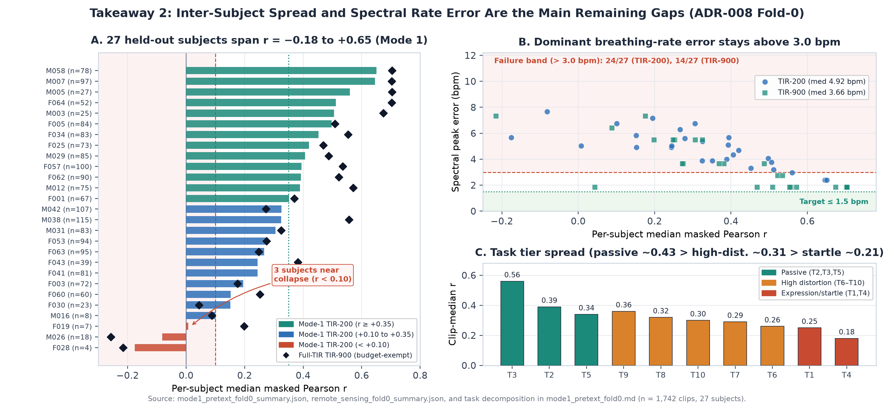

# Takeaway 2: Spectral Rate Precision and Inter-Subject Spread Remain the Main Gaps

*Plain-English briefing note (2026-11-28) for study stakeholders. Summarizes the error and variance decomposition in `code/notes/eval/baselines/tir_resp/mode1_pretext_fold0.md` and `code/notes/eval/baselines/tir_resp/multimae_style_panel.md`, plus the prior Stage-3 subject-effect finding in `code/notes/explanation/resp_t3_why_some_predictions_are_better.md`. Nothing here overrides the ADRs or code.*

---

## The short version

Even though ADR-008 eliminated flat-line collapse, two practical weaknesses limit current Stage-2 zero-shot predictions:
1. **Breathing-rate error is too high:** the dominant frequency of the predicted 8 s waveform misses the ground-truth breathing rate by a subject median of **`4.92 bpm`** in Mode-1 (`3.66 bpm` at full-frame `TIR-900`), failing ADR-008's `> 3.0 bpm` failure band (`≤ 1.5 bpm` target).
2. **Performance varies widely from person to person:** across the 27 unseen Fold-0 test subjects, per-subject median `r_masked` spans **`−0.18` to `+0.65`**, with subject identity explaining roughly twice as much spread as task difficulty.

*Figure generated from `code/notes/eval/baselines/tir_resp/artifacts/{mode1_pretext,remote_sensing}_fold0_summary.json` and the task decomposition in `mode1_pretext_fold0.md` via `code/notes/explanation/figures/generate_stage2_takeaway_figures.py`.*

---

## 1. Why the spectral peak rate error (`3.7–4.9 bpm`) matters

In `code/runners/run_eval_recon.py` (`--pretext_metrics`), the spectral peak error measures the absolute difference between the dominant frequency of the predicted waveform and the ground-truth waveform inside the `[0.10, 0.60] Hz` (`6–36 bpm`) respiratory band, computed via a Hann-windowed zero-padded rFFT on each 8 s clip.

- **Mode-1 `TIR-200`:** subject-median peak error is **`4.92 bpm` `[4.01, 5.61]`** (`24 / 27` subjects sit inside the `> 3.0 bpm` failure band).
- **Full-frame `TIR-900`:** peak error improves to **`3.66 bpm` `[1.83, 3.66]`** (`14 / 27` subjects still above `3.0 bpm`).
- **ADR-008 benchmarks:** failure threshold `> 3.0 bpm`; success target `≤ 1.5 bpm`.

### Is this just an FFT resolution artefact?

**No.** With `L = 8000` samples at `fs = 1000 Hz`, the zero-padded FFT (`N_fft = 32768`) has bin spacing `Δf = 0.0305 Hz = 1.83 bpm`. A `4.92 bpm` error is roughly **2.7 frequency bins** of genuine rate mismatch. In plain terms, on an 8 s window the model often produces a wave with plausible amplitude and partial shape correlation (`r ≈ 0.33–0.38`), yet places its main spectral peak at the wrong breathing frequency.

*(Note: an 8 s clip contains only 1–4 breathing cycles, so single-clip spectral peak estimates are inherently noisier than ADR-009's 30 s continuous-session rate windows. Even so, `4.9 bpm` is well above the protocol's target.)*

---

## 2. Why performance varies so much across subjects and tasks

Decomposing all `1,742` Fold-0 test clips (`27` subjects × `10` BP4D+ tasks, `213` sessions) under Mode-1 `TIR-200` shows where the spread actually lives:

| Grouping | Count | Spread (SD of medians) | Range of medians |
| :--- | ---: | ---: | :--- |
| **Subject** | 27 | **`0.203`** | `−0.18` (`F028`) to `+0.65` (`M058`) |
| **Task** (`T1`–`T10`, pooled clips) | 10 | `0.101` | `+0.18` (`T4`) to `+0.56` (`T3`) |
| **Session** (`subject × task`) | 213 | `0.238` | `−0.38` to `+0.84` |

Three clear patterns emerge:

1. **Who the person is matters roughly twice as much as what task they are doing.** Just like our earlier five-fold Stage-3 investigation (`resp_t3_why_some_predictions_are_better.md`), some individuals produce a consistently readable nasal/mouth thermal plume across tasks (`M058`, `M007`, `M005`, `F064` all exceed `r = +0.50` in Mode-1 and `+0.70` in `TIR-900`), while **3 of 27 subjects sit near collapse (`r < +0.10`)**: `F028` (`−0.18`, 4 clips), `M026` (`−0.08`, 18 clips), and `F019` (`+0.01`, 7 clips).
2. **Task difficulty follows a physically sensible gradient.** Grouping the ten BP4D+ tasks by facial distortion:
   - **Passive viewing** (`T2`, `T3`, `T5`): clip-median `r ≈ +0.43` (peaking at `T3 = +0.56`).
   - **High-distortion tasks** (`T6`–`T10`): clip-median `r ≈ +0.31`.
   - **Expression / startle** (`T1`, `T4`): clip-median `r ≈ +0.21` (`T4 = +0.18`), where laughter, grimacing, and abrupt head motion disturb the thermal plume around the nose and mouth.
3. **Within-session clip noise is also substantial.** Session spread (`SD = 0.238`) exceeds both subject and task spread alone — individual 8 s windows can fail even on an easy task if a transient movement or shallow breath occurs.

---

## 3. Practical implications for next steps

- **Spectral/rate supervision is the likely lever for the rate gap:** if the `> 3 bpm` error persists after Stage-3 fine-tuning and continuous-session assembly, increasing the spectral loss weight (`gamma`) or tuning `lambda_resp` (ADR-008 §5) is more targeted than changing masking placement alone.
- **Any headline metric must aggregate at the subject level:** because clip counts vary sharply across subjects (`4` clips for `F028` vs. `115` clips for `M038`) and tasks (`26` clips in `T4` vs. `459` in `T9`), clip-level averages overweight long, easy sessions. Subject-median aggregation with subject-level bootstrap CIs remains essential.
