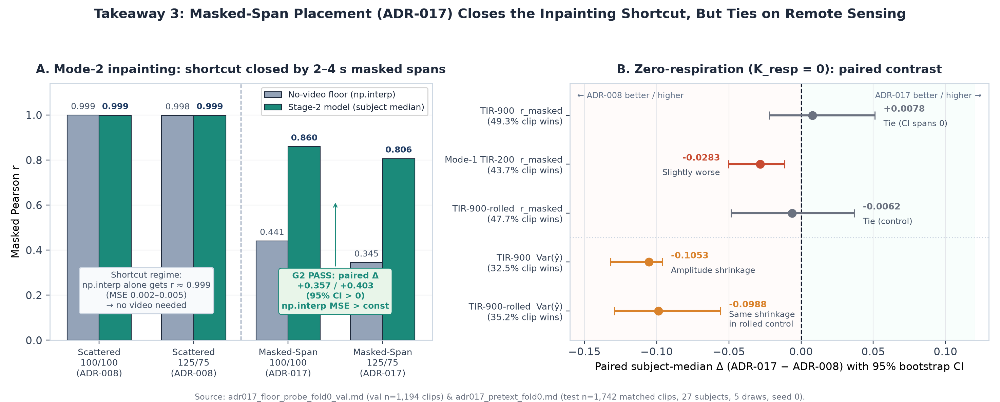

# Takeaway 3: Masked-Span Placement (ADR-017) Closes the Inpainting Shortcut, But Ties on Remote Sensing

*Plain-English briefing note (2026-11-28) for study stakeholders. Summarizes the Fold-0 floor probe (`code/notes/eval/baselines/tir_resp/adr017_floor_probe_fold0_val.md`) and Stage-2 zero-shot probes (`code/notes/eval/baselines/tir_resp/adr017_pretext_fold0.md`), governed by `code/notes/design/ADR-017-masked-span-physio-placement.md`. Nothing here overrides the ADRs or code.*

---

## The short version

Under ADR-008's default **`scattered`** masking, keeping 30–40% of respiration tokens leaves tiny gaps that simple linear interpolation (`np.interp`, using **no video at all**) solves to `r = +0.999`. **ADR-017 (`masked_span`)** replaces those tiny scattered holes with **2.0–4.0 s contiguous masked spans**, completely closing the shortcut: the no-video interpolator drops worse than predicting zero, while the ADR-017 model beats it by **`+0.36` to `+0.40`** in `r_masked`. However, when respiration is **completely hidden (`K_resp = 0`)**, paired clip-aligned tests against ADR-008 show **no gain in full-frame remote sensing (`Δ = +0.008`, tie)** and a **small drop in budgeted Mode-1 (`Δ = −0.028`)**, with the same `3.7–4.8 bpm` rate error.

*Figure generated from recorded Gate G0 (`adr017_floor_probe_fold0_val.md`) and Gates G2/G3 (`adr017_pretext_fold0.md`) tables via `code/notes/explanation/figures/generate_stage2_takeaway_figures.py`.*

---

## 1. The Mode-2 shortcut ADR-017 was designed to fix

During Stage-2 pre-training, Mode-2 steps (where both thermal video and partial respiration are visible) make up **90% of Phase I** and **50% of Phase II**. Under `scattered` placement at `32 ms` per token:

- Keeping `75–100` of `250` respiration tokens puts a visible sample roughly every `80–110 ms` — far faster than the `0.10–0.60 Hz` breathing cycle (`1.7–10 s` per breath).
- On the Fold-0 validation floor probe (`1,194` clips, zero GPU), plain linear interpolation (`np.interp`) between visible respiration tokens already achieves **`r = +0.998` to `+0.999`** (`MSE = 0.002–0.005`, vs. `1.00` for predicting zero).
- As a result, Mode-2 steps did not need to look at the thermal face video to reconstruct the missing respiration tokens.

---

## 2. What worked: ADR-017 cleanly forces cross-modal inpainting (Gates G0 & G2 PASS)

ADR-017 constrains every masked gap to `63–125` tokens (`2.016–4.000 s`, spanning `0.2–2.4` breathing cycles).

- **Gate G0 (val floor probe, zero GPU — PASS):** at every admissible Mode-2 count (`K_resp ∈ {25, 50, 75, 100}`), `np.interp` has **higher MSE than predicting a constant zero** (`1.09–1.24` vs. `≈ 0.98–0.99`). Local interpolation can no longer solve Mode 2.
- **Gate G2 (Fold-0 test, `1,742` clips, 27 subjects — PASS):** scored on identical masks against `np.interp`:

| Mode-2 condition (`masked_span[63,125]`) | No-video `np.interp` `r` (MSE) | ADR-017 model `r` (subject median) | Paired Δ (`model − interp`) [95% CI] |
| :--- | ---: | ---: | :--- |
| `respmax` (`100` TIR / `100` RESP) | `+0.4408` (`1.20` > `0.99` const) | **`+0.8595 [+0.8408, +0.8805]`** | **`+0.3571 [+0.3010, +0.4223]`** |
| `mid` (`125` TIR / `75` RESP) | `+0.3446` (`1.33` > `0.99` const) | **`+0.8063 [+0.7648, +0.8540]`** | **`+0.4027 [+0.3246, +0.5165]`** |

This proves the model is genuinely using the thermal face video (together with distant visible context) to bridge 2–4 s respiratory blackouts.

---

## 3. What did *not* improve: zero-respiration remote sensing (`K_resp = 0`)

Because `K_resp = 0` draws no respiration placement seed, ADR-017 and ADR-008 can be compared **clip-for-clip on the exact same 1,742 test clips** (`--seed 0`). This paired test tells a much more conservative story than comparing marginal aggregates alone:

| Condition (`K_resp = 0`) | Metric | ADR-017 | ADR-008 | Paired Δ (`ADR-017 − ADR-008`) [95% CI] | Interpretation |
| :--- | :--- | ---: | ---: | :--- | :--- |
| **`TIR-900` (full frame)** | `r_masked` | `+0.4601` | `+0.3819` | **`+0.0078 [−0.0219, +0.0511]`** (49.3% clip wins) | **Tie** (aggregate gap comes from a few small-`n` subjects) |
| **`TIR-900` (full frame)** | `Var(ŷ)` | `0.5217` | `0.6518` | **`−0.1053 [−0.1318, −0.0961]`** | **Amplitude shrinkage** (matches `−0.0988` drop in rolled control) |
| **`TIR-900` (full frame)** | `peak_err_bpm` | `3.66 bpm` | `3.66 bpm` | `0.00 bpm [0.00, 0.00]` | **Unchanged** (still > 3.0 bpm failure band) |
| **Mode-1 `TIR-200`** | `r_masked` | `+0.3299` | `+0.3256` | **`−0.0283 [−0.0501, −0.0113]`** (43.7% clip wins) | **Slightly worse** (passes G3 marginal floor, fails paired check) |

### Why did the marginal `TIR-900` median look `+0.078` higher when the paired test is a tie?

Because the 27 test subjects have very uneven clip counts (`4` to `115` clips). Three small-`n` subjects improved (`F030`, `M016`, `F028` with `23 / 8 / 4` clips), nudging the unweighted median of 27 medians up, while three large-`n` subjects regressed (`F041`, `M058`, `F064` with `81 / 78 / 52` clips). Similarly, `TIR-900` MSE looked slightly lower (`0.89` vs `1.00`), but only because predicted amplitude shrank by `−0.105` — the exact same shrinkage (`−0.099`) seen on the meaningless rolled-TIR control.

---

## 4. Current status of ADR-017

By decision recorded in `code/notes/plan/experiments/exp_20261127_adr017_tir_resp_masked_span.md`, Phase B (five-fold Stage-2 + Stage-3 fine-tuning) is **not pursued** based on these Fold-0 zero-shot results. ADR-017 stays **`Proposed`** (not `Accepted`), and `scattered` remains the baseline default unless a downstream Stage-3 experiment later justifies reopening it.
