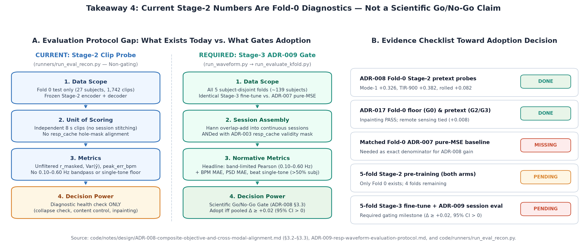

# Takeaway 4: Why Current Stage-2 Numbers Are Fold-0 Diagnostics — Not a Go/No-Go Claim

*Plain-English briefing note (2026-11-28) for study stakeholders. Explains the boundary between Stage-2 pretext probing (`code/runners/run_eval_recon.py`, `ADR-008 §3.2`) and the normative Stage-3 adoption protocol (`ADR-009`, `ADR-008 §3.3`, `ADR-001`). Nothing here overrides the ADRs or code.*

---

## The short version

There is currently **no session-wide evaluation** for the Stage-2 pre-training model. Every Stage-2 metric reported so far comes from a **frozen-checkpoint clip probe on Fold 0 only** (`27` subjects, independent 8 s windows, unfiltered Pearson). Per our evaluation contracts (`ADR-009` and `ADR-008 §3.3`), those numbers are **non-gating health diagnostics**: they confirm that pre-training no longer collapses and reads real thermal signal, but **cannot support a scientific Go/No-Go adoption claim** until we run matched Stage-3 fine-tuning and continuous-session evaluation across all 5 subject-disjoint folds.

*Figure generated from `ADR-008 §3.2–§3.3`, `ADR-009`, and `code/runners/run_eval_recon.py` via `code/notes/explanation/figures/generate_stage2_takeaway_figures.py`.*

---

## 1. Exact differences between Stage-2 probing and Stage-3 normative evaluation

| Dimension | Current Stage-2 Offline Eval (`run_eval_recon.py`) | Normative Stage-3 Gate (`ADR-009` + `run_evaluate_kfold.py`) |
| :--- | :--- | :--- |
| **Role in thesis** | **Non-gating diagnostic** (optimization health, collapse check, content control) | **Gating scientific Go/No-Go** for adopting a Stage-2 pre-training method |
| **Data coverage** | **Fold 0 test only** (`27` subjects, `1,742` clips) | **All 5 subject-disjoint folds** (`~139` unique held-out test subjects; `ADR-001`) |
| **Scoring unit** | Independent **8 s clips** in per-clip $z$-score space; **no session stitching** | Continuous **per-session waveforms** assembled via **Hann overlap-add** (`evaluation/assemble.py`) |
| **Ground-truth reference** | Per-clip dataset tensor | `ADR-003` precomputed `resp_cache` shard with invalid holes masked out (never zero-filled) |
| **Headline metric** | Unfiltered masked Pearson `r_masked` (clip → subject median) | **Band-limited Pearson (`0.10–0.60 Hz`)** (session → subject median → pooled 5-fold subject median + 95% CI) |
| **Secondary metrics** | `mse`, `mae`, `rmse`, `Var(ŷ)`, 8 s `peak_err_bpm` | Plain `pearson`, 30 s window `mae_bpm` & `% within 10%`, `dominant_freq_error_hz`, `psd_mae`, `hf_power_rel` |
| **Mandatory baseline** | Time-shifted `TIR-900-rolled` (content control) & `np.interp` (Mode-2 floor) | Constant line (`r = 0`), **single-tone frequency template** (must beat on `> 50%` of subjects), motion control |
| **Adoption threshold** | None (diagnostic thresholds only) | Pooled Stage-3 Δ `band_limited_pearson` **`≥ +0.02`** over matched pure-MSE ADR-007 (95% CI excluding `0`) |

---

## 2. Why Fold-0 clip diagnostics cannot substitute for the Stage-3 gate

1. **Pretext reconstruction ≠ downstream transfer quality.** Stage-2 pre-training exists to learn a stronger visual encoder (`ViT-Base`) for Stage-3 thermal-only respiration regression (`ADR-009 §1.1`). A pre-training objective can score modestly on frozen zero-shot decoding yet still transfer well — or score well on a pretext probe without improving fine-tuned downstream accuracy.
2. **No session assembly hides seam and drift errors.** Scoring isolated 8 s clips cannot detect discontinuities across overlapping sliding windows, slow baseline drift over 30–90 s recordings, or how the model behaves around sensor dropouts (`resp_cache` masks).
3. **One fold (27 subjects) has wide uncertainty.** In Fold 0 alone, the 95% bootstrap CI on `TIR-200` `r_masked` spans `0.16` correlation points (`[+0.244, +0.406]`) and on `TIR-900` spans `0.26` points (`[+0.273, +0.535]`). Pooling all 5 disjoint folds (~139 subjects) is required to shrink subject-level CIs enough to detect a `+0.02` improvement reliably.
4. **The exact comparator does not exist yet.** ADR-008's Fold-0 numbers currently compare against older 3-stream and 4-stream pure-MSE runs with different stream sets and budgets. The **matched 2-stream pure-MSE ADR-007 comparator** (identical anatomy-aware masking, geometry, and partition; only `alpha/beta/gamma = 1/0/0`, `lambda_resp = 0.5`, `lambda_align = 0`) has not yet been trained to 150 epochs.

---

## 3. Concrete roadmap to a stakeholder Go/No-Go decision

In order of highest information gain per GPU-hour:

1. **Train the matched Fold-0 pure-MSE ADR-007 comparator** (same seed, partition, and 150-epoch schedule as ADR-008) and score it with the exact same `run_eval_recon.py` probes. This gives an apples-to-apples Stage-2 denominator (and calibrates ADR-008's `grad_ratio` band).
2. **Run Fold-0 Stage-3 fine-tuning + ADR-009 session evaluation** on both encoders (ADR-008 vs. ADR-007) as an early downstream sanity check before scaling to 5 folds.
3. **Scale both arms to all 5 subject-disjoint folds** (`Stage-2` → `Stage-3` → `run_evaluate_kfold.py`) and evaluate the pre-registered ADR-008 §3.3 Go/No-Go rule: pooled subject-median Δ `band_limited_pearson ≥ +0.02` (95% CI > 0) and beating the single-tone template on `> 50%` of held-out subjects.
