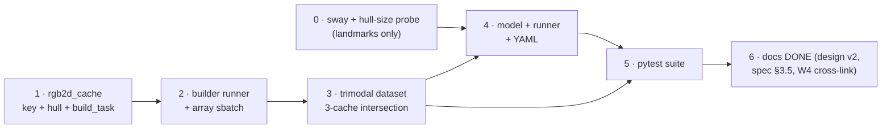

# 2D Texture ROI Cache Implementation Plan — `rgb2d` Shards and Trimodal Stage 2

Status: **PLANNED** (not implemented).
Scope: a NEW cache (`data/rgb2d_cache.py`), a NEW builder
(`runners/run_build_2d_roi_cache.py`), a NEW dataset
(`data/trimodal_dataset.py`), the `rgb2d` stream registration, one new HPC
config. **No existing shard, config or dataset changes value.**

Contract of record: `code/notes/design/2DTexture_ROI_cache_preprocessing.md`
(**v2, updated 2026-11-10** — native task-level artefacts and load-time
`input_size`; the v1 prerendered-clip text is superseded). Limitations of that
contract, and why: §2 below.
Reference implementations: `data/roi_cache.py` + `runners/run_build_roi_cache.py`
(cache + builder), `data/resp_cache.py` (second-cache key pattern),
`data/tir_resp_dataset.py` (geometry, gating, three-source intersection).

Paths are relative to `code/` unless they start with `code/`.

## What this lands

The 2D texture stream is the third cached modality. It must arrive through the
**same** window as the thermal ROI and the respiration grid, so that
`MultiModalMAE._check_space_time_alignment` passes unmodified and the mask
machinery needs no new case: one `__getitem__` returns
`{'tir': [3,T,96,96], 'rgb2d': [3,T,96,96], 'resp': [1,L]}` cut from one
`frame_start`/`frame_end`.

The design doc fixes the *pixel* contract — 49-landmark square box, RGB8, black
padding at the frame border, zero-tolerance tracking gate, and an isotropic
`INTER_AREA` rescale to the model's `input_size` (96) performed once, at load.
This plan keeps all of it and changes only where the pixels are cut and what the
artefact is keyed on, so the cache obeys the same doctrine as
the TIR one: *the cache is ONE STEP of the pipeline and encodes no downstream
decision*.

## Decisions

| # | decision | value |
|---|---|---|
| 1 | shard granularity | **task-level**, one `frames [T, H, W, 3] uint8` **native-resolution** square hull crop per `<S>_<T>` — NOT the doc's `(N_clips, 200, 96, 96, 3)` clip stack. Native pixels follow the TIR doctrine: *store native, rescale at load, and only there* |
| 2 | cache key | `store_resolution` (`'native'`), `roi_padding`, `crop_rule`, `clip_seconds`, `fps`, `src_w/h`, landmark set, `valid_frame_rule` are **IN**; `input_size`, `clip_stride`, `max_sway_px`, `min_valid_ratio`, `task_set`, `temporal_stride` are **OUT** — native storage makes `input_size` a free load-time knob, exactly as it is for TIR |
| 3 | stream name | **`rgb2d`**; the existing `rgb` name stays bound to the 224 px `rgb_roi` + BP arm |
| 4 | motion gate | `max_sway_px` is **measured first** (Phase 0), then pinned in the config; it is a selection rule, never a key field |
| 5 | out-of-frame crop | **black padding** (design §3.4), not TIR's translate-and-shrink; the session is skipped only below 50 % in-frame area |
| 6 | frame source | directory when present, else zip members decoded in memory — **`2D+3D` is never extracted to disk** |
| 7 | scope | **Stage-2 pretraining only**; no `run_waveform.py` arm, no `run_inspect_*` wiring |
| 8 | existing artefact | untouched: `roi_cache.CACHE_FORMAT_VERSION` stays 3 and the 1385 v3 shards stay valid; the only edit to `data/roi_cache.py` is an additive `keys=` parameter |
| 9 | storage format | **raw memory-mapped `.dat` + JSON metadata**, exactly as design §5.2 requires — NOT `.npz`, and not `.npy` (no header: `shape`/`dtype` live in the JSON). A task-level native hull is ~0.19 MB/frame (~300 MB/session), so a materialising reader would re-read and re-allocate hundreds of MB for every clip under DataLoader shuffling. There is no `read_shard`; the reader hands out `np.memmap(mode='r')` views |
| 10 | out-of-frame gate | checked at **two** levels: the build rejects a task whose hull is mostly out of frame, and the dataset rejects a **clip** whose own box is mostly out of frame (design §7) — black padding must never smuggle a mostly-empty clip into training |
| 11 | sizes | **`input_size = 96` for every video-like stream** (TIR-ROI and `rgb2d` share one patch grid; `_check_space_time_alignment` requires it). **`store_resolution = 'native'`**: the artefact holds native hull pixels and the dataset performs the ONE and only resample (hull → clip box → `input_size`) at load, exactly as the TIR cache does. There is no integer `store_size` |

Three positions this plan took against **v1** of the doc are now **v2** text.
The reasoning is kept here because it is what settled them, and because a future
reader will ask why the doc no longer matches its own first version.

1. **Shard granularity.** Storing clips bakes `clip_seconds`, `clip_stride`,
   `min_valid_ratio` and `max_sway_px` into the artefact, so every hop, fold or
   knob change forces a rebuild, and 8 s/2 s windows duplicate each frame
   ~5.5x. The doc's §5 assumes a one-shot training configuration; this repo
   runs Stage 2 at stride 2.0 s and Stage 3 at stride 1.0 s over the same
   pixels.
2. **Storage is native, like TIR.** The doc's §5.2 figure (5.53 MB per clip, a
   52.4× reduction) assumes prerendered 96 px pixels. A native square hull is
   ~0.19 MB/frame (~300 MB/session at 1500 frames), i.e. **~0.4 TB for the
   corpus** against ~58 GB prerendered — the reduction becomes ~23× relative to
   the raw 1392x1040 frames, not 52×. That is the accepted price of the TIR
   doctrine: a free `input_size`, a free hop, and per-clip tight framing. Phase 0
   measures the hull-side distribution so the disk budget is known **before** the
   build, and `--status` reports total bytes so it can be checked afterwards.
3. **Frame boxes become a hull box.** Design §3 derives a box per frame. The
   artefact is ONE square hull over the stride-1 clip windows, which contains
   every clip box (invariant I2) and keeps the crop spatially static across a
   task, as `code/notes/design/ROI_crop_and_rescaling.md` requires.

This plan also delivers, for the new cache path, the geometry half of the
*Deferred: the RGB port* (W4 in `code/notes/plan/RGB_BP_plan.md`): square box,
one isotropic scale, landmark-driven motion gate. `data/rgb_roi_dataset.py` is
still untouched and still runs the legacy `crop_rule='box'` geometry.

## Phase map and dependencies



Phase 0 runs against landmarks only and can overlap Phases 1–2: `max_sway_px`
is a dataset-level filter, so it never enters the cache key and the corpus can
be built before the threshold is pinned. Phase 4 needs Phase 3's API frozen.

| # | phase | primary artefact | depends on |
|---|---|---|---|
| 0 | measure | `code/notes/eval/rgb2d/sway_retention.md` (retention **and** hull/storage forecast) | — |
| 1 | cache module | `data/rgb2d_cache.py` | design doc |
| 2 | builder | `runners/run_build_2d_roi_cache.py`, `scripts/hpc/submit_2d_roi_cache.sbatch` | 1 |
| 3 | dataset | `data/trimodal_dataset.py` | 1, 2 |
| 4 | model / runner / config | `configs/pretrain/stage2_hpc_tir_roi_resp_rgb2d.yaml` | 0, 3 |
| 5 | tests | `tests/test_rgb2d_cache.py` + 3 others + 4 count pins | 1–4 |
| 6 | docs | design **v2 (DONE)**, `spec/01_data_pipeline.md` §3.5 + `write_specs.py` **(DONE)**, `RGB_BP_plan` W4 **(DONE)** | 5 |

---

## Phase 0 — measure `max_sway_px` and the storage budget before pinning either

**Step 0.1 — the probe.** New `code/notes/eval/rgb2d/sway_retention_probe.py`.
Landmarks only: no image decode, no cache, no GPU, and **no import from
`data.rgb2d_cache`** (Phase 1 does not exist yet — it unions the unclamped
square spans itself, ~10 lines).

- discovery: `rgb_features.find_2d_features` over `rgb_roi_dataset.discover_rgb_sessions`
  (status `usable` only), `--sample-per-task N` (default 10) stratified draw;
- track: `rgb_features.parse_2d_features` → `(pts [N,49,2], pose, frame, valid)`;
  map onto jpg indices with `rgb_features.jpg_index_of`, NaN-fill the gaps;
- per window (8 s at 25 fps, 2 s hop) compute
  `tir_resp_dataset.landmark_sway(pts[start:start+200], target_idx)` and the
  window's square side. Use `roi_box_from_landmarks(..., crop_rule='square')`
  inside a `try/except RoiBoxOutOfFrame` and fall back to the **unclamped**
  square span — an out-of-frame window is exactly the case the native store now
  keeps (black padding), so letting it raise would bias the sample;
- **hull-side distribution** per session (p50/p95/max of the stride-1 window
  union) and the implied artefact size
  (`hull_h * hull_w * 3 * n_valid_frames`), extrapolated to the corpus. This is
  the number the disk budget is checked against (Open item 3);
- sweep `10, 15, 20, 25, 30, 40, 60` px; report kept clips, retention, per-task
  and per-subject breakdown, and the `infl = hull_side / median(per-frame
  envelope side)` each threshold implies;
- write `code/notes/eval/rgb2d/sway_retention.md` (two tables + one-line verdict)
  and `output/eval/rgb2d/sway_retention.json`.

**Step 0.2 — pin the value.** Put the winning threshold in the new config as
`rgb2d_max_sway_px`, and record in the eval note how it compares with TIR's
40 px (which keeps 96.8 % of clips at 726x480, i.e. ~0.4 face widths). The
design's 15 px is ~0.06 face widths and is expected to be very aggressive.

## Phase 1 — cache module

**Step 1.1 — the additive hook in `data/roi_cache.py`.** Add
`find_cache(out_root, want, keys: Sequence[str] = COMPARE_KEYS)`, mirroring the
`resp_cache.find_cache` signature, so the new module reuses the
"Closest existing cache(es)" diff diagnostics without duplicating them. The
default argument keeps every existing caller and the TIR key bit-identical;
pin that with the existing `test_roi_cache.py` suite (no test change expected).

**Step 1.2 — `data/rgb2d_cache.py` constants.**

| constant | value |
|---|---|
| `CACHE_FORMAT_VERSION` | `1` (independent of TIR's 3, as `resp_cache` is of `roi_cache`) |
| `CACHE_PREFIX` | `'rgb2droi'` |
| `BOX_RULE` | `'window-hull'` |
| `VALID_FRAME_RULE` | `'finite-excluded'` |
| `PIXEL_FORMAT` | `'rgb8'` |
| `STORE_RESOLUTION` | `'native'` — the hull crop keeps the source pixels; **no resampling in the builder** (decision 11) |
| `CHUNK_FRAMES` | `32` (native hull ~250x250 → ~0.19 MB/frame → ~6 MB/chunk) |
| `SUBDIR_TASKS / SKIPPED / TMP` | `tasks` / `skipped` / `.tmp` |
| `FRAMES_SUFFIX / LANDMARKS_SUFFIX / META_SUFFIX` | `.dat` / `.lm.dat` / `.json` |
| `PARAMS_NAME / MANIFEST_NAME` | `params.json` / `manifest.json` |

Both pixel/landmark arrays are **raw** (`np.memmap`), with `shape` and `dtype`
recorded in the sibling `.json` — no `.npy` header. `mode='w+'` sizes the file to
exactly `prod(shape) * itemsize` at creation, so a truncated array is detectable
with one `os.stat`.

There is deliberately **no `SHARD_SUFFIX='.npz'` and no `--compress` flag**: see Step 1.6 for
why the format is a raw memmap.

`VALID_FRAME_RULE` **must not** be TIR's `'sentinel-excluded'`: a lost 2D frame
is an empty `[]` / NaN field, not the `(0,0)` sentinel (`rgb_features.py`:
*"Do not reuse `missing_frame_mask` here"*). The string is part of the key, so
the difference is enforced by construction.

**Step 1.3 — reuse, do not copy.** Import the **pure** helpers from
`data/roi_cache.py`: `_sha1`, `corpus_digest`, `cache_root`, `write_params`,
`read_params`, `write_skip`, `box_contains`. The **IO half is 2D-specific** and
must be re-implemented here, because `roi_cache`'s `shard_path`/`scan`/
`build_manifest` are hard-wired to `<session>.npz` and its `read_shard`
materialises arrays — which is precisely the behaviour decision 9 forbids. So
`rgb2d_cache` supplies its own `shard_path`, `open_shard`, `commit_shard`,
`scan`, `shard_metadata`, `build_manifest` (~80 lines), keyed on the
`tasks/<S>_<T>.json` commit marker. `find_cache` is still reused from
`roi_cache` through the Step 1.1 hook.

Adopting the raw-memmap layout is the one place this plan departs from the TIR
*cache layout*; it is the place the TIR cache departs from its own design doc
(`roi_cache.py` stores `np.savez` and re-reads whole shards, acceptable for a
control-signal cache, not for a hundred-MB pixel cache).

**Step 1.4 — the 2D half.** Only these are new:

- `landmark_set_name_2d(labels)` → a name from `rgb_features.ROI_LANDMARKS_2D`,
  `'face'` for `1..49`, else `'custom'`;
- `landmark_indices_2d(labels)` → 0-based indices, validating
  `1 <= i <= rgb_features.NUM_LANDMARKS_2D` (49);
- `valid_rows_2d(landmarks, labels)` → `[n, L, 2]` rows whose **target** subset
  is fully finite (same "ANY target bad drops the frame" semantics as
  `missing_frame_mask`, different predicate);
- `build_params(raw_root, sessions, target_landmarks, roi_padding, src_w,
  src_h, crop_rule='square', clip_seconds=8.0, fps=25.0,
  store_resolution=STORE_RESOLUTION, source_policy='dir-then-zip')` — there is
  no size in the key at all, only the resolution *rule* (`'native'`);
- `cache_key(params)` → slug
  `rgb2droi_face_pad0.10_square_window-hull_clip8s_src1392x1040_native_v1_<10hex>`
  (same shape as TIR's `..._src726x480_native_v3_...`);
- `loader_params(...)` → exactly the `COMPARE_KEYS` subset (`src_w=src_h=0`);
- `check_params_compatible(root, params)` → full-dict comparison, fail-loud;
- `square_span_2d(pts, padding, crop_rule)` → the **integer square span** of one
  landmark cloud, *without* clamping to the frame. ONE function used by
  `hull_box_2d` (build side) and by the dataset's clip-level area gate (load
  side), so the two can never disagree about what a clip's box is;
- `hull_box_2d(...)`, `build_task(...)`;
- `open_shard(path)` → `ShardHandle` opening `<S>_<T>.dat` and
  `<S>_<T>.lm.dat` with `np.memmap(dtype=..., mode='r', shape=meta[...])` —
  the **shape comes from the `.json`**, which is why the JSON is the commit
  marker. The handle is a context manager with an **idempotent `close()`**; the
  fd lifecycle is Step 1.7. **No materialising `read_shard` is provided**, so no
  later caller can reintroduce a materialising read by accident;
- `commit_shard(root, session, meta, stage_dir)` → `os.replace` the two arrays,
  then the `.json` **last** (the commit marker);
- `scan`, `shard_metadata`, `build_manifest` (`.json`-based).

`COMPARE_KEYS` = `format_version, corpus, roi_landmarks_name, roi_landmarks,
roi_padding, crop_rule, box_rule, clip_seconds, fps, valid_frame_rule,
pixel_format, store_resolution, source_policy` — the same 12 TIR fields with
`store_resolution`/`source_policy` in place of TIR's `store_resolution`/`decoder`,
and without `raw_root`/`src_w`/`src_h`/`n_sessions_discovered` in the comparison
(they stay in the hash, so a foreign build lands in a different directory).
`input_size`, `clip_stride`, `max_sway_px`, `min_valid_ratio` and the resize
kernel are **not present at all** — they cannot change a stored byte.

**Step 1.5 — `hull_box_2d`.** Template `roi_cache.hull_box`: union over every
**stride-1** `clip_seconds`-long window of that window's `crop_rule` box.
Windows overlapping a non-finite row are skipped — the same predicate the
dataset will use, so "the frames the hull unions over" and "the frames the
dataset keeps" cannot drift apart. Two deltas from TIR:

- an out-of-frame window is **kept** (its unclamped square span joins the
  union) instead of raising `RoiBoxOutOfFrame`;
- the result is expanded to a square and may extend past the frame; extraction
  clamps and `cv2.copyMakeBorder` fills black, so the crop stays square and
  still contains every clip box (I2).

Returns `None` when no usable row exists; a task shorter than one clip falls
back to its whole valid track.

The same `square_span_2d` on a **clip's** landmarks is what the dataset calls in
Step 3.1 to compute the clip's in-frame share — one implementation, two call
sites (decision 10).

**Step 1.6 — `build_task`.** Returns `(meta, None)` or `(None, reason)`; a
reason is never an exception. It **writes the staged `.dat` files itself** and
returns only the small metadata dict. Reason vocabulary:
`missing_2d_features`, `invalid_2d_features: ...`, `no_valid_landmark_rows`,
`missing_image_seq`, `image_count_mismatch: n_jpg != n_mat`,
`undecodable_images: ...`, `no_common_frames`,
`box_out_of_frame: <in-frame share>`, `too_large_for_memory: ...` (with the
streaming writer this is an **artefact-size** guard, not a RAM guard).

1. `rgb_features.find_2d_features` → `parse_2d_features`; build a
   `[n_jpg, 49, 2]` track with NaNs where the 1-based `.mat` `frame` field
   leaves a gap.
2. `n_frames = n_jpg`; a jpg/mat count mismatch is fatal for the session (the
   existing `rgb_roi_dataset` `unusable` rule), so the cached track can never
   silently mis-align with the images.
3. Resolve the frame source per session with `rgb_roi_dataset.find_rgb_dir` /
   `zip_source` — directory when present, else zip members; **never extract**.
4. Probe one frame → `(fh, fw)`; `hull_box_2d` → `(x0, x1, y0, y1)` in source
   px, **possibly outside the frame**; reject when the **task-level** in-frame
   share is `< 0.5` (`box_out_of_frame`). This is only the coarse gate; the
   per-clip gate lives in the dataset (Step 3.1).
5. Decode in `CHUNK_FRAMES` chunks; per frame: clamp the hull to the frame →
   `copyMakeBorder` (black) back to the full hull extent → `cv2.cvtColor(BGR2RGB)`
   → straight into the staging memmap. **No resize and no interpolation in the
   builder** (decision 11): the stored pixel is a source pixel, so the artefact
   carries no resampling decision and `input_size` stays out of the key.
6. Staging, **not** a payload: create the two raw arrays with
   `np.memmap(stage/<S>_<T>.dat, dtype=np.uint8, mode='w+',
   shape=(T, y1 - y0, x1 - x0, 3))` and
   `np.memmap(stage/<S>_<T>.lm.dat, dtype=np.float32, mode='w+',
   shape=(T, 49, 2))`, then fill both frame-block by frame-block. Peak build
   RAM is one chunk of hull rows (~6 MB at 250x250) instead of a 300 MB array,
   and the artefact is already in the reader's format — no re-encode step.
   *Why raw and not `.npy`*: `np.lib.format.open_memmap` would also work — it
   writes a 128-byte header and then calls `np.memmap(mode='r+', offset=128)`
   internally, so its allocation behaviour is identical — but a header-less
   file maps at **offset 0** (page-aligned) and keeps `shape`/`dtype` in ONE
   place, the JSON commit marker, which is also what design §5.2 specifies
   ("raw binary arrays accompanied by JSON metadata").
7. Metadata returned and written into `<S>_<T>.json`: `session, source,
   n_frames, box int32[4]` (source px, may exceed the frame), `pad int32[4]`,
   `src_hw, hull_hw`, `store_resolution`, `area_in_frac` (the task-level share,
   for `--status`), plus the `frames` and `landmarks` shape/dtype so `--status`
   can compare `os.path.getsize` against `prod(shape) * itemsize` (the raw
   format's only integrity check) and report the running total. **The landmark
   VALUES are not in the JSON**: at `T*49*2*4` bytes (~0.6 MB for 1500 frames)
   they live in the sibling `<S>_<T>.lm.dat` and are read through
   `open_shard(path).landmarks` — a second `np.memmap(mode='r')`, never the
   `frames` mapping. That split is what lets the dataset run the clip envelope
   gate (§3.1.3) by touching ~77 KB (`200 x 49 x 2 x 4 B`) per clip instead of
   the whole clip.
8. `commit_shard` — PID-staged `.tmp/<S>_<T>.<pid>.*`. **Flush and drop both
   mappings before publishing** (`m.flush(); del m` — the `np.memmap`
   equivalent of `fclose`); replacing a still-dirty mapping can publish a
   partial array that the `.json` would then bless. Then `os.replace` the two
   arrays and the `.json` **last**. A `.dat` without a `.json` is reported as
   `incomplete` by `--status` and never read; a `.dat` whose size disagrees
   with its `.json` shape is reported as `truncated`.

Footprint: at a ~250 px square hull, `250*250*3 = 187.5 KB/frame` → ~280 MB per
1500-frame session → **~0.4 TB for 1400 sessions** (the Phase-0 probe pins the
hull-side distribution, and `--status` reports the running total). **Measured
2026-11-10**: `WORK_SCRATCH=/work/scratch/ne95ocyg` is a **40 TB project quota**
with **623 GB used** (~39 TB free; `df -h` on that directory reports the quota,
not the 2.5 PB `/work` filesystem). So 0.4 TB takes the account to ~2.5 % of
quota: capacity is NOT the binding constraint — build wall-time and Lustre small-
file/metadata load are. The raw `.dat` is uncompressed — the same size the TIR
cache writes with its default `np.savez` (no `--compress`).

**Step 1.7 — `ShardHandle` fd lifecycle (reviewer comment 5).** Two mappings per
session means an evicted-but-unclosed handle leaks two file descriptors.

```
class ShardHandle:
    def __init__(self, meta_path):          # tasks/<S>_<T>.json, already parsed
        self.meta = json.loads(meta_path.read_text())
        self.frames = np.memmap(frames_path, dtype=np.uint8, mode='r',
                                shape=tuple(self.meta['frames']['shape']))
        self.landmarks = np.memmap(lm_path, dtype=np.float32, mode='r',
                                   shape=tuple(self.meta['landmarks']['shape']))
    def __enter__(self): return self
    def __exit__(self, *exc): self.close()
    def close(self):                        # idempotent
        for name in ('frames', 'landmarks'):
            m = getattr(self, name, None)
            if m is None:
                continue
            if m.flags.writeable:
                m.flush()                   # mode='r' maps: nothing to flush
            setattr(self, name, None)       # dropping the ref releases the fd
```

- **Do not call `._mmap.close()` directly.** `np.memmap._mmap` *is* an
  `mmap.mmap` (verified: there is no `._mmap._mmap`), and closing it while any
  numpy view of the mapping is alive raises `BufferError` at best and leaves a
  dangling buffer at worst. Dropping the reference is what releases the fd, once
  the last view dies.
- Step 3.2 crops **per frame** from the mapping and feeds
  `np.ascontiguousarray(...)` straight into `cv2.resize`, so no view of the
  mapping outlives the loop iteration — that is what makes `close()`
  deterministic rather than hopeful.
- The dataset's handle LRU evicts under `try/finally: handle.close()`, and the
  builder uses `with open_shard(p) as h:` in `--check` / `--status`.

## Phase 2 — builder entry point

**Step 2.1 — `runners/run_build_2d_roi_cache.py`.** Clone of
`run_build_roi_cache.py`: mutually exclusive `--init/--build/--status/--index/
--check N` (`--build` is the fall-through); `array_position()` / `my_sessions()`
(round-robin `i % cnt == idx`) driven by `SLURM_ARRAY_TASK_ID` /
`SLURM_ARRAY_TASK_COUNT`, overridable with `--array_index/--array_count`;
corpus identity from an **unfiltered** discovery so `--subjects`/`--limit`
restrict the WORK set only. Extra flags: `--source_policy` (default
`dir-then-zip`) and `--max_task_gb` (default `12`; a task whose native artefact
would exceed it becomes a `task_too_large` skip, **not** a truncation). There is
no `--store_size`: the resolution is always native. Default `--out_root` =
`${WORK_SCRATCH}/rgb2d_roi_cache`.

- `--init` probes one frame from up to 3 tasks, asserts a uniform `(h, w, 3)`,
  then writes or revalidates `params.json` (idempotent for array elements);
- `--check N` re-runs `build_task` into a temp stage dir and compares the two
  memmaps **chunk-wise** (`np.array_equal` per `CHUNK_FRAMES` block, so the
  parity check never holds two full arrays), plus `box`/`pad`/shapes; prints
  `VERDICT: PASS|FAIL`, exit 0/1. The reference is
  `rgb2d_cache.build_task`'s own geometry helpers, **not**
  `rgb_roi_dataset` (that arm still uses the legacy `crop_rule='box'` box with
  no black padding, so its crop is not comparable — see Step 1.5).

**Step 2.2 — `scripts/hpc/submit_2d_roi_cache.sbatch`.** `deflt` partition,
`--array=0-31`, `--ntasks=1`, `--cpus-per-task=2`, `--mem-per-cpu=8G`,
`--time=04:00:00`, `--init` + `--build` inline (the `submit_roi_cache.sbatch`
pattern), logs to `logs/rgb2d_cache_%A_%a.{out,err}`.

**Step 2.3 — build the corpus.** `--status` must report the shard count (the
`usable` set from `discover_rgb_sessions`, which is **not** the TIR cache's 1385
— that count is `IRFeatures`-driven), the skip histogram, and total bytes so the
disk budget from Step 1.6 is verified before the rest of the array job runs.
Every skip reason must be one of the vocabulary above. Then `--index` and
`--check 3`.

## Phase 3 — dataset

**Step 3.1 — `data/trimodal_dataset.py`.**
`class TirRoiResp2DPretrainDataset(TirRoiRespPretrainDataset)`.

It passes `streams=('tir','resp')` to the parent — so
`BP4DPlusTIRRespDataset` and its ~5 000 lines of clip enumeration, sentinel
gate, resp mask/cause accounting and motion gate stay untouched for the
existing lineage — then attaches the 2D cache itself and **post-filters the
parent's `entries`**. Filtering a superset is a subset operation, which is what
guarantees all three streams share one window.

- ctor extras: `rgb2d_cache`, `rgb2d_cache_lru=8`,
  `rgb2d_landmarks=FACE_LANDMARKS` (`1..49`), `rgb2d_min_valid_ratio=1.0`,
  `rgb2d_max_sway_px=<Phase 0>`, `rgb2d_area_min_frac=0.5`.
  `input_size` is **not** an extra — it is inherited from
  `TirRoiRespPretrainDataset` and is the same value the TIR stream uses (96 in
the shipped config), which is what makes the two visual streams share one patch
grid. Because storage is native it is a free load-time knob (decision 2), and
nothing in the dataset compares it to a stored resolution.
  **`rgb2d_cache_lru` counts open `ShardHandle`s, not materialised shards**: an
  eviction calls `.close()` and releases its two file descriptors (~2 fds per
  handle, so the default 16 keeps a worker at ~32 fds). Resident memory is ~0 —
  the pages live in the OS page cache and are evictable, which is the whole
  point of the raw-memmap layout. Clips of one session are contiguous anyway, so a
  small handle LRU captures almost all of the reuse that the old array LRU was
  trying to capture.
- attach: `rgb2d_cache.find_cache(out_root, loader_params(...))`, fail-loud on
  drift; handle LRU + `_rgb2d_track(session)` cache. The track is
  `handle.landmarks` (the `<S>_<T>.lm.dat` memmap, `float32 [T,49,2]`, ~0.6 MB
  for 1500 frames) — read once per session and kept, because every gate below
  needs it and none of them needs a pixel.
- session intersection, reusing the parent's helpers: a
  `skipped/<S>_<T>.json` marker excludes the session
  (`sessions_2d_excluded`); a missing shard raises `FileNotFoundError` naming
  the builder — never a silent shrink, never a fallback decode.
- entry filter, in this order (the order fixes which counter gets credit, the
  same reasoning that puts the rail test before the flat one in
  `_build_entries`), with `n_2d = handle.meta['n_frames']` (from the JSON — the
  filter needs no memmap) and `frame_start`/`frame_end` taken from the parent
  entry:
  1. `frame_end > n_2d` → `clips_dropped_2d_short`;
  2. invalid-row ratio `> 1 - rgb2d_min_valid_ratio` → `clips_dropped_2d_invalid`;
  3. **clip-level envelope gate** (design §7, decision 10):
     `pts = self._rgb2d_track(session)[frame_start:frame_end]`, then the clip's
     own box from `square_span_2d(pts, padding, crop_rule)` ->
     `x0, x1, y0, y1` (half-open), intersected with the source rect
     `[0, src_w) x [0, src_h)` written out explicitly so there is no off-by-one
     and no negative area when the box is entirely outside:

     ```
     ix0, iy0 = max(x0, 0), max(y0, 0)
     ix1, iy1 = min(x1, src_w), min(y1, src_h)
     inter = max(0, ix1 - ix0) * max(0, iy1 - iy0)
     share = inter / ((x1 - x0) * (y1 - y0))     # 0.0 outside, 1.0 inside
     ```

     Drop when `share < rgb2d_area_min_frac` → `clips_dropped_2d_envelope`.
     **Neither the `frames` memmap nor the images are touched**: the box comes
     from the landmark track (`<S>_<T>.lm.dat`) and the frame size from the
     cache's `params.json`, exactly the trick `_source_hw` uses for the TIR
     path. This is the clip-level mitigation the build-side hull check cannot
     provide — a subject can lean out of frame for one 8 s window inside an
     otherwise well-framed task, and black padding would otherwise feed a
     mostly-empty clip to the model;
  4. `landmark_sway > rgb2d_max_sway_px` → `clips_dropped_2d_sway`.
  The `--max_clips`/`--max_entries` caps are re-applied **after** the filter.
- guards: raise when the parent produced entries but the 2D filter emptied them
  (unless `allow_empty`); raise if `input_size % patch != 0` or
  `input_size <= 0` (the model asserts this too, but failing at dataset
  construction names the culprit). No size-vs-store check exists — there is no
  store size to compare against.

**Step 3.2 — `__getitem__`: per-clip crop and the ONE rescale.** Mirror
`BP4DPlusTIRRespDataset._roi_patches` exactly — the stored hull is native, so the
clip's **own** square box is cut out of it and resized once, at load:

```
h = self._shard(session)                        # ShardHandle, memmap mode='r'
f0, f1 = entry['frame_start'], entry['frame_end']          # the SAME window as 'tir'
hx0, hx1, hy0, hy1 = h.meta['box']                        # stored hull, source px
x0, x1, y0, y1 = square_span_2d(track[f0:f1], padding, crop_rule)
x0, x1, y0, y1 = x0 - hx0, x1 - hx0, y0 - hy0, y1 - hy0   # -> hull-local
if min(x0, y0) < 0 or x1 > hx1 - hx0 or y1 > hy1 - hy0:
    raise IndexError('clip box outside the stored hull (I2)')   # never clamp or wrap
s = self.input_size
interp = cv2.INTER_AREA if s <= min(x1 - x0, y1 - y0) else cv2.INTER_LINEAR
out = np.empty((f1 - f0, s, s, 3), np.uint8)
for i in range(f1 - f0):
    out[i] = cv2.resize(np.ascontiguousarray(h.frames[f0 + i, y0:y1, x0:x1]),
                        (s, s), interpolation=interp)
rgb2d = torch.from_numpy(out.transpose(3, 0, 1, 2)).float().div_(255)
```

→ `[3, T, s, s]` with `s = input_size` (96), then the **same**
`temporal_stride` decimation and `num_frames` trim as `'tir'`, with the same
hard shape assertion. Both visual streams therefore report `T == num_frames`
**and** `H == W == input_size` — the only conditions
`_check_space_time_alignment` imposes.

- **Per frame, not per clip.** `np.ascontiguousarray` on the box slice (~0.19 MB
  at 250 px) gives cv2 a defined input and never materialises a whole clip. Peak
  per sample is the uint8 `[T,S,S,3]` (5.5 MB) plus the float32 tensor (22 MB).
- **The kernel follows `_roi_patches`**: `INTER_AREA` when downscaling (the
  normal case, ~250 → 96), `INTER_LINEAR` otherwise. Deliberate parity with TIR.
- **This is the only resample in the 2D path**, and it depends solely on
  `input_size` — which is why `input_size` is a free load-time knob (decision 2)
  and `store_resolution='native'` is the only size-like field in the cache key.
- The memmap's pages are read-only, so the copy happens **inside**
  `cv2.resize` via `ascontiguousarray`, never by aliasing a writable tensor.
  Views never outlive the call, which is what makes `ShardHandle.close()`
  deterministic (Step 1.7).

**Step 3.3 — `describe()`.** Report the three cache keys, the pinned gates and
the per-counter drop tallies, so a run log explains its own corpus.

## Phase 4 — model, runner, config

**Step 4.1 — stream registration.** `core/multimae.py`:
`_VISUAL_STREAMS = ('rgb', 'tir', 'rgb2d')` (line 91) and
`STREAM_CHANNELS['rgb2d'] = 3` (line 101). Mirror `_VISUAL_STREAMS` in
`core/waveform_model.py` (line 38). Nothing else: adapters, `positions`,
`heads`, `_tube_mask`, `_targets` and the AMMM `StreamSpec` list are already
per-stream, and both visual streams share `input_size` 96 and
`tubelet (2,16,16)` — which is precisely why per-stream geometry is NOT needed
for this change.

**Step 4.2 — `data/datasets.py`.** New
`TIR_ROI_RGB2D_DATA_SETS = ('tir_roi_resp_rgb2d', 'trimodal')`; a dispatch
branch in `build_pretraining_dataset` ahead of the `TIR_ROI_DATA_SETS` branch;
include the tuple in the `pretrain_split='fold'` subject-universe branch; add it
to `run_pretrain.pin_roi_target_norm` (it is driven by the data-set tuples, so
`target_norm` stays pinned to `'none'`).

The branch must call a **new** `build_tir_roi_rgb2d_pretrain_dataset(args)` in
`data/trimodal_dataset.py`; it cannot reuse `build_tir_roi_pretrain_dataset`,
which forwards `args.streams` verbatim (`data/tir_resp_dataset.py:2252`) into a
class that raises on anything outside `('tir','resp')` (`:1776`). The new
builder strips `rgb2d` before constructing the parent, sets
`self.streams = ('tir','rgb2d','resp')` for `describe()`, and reuses
`_log_corpus_cleaning(ds.stats, 'stage2')`.

**Step 4.3 — `runners/run_pretrain.py` flags.** `--rgb2d_cache`,
`--rgb2d_cache_lru`, `--rgb2d_landmarks`, `--rgb2d_min_valid_ratio`,
`--rgb2d_max_sway_px`, `--rgb2d_area_min_frac`, `--mask_ratio_rgb2d`
(default `0.50`). These must exist **before** the YAML key does:
`_common._check_config_keys` treats an unknown config key as a hard error, so a
missing `--rgb2d_area_min_frac` would abort the run rather than fall back to the
dataset default.

There is **no** `--rgb2d_store_size` flag and no store-size concept at all:
the cache holds native pixels, and `--input_size` is purely the model's value
(and the load-time rescale target). `run_pretrain.py`'s default is **64**, while
the shipped config pins **96** for both visual streams — the TIR lineage's HPC
value, and the value that gives 6x6 = 36 patches per frame.

**Step 4.4 — `configs/pretrain/stage2_hpc_tir_roi_resp_rgb2d.yaml`.** A
one-variable clone of `stage2_hpc_tir_roi_resp.yaml` (clip 8 s, stride
2 s, tubelet `2,16,16`, 150 epochs, warmup 10, `split_seed 42` + stratify sex,
batch 16/GPU) changing only `data_set`, `streams: tir,rgb2d,resp`,
**`input_size: 96`** (explicit; the shared patch grid for TIR and `rgb2d`), the
two cache roots, the three `rgb2d` selection knobs (`rgb2d_max_sway_px`,
`rgb2d_min_valid_ratio`, `rgb2d_area_min_frac`), `mask_ratio_rgb2d` and
`output_dir`. Every gate value and the pixel size are explicit in the config, so
a run log plus its YAML fully states which corpus and which geometry it saw.

## Phase 5 — tests

**Step 5.1 — `tests/test_rgb2d_cache.py`** (~30 cases, no real data: synthetic
`2DFeatures/*.mat` via `scipy.io.savemat` and synthetic jpgs, the
`test_rgb_zip_source.py` pattern):

- the key changes on `store_resolution`, `roi_padding`, `crop_rule`,
  `clip_seconds`, `fps`, `src_w`, the landmark set and `raw_root`, and is
  **unchanged** by `input_size`, `clip_stride`, `max_sway_px`, `min_valid_ratio`,
  `task_set`, and the resize kernel — the last group cannot change a stored byte;
- the exact slug prefix `rgb2droi_face_pad0.10_square_window-hull_clip8s_src1392x1040_native_v1_`;
- `find_cache`: single match, no-match message carrying `roi_padding` and
  `Closest existing cache`, two identical caches → `refusing to guess`, missing
  root → `FileNotFoundError`; `check_params_compatible` drift raises;
- shard round-trip through `open_shard`/`commit_shard`: `frames (T,H,W,3)` with
  `H == W ==` the hull side (native, **not** 96) and all three of `H`, `W` ≤ the
  source extent, `landmarks (T,49,2)`, `box`, `pad`;
- **per-clip crop parity**: `_roi_patches`-equivalent on a synthetic hull
  reproduces `cv2.resize(crop(box), (s,s), INTER_AREA)` exactly, for
  `s = 64, 96, 112`, and the clip box is asserted **inside** the hull — a box
  one pixel outside raises `IndexError` instead of wrapping or clamping (I2);
- **the reader returns views, not copies** (decision 9's whole claim, pinned
  structurally rather than statistically): for
  `s = handle.frames[frame_start:frame_end]` assert `s.base is not None`,
  `s.flags.owndata is False` and `s.flags.writeable is False`, then confirm with
  the exact (not heuristic) `np.shares_memory(s, handle.frames)`.
  Do **not** assert `isinstance(s.base, np.memmap)`: it happens to hold today
  (a memmap slice is itself a `memmap` whose `.base` is the parent, measured),
  but it depends on numpy's view construction and is not what the claim needs.
  Do **not** use `np.may_share_memory` either — a bounds heuristic that can
  pass on a copy; and **not** `np.MAY_SHARE_BOUNDS`, which numpy 2 removed;
- **commit-marker behaviour**: a `.dat` with no sibling `.json` is reported
  `incomplete` by `scan` and refused by `open_shard` (never read silently);
  a `.dat` whose byte size disagrees with its `.json` shape is reported
  `truncated`;
  no `.tmp` residue after a successful commit, and `write_skip` creating its own
  staging dir;
- black-pad case: a hull partly outside the frame stores the padded square with
  a non-zero `pad` and zero border rows;
- task-level `box_out_of_frame` skip when the hull's in-frame share is `< 0.5`;
- **zip-only source**: a tree with `<S>.zip` and no extracted directory builds
  and creates no directory;
- hull containment: every stride-1 window's square box is inside `box`;
- `square_span_2d` is the single source of truth: `hull_box_2d`'s per-window
  span and the dataset's clip-level share agree **by construction**;
- `valid_rows_2d` parity with the dataset predicate **plus** an explicit
  expected count (the predicate is shared, so parity alone is tautological).

**Step 5.2 — `tests/test_trimodal_dataset.py`.** Three-cache intersection
(`skipped` → excluded, missing → raises); sample dict shapes
`{'tir': [3,100,96,96], 'rgb2d': [3,100,96,96], 'resp': [1,800]}`; identical
`frame_start`/`frame_end` across the three keys; `temporal_stride=2`
decimation; **one cache serves any `input_size`**: the same fake cache yields
`rgb2d [3,100,64,64]` at `input_size=64` and `[3,100,112,112]` at 112, with the
`tir` tensor following in lock-step (decision 2/11 — this is the property the
native doctrine buys). Per-gate cases, one each, so an
ordering bug cannot hide: `clips_dropped_2d_short`, `clips_dropped_2d_invalid`
(a NaN row in the window), **`clips_dropped_2d_envelope`** (a clip whose
landmarks sit outside the source rect while the task-level hull still passes —
the case reviewer comment 2 named), and `clips_dropped_2d_sway`. Build the fake
caches with `rgb2d_cache.build_params/write_params/commit_shard` (the
`test_resp_window_contract.py` pattern).

**Step 5.3 — `tests/test_multimae_rgb2d.py`.** A **3-stream** forward
(`tir`, `rgb2d`, `resp` — two visual streams plus one 1-D stream, matching the
config in Step 4.4) at 96 px / 100 frames / tubelet `(2,16,16)` → 36 spatial ×
50 tubelets per visual stream; `losses_mse`/`masked_<s>` emitted for **exactly
those three** streams every step (the DDP key-set rule), asserted as a set
equality so a silently added or dropped stream fails; AMMM `StreamSpec` list of
length 3 with two visual entries.

**Step 5.4 — update the pinned inventories.** `test_rail_rule_plumbing.py`
(`len(TIR_CONFIGS)` 7 → 8, plus its `EXPECTED_STRIDE_S` entry),
`test_task_group_configs.py` (`TIR_ROI_CONFIGS`), `test_physio_norm.py`
(`ROI_PRETRAIN_CONFIGS`), `test_config_loading.py` (the new YAML must parse
under the pretrain parser). These are deliberate, single-line edits — a silent
glob change is the failure mode they exist to catch.

## Phase 6 — documentation

**Step 6.1 — DONE (2026-11-10).**
`code/notes/design/2DTexture_ROI_cache_preprocessing.md` is now **v2** and no
longer contradicts this plan: it records the task-level **native** artefact, the
two-resolution contract (`store_resolution='native'` + a load-time
`input_size`), dataset-level gates with their counters, the raw `.dat` +
`.lm.dat` + `.json` layout with the commit marker, the `ShardHandle` fd rules,
and a v1→v2 change table with the superseded 5.53 MB / 52.4x storage figures.
Both illustrative snippets in its §6 were rewritten to the v2 geometry.
Remaining doc work is 6.2/6.3 below.

**Step 6.2 — DONE (2026-11-10).** `code/notes/spec/01_data_pipeline.md` gained a
**§3.5 "2D-Texture ROI stream (`rgb2d`) — cached"** (pieces, artefact, key fields,
dataset-level gates and counters, load path, frame source) and a dispatcher row +
the `build_pretraining_dataset` routing note in §4. The **same prose was written
into `code/scripts/project/write_specs.py`**, so a future regeneration keeps it;
the generator still compiles (`python -m py_compile`). The spec's *Config File
Inventory* was deliberately **not** touched — it is a stale static list and the
new YAML does not exist yet, so it should gain the row when the config lands.

**Step 6.3 — DONE (2026-11-10).** `code/notes/plan/RGB_BP_plan.md` §3.3 and the
**W4** row now record that the `rgb2d` cache implements the full ROI doctrine
(square span → native square hull → one isotropic rescale at load, landmark
motion gate, dataset-level validity), and that W4 stays OPEN for
`data/rgb_roi_dataset.py` (the 224 px `rgb` + BP arm), which is untouched.

## Review response

### Round 1 (2026-11-10)

| # | comment | resolution |
|---|---|---|
| 1 | `.npz` + `lru=1` thrashes: shuffled clips re-read 41 MB per sample, violating design §5.2's memory-mapping requirement (severity high) | **Accepted, format changed.** Decision 9 + Step 1.2/1.3/1.6: `tasks/<S>_<T>.npy` + `.lm.npy` + a `.json` commit marker, read through `np.memmap(mode='r')`; no materialising `read_shard` exists at all. Shared storage in the dataset drops from ~41 MB to 5.5 MB per sample. `rgb2d_cache_lru` is redefined as an *open-handle* LRU (fd-bounded, ~0 RAM). Verification step 5 makes the claim measurable under a shuffled sampler. |
| 2 | 50 % out-of-frame check placed only at task level; black padding could smuggle a mostly-black clip through (severity medium) | **Accepted, gate added** rather than merely documented: decision 10 + Step 3.1 filter 3 `clips_dropped_2d_envelope`, computed from the stored landmarks and `params.json`'s frame size (no pixel read) via the same `square_span_2d` the build uses, plus a dedicated test in Step 5.2. |
| 3 | `rgb2d_area_min_frac` is a dataset parameter but missing from `run_pretrain.py` and the YAML (severity low) | **Accepted.** `--rgb2d_area_min_frac` added to Step 4.3, and Step 4.4 now lists all three `rgb2d` selection knobs explicitly. |
| 4 | "4-stream forward" contradicts "two visual streams" and the 3-stream config (severity low) | **Accepted.** Step 5.3 rewritten as a 3-stream forward (`tir`, `rgb2d`, `resp`) with a set-equality assertion on `losses_mse`/`masked_<s>` and an AMMM `StreamSpec` list of length 3. |

### Round 2 (2026-11-10)

| # | comment | resolution |
|---|---|---|
| 1 | `open_memmap(..., dtype=uint8, ...)` passes a bare name and raises `NameError` (severity medium) | **Accepted.** Step 1.6.6 now spells `dtype='uint8'` / `dtype='float32'` for both arrays, with a note that `open_memmap` wants a dtype object or its string spelling. |
| 2 | `build_task`'s metadata omits the landmarks the clip envelope gate needs (severity high) | **Accepted, clarified rather than duplicated.** Step 1.6.7 states the landmark VALUES live only in the sibling `<S>_<T>.lm.npy` (0.6 MB — too large for JSON), reached via `open_shard(path).landmarks`; Step 3.1.3 now names `self._rgb2d_track(session)[frame_start:frame_end]` as the input to `square_span_2d`, and notes it touches ~77 KB/clip (`200 x 49 x 2 x 4 B`), never the `frames` mapping. |
| 3 | `f0:f1` in Step 3.2 vs `frame_start`/`frame_end` in Step 3.1 (severity low) | **Accepted.** Step 3.2 binds `frame_start, frame_end = entry['frame_start'], entry['frame_end']` explicitly, so the snippet uses the document's vocabulary and still matches the parent dataset's entry keys. |
| 4 | `np.may_share_memory` is a layout heuristic, not a view test (severity low) | **Accepted.** Step 5.1 now asserts the structure — `isinstance(s.base, np.memmap)`, `s.base is handle.frames`, `s.flags.writeable is False` — and removes the unreliable `np.shares_memory` cross-check entirely, with a note that a write-back test is impossible here because a `mode='r'` mapping is read-only. |

### Round 3 (2026-11-10)

| # | comment | resolution |
|---|---|---|
| 1 | `np.lib.format.open_memmap(mode='w+')` may not pre-allocate, producing sparse/fragmented files; use `np.memmap(mode='w+')` (severity medium) | **Accepted on the change, corrected on the reason.** Verified in `numpy/lib/_format_impl.py:891`: `open_memmap` writes a 128-byte header and then calls `np.memmap(..., mode='r+', offset=offset)`, so sizing is `np.memmap`'s in both cases (`mode='w+'` truncates to `prod(shape)*itemsize`; measured 276 480 B for `10x96x96x3`). The switch is still right for two other reasons: a header-less file maps at **offset 0** (page-aligned) and keeps `shape`/`dtype` in a single place, the JSON commit marker — which is what design §5.2 specifies. Steps 1.2/1.6.6 now use `np.memmap`, and the artefacts are `*.dat`. |
| 2 | `area(box ∩ rect)` is unspecified; risk of off-by-one or negative area (severity low) | **Accepted.** Step 3.1.3 now spells out the half-open intersection (`ix0/iy0 = max(…, 0)`, `ix1/iy1 = min(…, src_w/h)`, `inter = max(0, ·) * max(0, ·)`, `share = inter / box_area`), with the `0.0 outside / 1.0 inside` bounds stated. |
| 3 | `isinstance(s.base, np.memmap)` is brittle across numpy versions (severity low) | **Accepted.** Step 5.1 now asserts `s.base is not None`, `s.flags.owndata is False`, `s.flags.writeable is False`, then confirms with exact `np.shares_memory(s, handle.frames)` (verified `True`). It also warns off `np.MAY_SHARE_BOUNDS`, which numpy 2 removed. |
| 4 | Security: no issues | No action. |
| 5 | `ShardHandle` fd management unspecified; risk of leaking descriptors on eviction (severity medium) | **Accepted, with one correction.** New **Step 1.7** specifies `__enter__`/`__exit__` and an idempotent `close()`. Correction: `np.memmap._mmap` **is** an `mmap.mmap` — there is no `._mmap._mmap` (verified) — and calling `mmap.close()` while a numpy view is alive raises `BufferError`/leaves a dangling buffer, so `close()` flushes only writable maps and then **drops the references**, which releases the fd once the last view dies. Step 3.2's copy is now also justified as what bounds view lifetime, and the LRU evicts under `try/finally`. |

### Round 4 — decision change (user directive, 2026-11-10)

Not a review comment: a ruling that supersedes **decision 11** and rewrites
Phases 1–3 and 5.

| directive | effect |
|---|---|
| `input_size` is **96 for every video-like input** (TIR-ROI and `rgb2d`) | Decision 11 restated: one patch grid for both visual streams, set in the config; no dataset-level size comparison, because there is nothing to compare to. `input_size` is once again a free load-time knob (64/96/112) — the property TIR already has. |
| `store_size` follows the **TIR doctrine: store native, rescale at load** | `store_size` (an integer) is **gone**, replaced by `store_resolution = 'native'`. Step 1.6 stores native hull pixels with **no interpolation**; the builder's `--store_size` flag and the `STORE_SIZE`/`INTERP` key fields are removed; the slug becomes `..._native_v1_...`. Step 3.2 now performs the TIR `_roi_patches` dance: per-clip square box → hull-local crop → one `INTER_AREA`/`INTER_LINEAR` resize to `input_size`. Per-clip tight framing is restored, so the old deviation 2 (*no per-clip re-crop*) is deleted. |
| consequences accepted | storage rises from ~58 GB (prerendered) to **~0.4 TB** (native, ~0.19 MB/frame); the doc's 52.4x per-clip reduction becomes ~23x against raw frames; `--status` must report total bytes and Phase 0 must forecast the hull side **before** the array job. |

## Verification

1. `python -m compileall code` from the repository root.
2. `cd code && python -m pytest -q` — baseline 562 pass; expect ≥ +50, and
   confirm each updated count pin was a deliberate edit.
3. Builder smoke on real data: `--limit 3 --init`, then `--build --status`.
   Assert `<root>/<KEY>/{params.json,tasks/<S>_<T>{,.lm}.dat,<S>_<T>.json,
   skipped/,manifest.json}`, no `.tmp` residue, and a key matching
   `rgb2droi_face_pad0.10_square_window-hull_clip8s_src1392x1040_native_v1_<10hex>`.
   Confirm `frames.shape[1:]` is the **hull** extent (native, not 96) and that
   `--status` total bytes is within ~20 % of the Phase-0 forecast.
4. `--check 3`: chunk-wise byte parity of the `frames`/`landmarks` memmaps and
   of `box`/`pad` against a fresh raw build; the same session resolved from
   `dir` and from `zip` must produce identical bytes.
5. Throughput gate for decision 9 (this is the reviewer's point, so measure it
   rather than assume it): with a **shuffled** sampler over ≥ 200 entries,
   assert per-sample time stays within ~10 % of the sequential order and that
   worker RSS stays flat across epochs. A materialising reader regresses this
   by an order of magnitude; the memmap reader does not.
6. Dataset smoke with all three real caches, `--max_entries 4`: print shapes,
   assert equal windows across streams, measure ms/sample. Run it at
   `--input_size 64` and `--input_size 96` against the **same** cache — both
   must work (decision 11) — and record the cost; a 96 px native path re-reads
   ~0.19 MB/frame from page cache, so expect more than the TIR-only 13 ms.
7. One-epoch local pretrain with the new config
   (`--max_entries 4 --batch_size 2 --num_workers 0 --epochs 1
   --warmup_epochs 0 --rail_touch_v 0.0 --min_signal_spread 0.0`): the log must
   show `masked_tir`, `masked_rgb2d`, `masked_resp` and no alignment assertion.
   `input_size` comes from the config (96, the shared grid for both visual
   streams).
   Then repeat with `--num_workers 4` to exercise the handle LRU across worker
   processes (fd budget, close-on-evict).
8. Phase-0 table reviewed, `rgb2d_max_sway_px` pinned, retention recorded in
   `code/notes/eval/rgb2d/sway_retention.md`; report the number of clips the
   clip-level `clips_dropped_2d_envelope` gate removes (expected: few — it is
   a safety net, not a filter).

## Risks

| risk | mitigation |
|---|---|
| zip random access is slower than a directory read on a parallel FS | one `ZipFile` handle per session, sequential member order; the ~44 sessions/array element budget still fits 4 h |
| too many open memmaps exhaust the fd limit (one fd per array, two per session) | the handle LRU evicts by `.close()`; default `rgb2d_cache_lru=8` = ~16 fds/worker, and a test with `num_workers=4` pins the close-on-evict path |
| page-cache pressure from ~0.19 MB/frame native hulls under a shuffled sampler | the clip working set per worker is one hull's worth of rows (~37 MB at 200 frames x 250 px); pages are clean and evictable, so the kernel reclaims them like any file-backed mapping — this is why the storage is a raw memmap, and Verification step 5 measures it instead of assuming it |
| **storage cost**: native hulls ~0.4 TB | **not a capacity risk** — measured quota is 40 TB with 623 GB used (2026-11-10), so this is ~2.5 % after the build. The real costs are build wall-time and Lustre metadata (~4200 small files); `--max_task_gb` still caps a pathological task, and `--status` bytes are checked after the first array element |
| `input_size` is a free knob but the two visuals must agree | they are one dataset attribute, so they cannot diverge; `_check_space_time_alignment` and `input_size % patch == 0` are the only constraints |
| a mostly-black clip from black padding reaches the model | clip-level `clips_dropped_2d_envelope` gate (Step 3.1.3) computed from landmarks only, plus the task-level build gate |
| the 49-point numbering is a different family from TIR's 28-point one | presets come from `rgb_features.ROI_LANDMARKS_2D` only; never mix preset families ("THE TRAP" in that module's docstring) |
| jpg index ≠ thermal frame index on F037 | v1 assumes index alignment (as both existing arms do); the landmark-only F037 check in *Open items* §1 must be documented before the corpus build |
| shard sizes differ wildly across tasks (a long, restless task has a big hull) | `--max_task_gb` turns an outlier into a `task_too_large` skip; the per-task byte report in `--status` shows the distribution before the whole corpus is built |

## Open items

1. **Frame alignment risk.** Run a landmark-only check on F037 (jpg count vs
   `IRFeatures` lines vs the `.mat` `frame` range) and document the residual
   risk before the full corpus build.
2. **Handle LRU size.** The default `rgb2d_cache_lru=8` is a guess bounded by
   the fd budget (2 fds per session), not by RAM. Tune it from the
   `num_workers=4` run in Verification step 7 to the point where the *clip*
   hit rate stops improving; it does not affect memory, only how often a
   memmap is re-opened (~0.1 ms).
3. **Storage budget — MEASURED, not a blocker.** Phase 0 still reports the
   hull-side distribution (p50/p95/max) so the ~0.4 TB estimate can be corrected
   before the build, but capacity is confirmed: `WORK_SCRATCH` is a 40 TB quota
   at 623 GB used (2026-11-10), so the cache lands at ~2.5 % of quota. The
   remaining real cost is **build time** (~1400 sessions x ~1500 JPEG decodes)
   and Lustre metadata for ~4200 small files, so keep the 32-element array and
   verify `--status` bytes after element 0 rather than waiting for the job.
