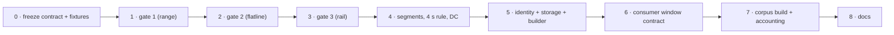

# ADR-004 — Blood-pressure session artefact implementation plan

> **Authority.** `code/notes/design/ADR-004-bp-session-cache-artefact.md` is the contract.
> This plan defines only the build order, module boundaries, and gates. If this plan and the
> ADR disagree, the ADR wins; the disagreement is recorded in §5.
>
> **Scope.** Clean each `BP_mmHg.txt` trace **once, offline** into one per-session artefact.
> The artefact contains a whole-session signal grid on the unchanged 1000 Hz source grid, a
> per-sample validity mask, a per-sample cause code, and a segment table. Every consumer reads
> this artefact and cuts windows from it. The fixed parameters are 30.0 / 250.0 mmHg, a 200 ms
> flatline threshold, a 30 ms rail dwell, a 4.0 s minimum segment, and
> `fs_in = fs_out = 1000 Hz`.
>
> **Outside this plan.** Clip length, hop, split, fold, task subset, label normalisation, Tier-2
> detrending and standardisation, model geometry, losses, tokenisation, the pixel/ROI and
> respiration artefacts, and all training or retraining. ADR §2.8 keeps these choices out of the
> artefact, and Criterion 10 requires the stored bytes to remain unchanged when they change.
>
> **State: new design; no compatibility target.** This plan implements a new design from
> the ADR. It does not import, adapt, wrap, or migrate an existing cache, preprocessing, window,
> masking, or dataset module. It does not preserve existing configuration, flag names, or on-disk
> artefacts, and it cannot read artefacts from another lineage. The implementation follows §3 and
> starts at `format_version: 1`.
>
> **Fixed context.** The design uses three existing items as context, not as implementation
> dependencies:
>
> - the **raw corpus**, read-only (`Physiology/<SUBJECT>/<TASK>/BP_mmHg.txt`, ADR §2.1);
> - the **test runner**, which must pass at every step (G13); a new module that breaks an
>   unrelated test is a defect in that module;
> - the **documents of record** (spec, glossary, and README), updated in Phase 8 because repo
>   policy requires one authoritative description per topic (§0 of `AGENTS.md`).
>
> No stage of this plan uses a GPU or reads a model checkpoint. The plan ends when the data
> pipeline is verified and the consumer contract is green.
>
> Paths are relative to `code/` unless they start with `code/`.
>
> **Reference convention.** An unqualified `§n.m` refers to this plan. A reference to the design
> document is written as `ADR §n.m`.
>
> **Implementation status (2026-11-20): COMPLETE — all phases landed, all gates green.**
> `data/bp_preprocess.py`, `data/bp_artefact.py`, `data/bp_windows.py`,
> `runners/run_build_bp_artefact.py` and the four test modules of §2 exist;
> **93 new tests pass and the full suite is 759 passed** at the time of writing.
> The corpus build ran on `raw_root=/work/projects/l0003511/test`:
> **1400 / 1400 shards, 0 skips, 0 missing, 34.1 s, 380.2 MB**, `--check 200`
> **PASS** (bit-identical on signal/mask/cause/segment table). Every ADR §1 corpus
> statistic reproduced exactly. Numbers, per-segment distribution and the
> rollback observables: `code/notes/eval/bp/bp_artefact_build.md`. Deviations and
> the files added beyond §2 are listed in §10.

---

## 1. Definition of done

1. `bp_preprocess.preprocess_session(x, …)` is a pure function from one raw trace to one
  artefact payload. It performs no IO, uses no configuration object or global state, and imports
  no accelerator library.
2. Validity is decided **once**, per sample, on the raw mmHg trace at the nominal 1000 Hz,
   **before** any offset removal (ADR §2.2 step 1), and the emitted mask is the only statement
   of validity anywhere in the lineage.
3. The gates are applied in the fixed order **1 → 2 → 3**; a rejected sample is never seen by a
   later gate, and carries exactly one cause.
4. Every readable session produces a shard, including a session whose every segment is shorter
  than 4 s (ADR §2.9 R6/R11). Only a missing, unreadable, or empty file produces a skip record.
5. `np.isnan(signal) == ~mask` and `mask ⇔ cause == 0` hold on every shard, asserted by the
   writer, re-asserted by the loader. An invalid sample is `NaN`, never `0`.
6. A consumer verifies the identity before cutting a window, derives `s` and `n` from `fs_out`
   arithmetic (ADR §2.7 C4) rather than from any stored window table, and refuses a mismatch.
7. Gates G0–G13 of §7 pass, and G8 leaves the per-cause accounting in
   `code/notes/eval/bp/bp_artefact_build.md`.

---

## 2. Target layout

Every file below is **new**. Each module may use only its own symbols, the Python standard
library, or NumPy. No module in this design may import another artefact's cache, window, or
preprocessing module. A simple import check can verify this greenfield rule.

| piece | new file | responsibility (and only this) |
| :--- | :--- | :--- |
| decision | `data/bp_preprocess.py` | `contiguous_runs`, `gate1_range`, `gate2_flatline`, `gate3_rail`, `admitted_mask`, `segment_table`, `preprocess_session` — pure NumPy, no IO |
| identity + storage | `data/bp_artefact.py` | params, cache key, shard/skip IO, `find_cache`, identity verification, manifest |
| consumer contract | `data/bp_windows.py` | window arithmetic, `usable()`, `read_window()`, `segment_of()`, `verify_identity()` |
| builder | `runners/run_build_bp_artefact.py` | `--init` / `--build` / `--status` / `--index` / `--check N` |
| tests | `tests/test_bp_gates.py`, `tests/test_bp_preprocess.py`, `tests/test_bp_artefact.py`, `tests/test_bp_windows.py`, `tests/bp_synth.py` | the gates of §7, case list in §7.1; `bp_synth.py` is the shared synthetic-trace generator (no binary fixture, §10 D1) |
| evidence | `code/notes/eval/bp/bp_artefact_build.md` | corpus accounting only; **not** read or written by the build |

Boundary rules:

- **`bp_preprocess` does not know about windows.** A function that takes `clip_seconds`,
  `clip_stride`, a split, a task list, or a normalisation flag belongs elsewhere.
- **`bp_windows` is the only module that defines the window rule** (§3.4). Every consumer calls
  it, so C2 and C3 are enforced by one implementation.
- **`bp_artefact` stores identity, not meaning.** It does not decide validity or interpret the
  mask.

Artefact layout (ADR §2.6: one shard per session and one manifest derived from the shards).
The names below belong to this design; no other component is expected to create these paths:

```
bpsession_src1000_range30-250_flat200ms_rail30ms_seg4s_v1_<sha1(params)[:10]>/
    params.json                 # the frozen contract (--init writes it)
    sessions/<SESSION>.npz      # THE SOURCE OF TRUTH
    skips/<SESSION>.json        # {"session","reason"} — missing/unreadable/empty ONLY
    manifest.json               # derived index (--index)
```

**No resampling module is needed.** Because `fs_out == fs_in`, grid index `k` equals source
index `k`. There is no anti-alias filter, phase alignment, edge padding, or gap between grid
instants. The build therefore needs **NumPy only**, not SciPy. This makes the CPU-only and
no-accelerator requirement in Criterion 12 a property of the implementation, not just a promise.

---

## 3. Frozen contract (transcribed from ADR §2.6/§2.1/§2.3–§2.5)

### 3.1 Identity fields — hashed into the directory name, compared by every consumer

| field | value at defaults | why it changes stored bytes |
| :--- | :--- | :--- |
| `format_version` | `1` | shard schema |
| `corpus` | digest of the discovered session list | which shards exist |
| `fs_in` | `1000` (nominal) | grid mapping |
| `fs_out` | `1000` (must equal `fs_in`; the cache is full-rate) | the grid consumers address |
| `gate1_min_mmhg` | `30.0` | mask |
| `gate1_max_mmhg` | `250.0` | mask |
| `flatline_max_ms` | `200` | mask |
| `rail_dwell_min_ms` | `30` | mask |
| `min_segment_s` | `4.0` | mask + segment table |
| `store` | `'signal+mask+cause+segments:float32,bool,uint8,int64,float64'` | representation |

### 3.2 Never in the identity, never in a shard (ADR §2.8)

`clip_seconds`, `clip_stride`, the subject split or fold, `task_set` / `task_groups`,
`physio_norm` and every normalisation statistic, `input_size`, `max_entries`, per-clip offsets,
and any other modality or artefact. These select or rescale windows; they do not change a
stored sample.

### 3.3 Shard members

| member | dtype | meaning |
| :--- | :--- | :--- |
| `signal` | `float32 [N]` | segment-mean-removed **mmHg** at absolute source positions; `NaN` exactly where `mask` is `False` |
| `mask` | `bool [N]` | `True` = usable; the sole authority |
| `cause` | `uint8 [N]` | `0` valid, `1` non-finite, `2` range, `3` flatline, `4` rail, `5` short segment |
| `seg_start`, `seg_stop` | `int64 [S]` | valid segment bounds, `stop` exclusive, source indices |
| `seg_mean_mmhg` | `float64 [S]` | mean removed from that segment |
| `seg_seconds` | `float64 [S]` | segment length in seconds |
| `n_src`, `fs_in`, `fs_out` | int | self-verifying grid identity, no raw file needed |
| `n_segments`, `valid_frac`, `n_nonfinite` | scalar | build statistics |
| `session`, `source_file` | str | provenance |

### 3.4 Grid arithmetic — the whole consumer contract in three lines

$$N = N_{\text{src}},\qquad s = \operatorname{round}(t_{\text{start}}\,f_{s,\text{out}}),\qquad n = \operatorname{round}(\ell_{\text{clip}}\,f_{s,\text{out}})$$

$$\text{usable}(t_{\text{start}}) \iff n > 0 \;\wedge\; 0 \le s \;\wedge\; s+n \le N \;\wedge\; \texttt{mask}[s{:}s{+}n].\text{all}()$$

Because every segment boundary and every short segment is `False`, an all-`True` window lies
inside exactly one valid segment and carries that segment's offset (C3). There is no
clip-length ceiling: a clip longer than `min_segment_s` is a legal request that simply finds no
usable window where no segment is long enough (§5, A7).

---

## 4. Phases



Phases 1→2→3→4 are strictly sequential: each gate consumes the previous gate's survivors, and
segments consume Gate 3's survivors. Phase 5 needs only Phase 4's payload; Phase 6 needs only
Phase 5's shard format. No phase changes tensor shapes, so the existing suite must pass at every
step.

### Phase 0 — freeze the contract

1. `data/bp_preprocess.py` carries §3.1–§3.4 verbatim in its module docstring (the code-side
   copy of the ADR; the ADR stays the authority).
2. One constant per identity field, next to the header, so the key is **derived** and never
   restated: `FS_IN = 1000` and `FS_OUT = 1000` (**integers**), `GATE1_MIN_MMHG = 30.0`,
   `GATE1_MAX_MMHG = 250.0`, `FLATLINE_MAX_MS = 200`, `RAIL_DWELL_MIN_MS = 30`,
   `MIN_SEGMENT_S = 4.0`, plus the six cause codes and their names.
2a. **One key, one spelling.** `store` is a single frozen string, not a sub-dict:
   `STORE = 'signal+mask+cause+segments:float32,bool,uint8,int64,float64'`. The rates and the two
   millisecond thresholds serialise as `int`, the mmHg/seconds thresholds as `float`, so `1000`
   and `1000.0` — or `200` and `200.0` — can never yield two different `params.json` digests,
   and therefore two keys for one artefact. `build_params()` emits exactly the ten scalars of
   §3.1 with no derived nesting; that flatness is what G0's literal comparison checks.
3. **No binary fixture is committed.** A `synthetic_session()` helper builds traces with a known
   answer at every boundary — one small trace per boundary plus one composite trace whose every
   boundary is stated as an explicit window: a 0.3 Hz pulse of ~1 mmHg around 90 mmHg (so Gate 3
   has no dwell), a 200-sample and a 201-sample invariant stretch, a 29-sample and a 30-sample
   dwell at the trace maximum, a `250.01` spike and a `29.99` dip, a `300.0` spike, a 3 999-sample
   and a 4 000-sample segment, and two segments with means 70 and 110 mmHg.
4. **Gate G0 is automated, not a human diff.** `tests/test_bp_artefact.py::test_identity_schema`
   asserts `build_params()` returns **exactly** the canonical key set of §3.1 (a frozen literal
   in the test) and that **none** of §3.2's consumer fields is present. Adding, renaming or
   removing a key field fails the suite until the test and §3.1 move together.

### Phase 1 — Gate 1, dynamic range (per sample)

5. `gate1_range(x, min_mmhg, max_mmhg) -> (alive, cause)`:
   `cause` starts at `0`; `cause[~isfinite(x)] = 1`; then
   `cause[isfinite(x) & ((x < min) | (x > max))] = 2`. `alive = cause == 0`.
6. The non-finite clause is evaluated **first** and is required: comparisons with `NaN` are
   false, so a `NaN` would otherwise pass the range test. The verdict is per sample; neighbours
   are untouched. The corpus holds no non-finite sample today (ADR §2.3) — the rule is a
   correctness guard, and Phase 1 must not be optimised away on the grounds that it never fires.

### Phase 2 — Gate 2, flatline (on the Gate-1 survivors)

7. Gate 2 uses the shared helper `equal_runs(x, alive1)` of step 9, which returns maximal runs of
   exactly-equal consecutive samples lying **wholly inside** `alive1` blocks. A rejected sample
   therefore breaks the run *and* is never compared to its neighbour — this is not
   `np.diff(x) == 0` on the raw trace, which would join two identical values across a rejected
   gap.
8. Reject a run iff `run_len > FLATLINE_MAX_MS * FS_IN / 1000` (**strictly** greater, i.e.
   `> 200` samples): **201 samples are rejected, 200 are kept**. The strict comparison is the
   ADR's wording and is deliberately *not* the same operator as Gate 3's.
9. **One run-length helper — and Gate 1 is not invited.** Gate 1 is point-wise and carries no
   run logic. Gates 2 and 3 share `equal_runs`:

   ```
   xs = np.where(alive, x, 0.0)                    # sanitised: no NaN is ever compared
   eq = np.zeros(n, bool)
   eq[1:] = (xs[1:] == xs[:-1]) & alive[1:] & alive[:-1]
   break_at = np.zeros(n, bool)
   break_at[0] = True
   break_at[1:] = ~eq[1:] | ~alive[1:] | ~alive[:-1]
   run_id = np.cumsum(break_at)                    # runs wholly inside alive blocks
   ```

   Lengths come from `np.bincount(run_id)`; a run is admissible only where `alive` is `True`
   throughout, which `break_at` enforces structurally. The sanitised copy removes the
   `RuntimeWarning: invalid value encountered in not_equal` that an unmasked comparison on `NaN`
   would emit — the helper does not rely on Gate 1 having removed non-finite samples already.
   A brute-force RLE loop is kept in the tests and pinned **equal** on a 5 000-sample synthetic:
   this is the one place an off-by-one silently changes the mask.

### Phase 3 — Gate 3, amplifier rail (on the Gate-2 survivors)

10. **Guard before any reduction.** Gate 3 never computes `.max()` on a possibly empty selection.
    If `not np.any(alive1)` or `not np.any(alive2)`, the cascade ends here: Gate 3 is not
    evaluated and control passes to step 14 with an empty admitted set. (`x[alive2].max()` on an
    empty selection raises `ValueError: zero-size array to reduction operation maximum which has
    no identity`, which would turn a fully-dropped session — an expected corpus case — into a
    build failure.) Otherwise `y_max = x[alive2].max()` and `y_min = x[alive2].min()`, **recomputed
    on the Gate-2 survivors**, never on the raw trace (Criterion 4: a `300 mmHg` sample removed by
    Gate 1 must not become Gate 3's extremum).
11. A dwell is a maximal run from `equal_runs(x, alive2)` **whose value equals `y_max` or
    `y_min`**. Reject iff `dwell_len >= RAIL_DWELL_MIN_MS * FS_IN / 1000` (**at least**, i.e.
    `>= 30` samples): **30 samples are rejected, 29 are kept.** This asymmetry with step 8 is
    mandated by the ADR and must be restated in the docstring and pinned by two tests, so nobody
    "tidies" the two thresholds into the same operator.
12. An **interior plateau** — a constant run at a value strictly between `y_min` and `y_max` — is
    not a Gate 3 rejection. This follows from step 11's value filter, not from a second
    algorithm: `equal_runs` segments every constant run, and Gate 3 admits only the two extremal
    values as dwell sites.
13. If `y_max == y_min` (a survivor block that is constant), it is **one** dwell, not two: the
    samples are rejected once and carry cause `4`. This cannot coincide with a Gate-2 hit,
    because such a block is shorter than 201 samples by construction.
14. A zero-survivor session is a **shard, not a skip**: `n_segments == 0`, `valid_frac == 0.0`,
    `signal` all `NaN`, `mask` all `False`, a `cause` of `1`/`2`/`3` as far as the cascade got,
    and the four segment-table columns present at length 0 with their fixed dtypes (step 19).

### Phase 4 — segments, the 4 s rule, per-segment DC

15. `admitted = alive3`; `segments = contiguous_runs(admitted)` — maximal continuous stretches
    of admitted samples. Segments never merge across a rejected sample.
16. A segment is **valid** iff `stop - start >= round(MIN_SEGMENT_S * FS_IN)` = **4 000**
    samples. `3 999` → invalid; `4 000` → valid and present in the table. Every sample of an
    invalid segment becomes `mask = False`, `cause = 5`, `signal = NaN`, and the segment does
    not appear in the table. `short_segment` is assigned **only** to samples that passed all
    three gates.
17. Per valid segment: `y = x[start:stop].astype(np.float64) - x[start:stop].mean()`, cast to
    `float32` and written at its **absolute** source positions `[start, stop)`. No high-pass
    filter, no detrend, no rescale, no guard band. No mean is computed over a clip and no mean
    crosses a boundary (ADR §2.9 R5).
18. Emit and assert on the way out: `np.isnan(signal) == ~mask` **and**
    `mask ⇔ (cause == 0)`. The writer asserts; it never repairs.
19. Segment table rows are `(seg_start, seg_stop, seg_mean_mmhg, seg_seconds)`; `seg_mean_mmhg`
    is the removed mean in mmHg (float64), taken before the float32 cast. An **empty** table keeps
    its fixed dtypes — `np.empty(0, dtype=np.int64)` for `seg_start`/`seg_stop` and
    `np.empty(0, dtype=np.float64)` for `seg_mean_mmhg`/`seg_seconds` — because `np.array([])`
    would silently make the two integer columns `float64` and break §3.3 for exactly the sessions
    that have no segment.

### Phase 5 — identity, storage, builder

20. `data/bp_artefact.py`: `BP_ARTEFACT_FORMAT_VERSION = 1`; `build_params()` returning exactly
    §3.1 and refusing any `store` dtype other than the frozen one; `corpus_digest()` over the
    **unfiltered** discovery (`session`, `source_file`), so `--subjects` / `--limit` narrow the
    work without creating a second identity.
21. `cache_key(params)` = readable slug
    `bpsession_src1000_range30-250_flat200ms_rail30ms_seg4s_v1` + `sha1(params_json)[:10]`.
22. `write_params` / `read_params` / `check_params_compatible` (field-by-field diff, refuse),
    `COMPARE_KEYS` = the whole identity, `find_cache(out_root, want)`, `write_shard` (staging
    dir + `os.replace`, never a partially written shard), `write_skip`, `read_shard`
    (re-asserting both invariants of step 18), `shard_path`, `scan`, `build_manifest` (derived
    from the shards, never an independent index). Failure messages name the differing field and
    the rebuild command. `find_cache` must distinguish a **mismatch** (a candidate exists with
    other fields → `ValueError` with the diff) from an **absence** (nothing there →
    `FileNotFoundError`).
23. `build_task(spec, params)` returns `(None, reason)` **only** for `missing_bp_mmhg`,
    `unreadable_bp_mmhg`, `empty_bp_mmhg`. It never skips on label content: a session whose
    every segment is short is still a shard.
24. `runners/run_build_bp_artefact.py` with `--init`, `--build` (default), `--status`, `--index`,
    `--check N`, plus `--out_root`, `--raw_root`, `--subjects`, `--limit` and the six validity
    knobs. **Every knob is a key field**, so a non-default value produces a *different artefact*
    and never edits the existing one. Discovery enumerates the **session directory set**
    `<raw_root>/Physiology/<SUBJECT>/<TASK>/` — subjects from the tree, tasks from each subject's
    sub-directories — giving session id `<SUBJECT>_<TASK>`, and resolves `BP_mmHg.txt` **inside**
    each. It never globs for `BP_mmHg.txt`: a file glob would make `missing_bp_mmhg` unreachable
    by construction and would silently shrink the denominator Criterion 8 reports. The list is
    unfiltered, and it is the same list whose digest is `corpus` (step 20). Single process, CPU
    only, no YAML, no torch import.
25. `--check N` re-preprocesses a seeded random sample from raw and requires the shard to be
    **bit-identical on `signal` (NaN-aware), `mask`, `cause` AND the segment table**
    (Criterion 9).

### Phase 6 — consumer window contract

26. `window_indices(t_start, clip_seconds, fs_out) -> (s, n)` — the two `round()` calls of
    §3.4. It raises when `clip_seconds <= 0` (`n == 0` would make `mask[].all()` vacuously
    true) or `t_start < 0`, and it does **not** assert that the window fits: a window-generating
    loop must be able to probe the end of a session and reject cleanly.
27. `usable(mask, s, n)` — bounds **first**, slice second:
    `n > 0 and 0 <= s and s + n <= mask.size and mask[s:s+n].all()`. The order matters:
    `mask[s:s+n]` truncates silently, so a window running past the end whose remaining samples
    are `True` would otherwise be reported usable.
28. `read_window(shard, s, n)` — returns the slice and **raises** if the window is out of
    bounds or holds any `NaN`, so an unmasked read fails loudly instead of training on a hole
    (ADR §2.9 R6).
29. `segment_of(shard, s, n)` — C3 as an executable assertion. Contract, in this order:
    (a) `usable(shard['mask'], s, n)` is `False` → **`ValueError`**: a window that is out of
    bounds, empty, or touches any masked sample (a short segment, a flatline, a rail dwell) has
    no segment, and that is a caller error the caller can fix by testing `usable` first;
    (b) otherwise return the index of the **one** row whose `[seg_start, seg_stop)` contains
    `[s, s + n)`;
    (c) **`AssertionError`** if no row contains it, or if two do. A usable window that lies
    outside every valid segment, or that spans two, means the mask and the table disagree — a
    shard defect, not a caller error. The distinction is deliberate: `ValueError` tells a caller
    to ask a different question, `AssertionError` tells the build that its own invariant broke.
30. `verify_identity(cache_root, expected_params)` — the only entry point a consumer may use to
    obtain an artefact root (C6).

### Phase 7 — corpus build, accounting, resources

31. Subset build (`--limit 5`), then a rebuild of the same 5: both bit-identical.
32. Full build; then `--status`, `--index`, `--check 40`.
33. Publish `code/notes/eval/bp/bp_artefact_build.md`: shards written, skips by reason (target
    **0**), per-cause invalid-sample share, `valid_frac` distribution, segment-length
    percentiles, sessions with **zero** valid segments, wall time, payload bytes — **and** the
    re-derivation of ADR §1's corpus statistics (samples below 30 mmHg, negative samples,
    longest sub-30 plateau, samples above 250 mmHg, maximum value, longest run of exactly equal
    consecutive samples). Those numbers are the ADR's evidence and are re-measured, never
    copied.
34. Verify the resource budget of Criterion 12: wall time `< 10 min`, payload `< 600 MB`
    (expected ≈ 374 MB for 62 405 029 samples at 6 B/sample, plus container overhead), CPU only,
    and an assertion that the runner's import graph contains no `torch`.

### Phase 8 — docs

35. Record the contract where repo policy keeps it: a BP-artefact section in
    `code/notes/spec/01_data_pipeline.md`, the canonical field names in `code/notes/GLOSSARY.md`
    §8 (`gate1_min_mmhg`, `gate1_max_mmhg`, `flatline_max_ms`, `rail_dwell_min_ms`,
    `min_segment_s`, `seg_mean_mmhg`), and the builder's modes in `code/README.md`. The section is
    written from §3 of this plan, so no generated document, template or script decides its
    content. Then `grep -rn "code/notes/" code/` must still resolve every referenced path.

---

## 5. ADR points that need a reading before code exists

Section numbers in the *point* column are the ADR's; the *reading* column is this plan's.

| # | point | reading used here |
| :--- | :--- | :--- |
| A1 | §2.1 names causes numerically (`1`…`5`) while §2.3 names them `gate1_nonfinite`, `gate1_range`, `gate2_flatline`, `gate3_rail`, and §2.5 adds `short_segment` | the numeric codes of §2.1 are canonical and the §2.3 names are their labels. **No precedence table is needed**: the gate order is the precedence, so a rejected sample has exactly one cause by construction and no later gate can overwrite it. `short_segment` is assigned last, and only to samples with `cause == 0`. |
| A2 | §2.3 says "strictly more than 200 samples" for Gate 2 but "at least 30 samples" for Gate 3 | the asymmetry is **intentional and fixed**: `run_len > 200` rejects, `dwell_len >= 30` rejects. Steps 8 and 11 restate it in code and two tests pin the exact boundary samples. Using one operator for both thresholds would require a new ADR, not a refactor. |
| A3 | §2.5 defines a segment as a maximal stretch of *admitted* samples but does not say on which sample set "maximal" is evaluated | on the **trace-adjacent** admitted samples at the source rate, i.e. a Gate-1/2/3 rejection splits a segment exactly as it splits a run or a dwell. §2.9 R4 and Criterion 6 ("no sample may carry the other segment's offset") only hold under that reading. |
| A4 | Criterion 8 requires **0 skips / 0 missing over 1400 sessions**, but §2.1 defines no skip reasons | skips exist only for a missing, unreadable, or empty file: the three reasons in step 23. A readable trace cannot be skipped. The corpus gate is therefore a *finding*, not a fallback. If discovery does not yield the ADR's 1400 subject-tasks, or a readable trace cannot be processed, the evidence note reports the deviation and the corpus gate fails rather than using a smaller denominator. |
| A5 | "exactly equal consecutive samples" does not name the comparison dtype | compare the values as parsed from the text in `float64`, and note that this is equivalent to comparing them in `float32`: the `float32` ulp at 250 mmHg is `3.05e-5 mmHg`, three orders of magnitude below the finest step a mmHg ADC can produce, so two distinct ADC codes can never collapse onto one `float32`. Gate 1 runs first, so `NaN` never participates in an equality test. |
| A6 | §2.5 fixes a 4.0 s minimum segment but the ADR never states a memory/shard container | the container is implementation freedom (§2.10): one `.npz` per session, **uncompressed**, written atomically. The build does not use compression because it adds build time and would make the ADR's "uncompressed" byte budget difficult to measure. |
| A7 | ADR §2.7 C7 makes the clip a consumer choice, and §2.9 R10 forbids it in the artefact — but §2.5's 4 s minimum is nonetheless a real bound on what a consumer can obtain | there is **no `clip_seconds <= min_segment_s` refusal**. A longer clip is a legal request that yields no usable window wherever no segment is long enough; the consumer sees "zero usable windows", not an exception. This differs from treating an impossible clip as an error, and the tests pin the behavior: a 6 s window over 4 s segments is `usable == False`, not an error. |
| A8 | §2.6 lists `fs_in` and `fs_out` as separate fields although both are 1000 Hz | both are recorded and both are identity fields, and `fs_out != fs_in` is **refused** at `--init`: "no resampling" is a decision of this artefact (§2.2 step 5), so a full-rate grid is the only supported geometry. Recording both keeps Criterion 8's "both recorded rates equal 1000 Hz" checkable from the shard alone. |
| A9 | §2.2 step 5 says "no resampling is applied", but Criterion 12(a) of the ADR's rollback list reopens if "the nominal 1000 Hz source rate is shown to be wrong" | this artefact **cannot** detect a wrong rate: it stores absolute source positions, so a wrong `fs_in` would rescale every window index and nothing inside a shard would look wrong. The rate stays a corpus convention (`[TODO: verify: the 1000 Hz nominal is a corpus constant; no measurement inside this artefact can confirm or refute it]`), and a provenance measurement — if wanted — is a separate probe that writes into the evidence note and never into the artefact. |

---

## 6. Implementation exclusions

- No smoothing, no high-pass filter, no detrend, no outlier interpolation, no gap bridging: the
  only arithmetic applied to a valid sample is `x - segment_mean`.
- No re-testing of a sample after the mask is written, and no exception for apparently valid data.
- No per-clip DC removal, no per-session offset, no cross-segment mean.
- No clip length, hop, split, fold, task subset or normalisation in the key, the shard, the
  manifest or the log line a consumer could act on.
- No skip path for a readable trace, however poor its content.
- No second implementation of the window rule outside `bp_windows`.

---

## 7. Gates

| # | gate | pass condition | ADR |
| :--- | :--- | :--- | :--- |
| G0 | identity schema (**automated**) | `build_params()` equals the frozen key set of §3.1 and contains none of §3.2's consumer fields (`test_identity_schema`) | §2.6 |
| G1 | Gate 1 is per sample | `29.99` → cause `2`, `30.00` → admitted; `250.00` → admitted, `250.01` → cause `2`; a non-finite sample → cause `1`; neighbours unaffected | Crit. 1 |
| G2 | Gate 2 is per sample | a 201-sample invariant run → cause `3` on every sample of the run; 200 → kept; samples outside the run unaffected; a Gate-1-rejected sample inside an otherwise invariant stretch breaks the run | Crit. 2 |
| G3 | Gate 3 is per sample | a 30-sample dwell at the surviving `y_max` or `y_min` → cause `4`; 29 → kept; an interior plateau → no rejection; samples outside the dwell unaffected; a Gate-2-rejected sample breaks the dwell | Crit. 3 |
| G4 | order, survivors, one cause | a `300 mmHg` sample is rejected by Gate 1 and Gate 3 evaluates the extrema of the remainder; a Gate-1 rejection is never considered by Gates 2–3; every rejected sample carries exactly one cause | Crit. 4 |
| G5 | segment validity is exact | 3 999 samples → invalid, all `mask == False`, cause `5`, `NaN`, absent from the table; 4 000 → valid and present | Crit. 5 |
| G6 | DC removal is per segment | two valid segments with means 70 and 110 mmHg store means `0 ± 1e-3 mmHg`; no sample carries the other segment's offset | Crit. 6 |
| G7 | the mask is the sole authority | `usable` rejects `n == 0`, `s < 0`, `s + n > N` and a truncated all-`True` slice; an all-`True` window lies in exactly one segment; `segment_of` raises on a straddle; `np.isnan(signal) == ~mask` on every shard | Crit. 7 |
| G8 | one shard per readable session | every readable session of the corpus has a shard (target: 1400 shards, 0 skips, 0 missing per A4); each carries signal, mask, cause, segment table and provenance with `n_src` equal to the source sample count and both rates `1000`; a session with **zero** surviving samples still has a shard, with an all-`NaN` signal and an empty segment table in its fixed dtypes | Crit. 8 |
| G9 | identity and parity | a rebuild with the same identity is bit-identical on signal (NaN-aware), mask, cause **and** segment table; changing any gate, the 4 s minimum, `fs_in` or `fs_out` changes the key; a foreign shard is refused with a field diff | Crit. 9 |
| G10 | no consumer choice in the artefact | rebuilding with a different clip length or hop leaves every stored array unchanged; no shard holds a window, stride, split, fold, task-subset or normalisation field | Crit. 10 |
| G11 | self-containment | a build run against a directory holding only the trace and the frozen parameters produces the same shard as a build with the full corpus present; no read outside the trace is permitted | Crit. 11 |
| G12 | smoke and resources | a 5-session build produces 5 shards and a rebuild of the same 5 is bit-identical; the build is CPU-only with no accelerator import; the full build finishes `< 10 min` and `< 600 MB` uncompressed | Crit. 12 |
| G13 | suite | `cd code && ../.env/bin/python -m pytest -q` green | — |

### 7.1 Test map

| file | cases |
| :--- | :--- |
| `tests/test_bp_gates.py` | the four Gate-1 boundary samples and the non-finite sample (G1); 200/201-sample runs, a Gate-1 break inside an invariant stretch, samples outside a run untouched (G2); 29/30-sample dwells at `y_max` and `y_min`, an interior plateau, a Gate-2 break inside a dwell (G3); `y_max == y_min` producing one dwell, not two (A2/step 13); cause precedence by construction, and the `300 mmHg` sample that must not become Gate 3's `y_max` (G4); an all-failed trace (`alive1` empty) and a trace whose every Gate-1 survivor is removed by Gate 2 (`alive2` empty) both end the cascade **without any reduction on an empty selection**, yielding zero segments; the vectorised run-length construction equals a brute-force RLE loop on a 5 000-sample synthetic **and** emits no `RuntimeWarning` on a trace containing `NaN` |
| `tests/test_bp_preprocess.py` | 3 999 vs 4 000 samples (G5); two-segment means 70/110 stored as `0 ± 1e-3 mmHg`, no cross-boundary offset (G6); per-segment mean removed to `< 1e-6` before the cast; shape and pulse amplitude preserved (no filter); `np.isnan == ~mask` and `mask ⇔ cause == 0` (G7); an all-invalid trace yields a payload with `valid_frac == 0`, an all-`NaN` signal and an **empty segment table that keeps its fixed dtypes** (`seg_start`/`seg_stop` still `int64`, not `float64`); a second call is bit-identical |
| `tests/test_bp_artefact.py` | `test_identity_schema` — key set equals the frozen §3.1 literal, no consumer field (G0); any key field changes the key while `clip_seconds`/`clip_stride`/`physio_norm`/`input_size` do not (G10); `find_cache` field diff, ambiguous refusal and mismatch-vs-absence (G9); shard round-trip including the segment table and both invariants re-asserted on load; an atomic write leaves no staging file; skips only for missing/unreadable/empty while an all-invalid session still writes a shard (G8); identity self-verification from the shard alone (`fs_in == fs_out == 1000`, `n_src`) (G11); a shard whose `signal`/`mask` disagree, or whose `mask`/`cause` disagree, is rejected by `read_shard` — both violations, in both directions — and a shard with a hand-edited segment table is reported by `--check` |
| `tests/test_bp_windows.py` | `s`/`n` round-trip against a brute-force index walk at 1000 Hz; `usable` rejects `n == 0`, `s < 0`, `s + n > N` and a truncated all-`True` slice; `read_window` raises on `NaN` and out of bounds; `segment_of` returns exactly one segment for every usable window (G7); a 6 s clip over 4 s segments is `usable == False` rather than an error (A7); `segment_of` raises **`ValueError`** for an unusable window and **`AssertionError`** for a usable one that lies outside every segment or spans two; identity mismatch aborts |

### 7.2 BDD Acceptance Scenarios

Concrete Given / When / Then specifications for the automated test suite.

#### Feature: Gate 1 — Dynamic Range and Non-Finite Rejection (G1, Criterion 1)
```gherkin
Scenario: Admitting physiological mmHg samples
  Given a raw trace sample at 30.00 mmHg and a sample at 250.00 mmHg
  When Gate 1 evaluates the samples
  Then both samples are marked alive with cause 0
  And neither sample is masked as invalid

Scenario: Rejecting out-of-range samples
  Given a raw trace sample at 29.99 mmHg and a sample at 250.01 mmHg
  When Gate 1 evaluates the samples
  Then both samples are marked dead with cause 2 (gate1_range)
  And their adjacent valid neighbours remain completely unaffected

Scenario: Rejecting non-finite samples
  Given a raw trace sample containing NaN or positive/negative infinity
  When Gate 1 evaluates the sample
  Then the non-finite sample is marked dead with cause 1 (gate1_nonfinite)
  And the evaluation does not raise or emit comparison warnings
```

#### Feature: Gate 2 — Flatline Run Invalidation (G2, Criterion 2)
```gherkin
Scenario: Invariant run at threshold boundary (200 ms accepted, 201 ms rejected)
  Given a continuous sequence of 200 samples of identical value 85.0 mmHg surviving Gate 1
  And a separate continuous sequence of 201 samples of identical value 85.0 mmHg surviving Gate 1
  When Gate 2 evaluates the sequences at 1000 Hz
  Then all 200 samples of the 200-sample run remain alive with cause 0
  And all 201 samples of the 201-sample run are marked dead with cause 3 (gate2_flatline)

Scenario: Invalid Gate 1 sample breaks invariant run
  Given 100 samples at 85.0 mmHg, followed by 1 sample at 20.0 mmHg (Gate 1 rejected), followed by 100 samples at 85.0 mmHg
  When Gate 1 and Gate 2 evaluate the sequence in order
  Then Gate 1 marks the middle sample dead with cause 2
  And Gate 2 treats the survivor blocks as two distinct runs of length 100
  And neither run of length 100 is rejected by Gate 2
```

#### Feature: Gate 3 — Amplifier Rail Clipping Dwell (G3, Criterion 3, Criterion 4)
```gherkin
Scenario: Dwell at survivor extremum boundary (29 ms accepted, 30 ms rejected)
  Given Gate 2 survivor samples with dynamic range spanning y_min = 60.0 mmHg to y_max = 140.0 mmHg
  And a contiguous run of 29 samples dwelling at 140.0 mmHg
  And a contiguous run of 30 samples dwelling at 140.0 mmHg
  When Gate 3 evaluates the dwell runs at 1000 Hz
  Then all 29 samples of the 29-sample dwell remain alive with cause 0
  And all 30 samples of the 30-sample dwell are marked dead with cause 4 (gate3_rail)

Scenario: Interior plateaus are ignored by Gate 3
  Given Gate 2 survivor samples with y_min = 60.0 mmHg and y_max = 140.0 mmHg
  And an interior plateau of 50 consecutive samples at 100.0 mmHg (< 201 samples so passing Gate 2)
  When Gate 3 evaluates the survivors
  Then all 50 samples remain alive with cause 0 because 100.0 mmHg is strictly between y_min and y_max

Scenario: Out-of-range extremum does not define Gate 3 bounds
  Given a raw trace containing a spike of 300.0 mmHg, while the remaining valid samples stay below 130.0 mmHg
  When Gate 1 and Gate 2 complete
  Then Gate 1 rejects the 300.0 mmHg spike with cause 2
  And Gate 3 calculates y_max strictly on survivors (y_max <= 130.0 mmHg, never 300.0 mmHg)
```

#### Feature: Survivor Cascade & Empty Session Handling (G4, G8, Steps 10 & 14)
```gherkin
Scenario: Complete session dropout halts cascade cleanly
  Given a session where all samples are below 30.0 mmHg (all rejected by Gate 1)
  When Gate 2 and Gate 3 execute in sequence
  Then the cascade halts without reduction errors (no zero-size array max/min operations)
  And a shard is emitted with valid_frac = 0.0, signal all NaN, mask all False
  And the segment table contains 0 rows while retaining fixed dtypes int64 and float64
```

#### Feature: Segment Formation and 4.0 s Validity Rule (G5, Criterion 5)
```gherkin
Scenario: Segment length threshold boundary (3,999 samples rejected, 4,000 samples admitted)
  Given a maximal continuous block of 3,999 samples passing Gates 1 to 3
  And a separate maximal continuous block of 4,000 samples passing Gates 1 to 3
  When segment validity is evaluated at 1000 Hz with min_segment_s = 4.0
  Then every sample of the 3,999-sample block is invalidated with mask = False, cause = 5 (short_segment), and signal = NaN
  And the 3,999-sample block is omitted from the segment table
  And the 4,000-sample block is recorded as a valid segment in the segment table with mask = True and cause = 0
```

#### Feature: Per-Segment DC Removal (G6, Criterion 6)
```gherkin
Scenario: Independent zero-mean DC removal per valid segment
  Given two valid segments of 5,000 samples each, separated by 100 invalid samples
  And the first segment has mean raw value 70.0 mmHg, and the second segment has mean raw value 110.0 mmHg
  When the session artefact is emitted
  Then the stored signal values for segment 1 have arithmetic mean 0.0 ± 1e-3 mmHg
  And the stored signal values for segment 2 have arithmetic mean 0.0 ± 1e-3 mmHg
  And seg_mean_mmhg records 70.0 and 110.0 in float64 without cross-segment offset leakage
```

#### Feature: Consumer Window Contract and Straddle Safety (G7, Criterion 7, Step 29)
```gherkin
Scenario: Window query on unusable or straddling region
  Given a shard with a valid segment spanning source indices [0, 5000) and an invalid region at index 5000+
  When a consumer queries segment_of(shard, s=4500, n=1000)
  Then usable(shard['mask'], s=4500, n=1000) evaluates to False
  And segment_of raises ValueError

Scenario: Valid window wholly inside a segment
  Given a shard with a valid segment spanning source indices [0, 5000)
  When a consumer queries segment_of(shard, s=1000, n=2000)
  Then usable(shard['mask'], s=1000, n=2000) evaluates to True
  And segment_of returns the segment row index
  And read_window(shard, s=1000, n=2000) returns the 2,000 float32 samples with zero NaNs
```

#### Feature: Identity Verification & Parity (G0, G9, G10, Criterion 9)
```gherkin
Scenario: Identity mismatch rejection
  Given an artefact directory built with gate1_min_mmhg = 30.0
  When a consumer attempts to verify identity expecting gate1_min_mmhg = 35.0
  Then find_cache and verify_identity refuse the cache with a detailed field diff

Scenario: Consumer parameters absent from identity
  Given the parameter builder build_params()
  When inspecting the generated identity dictionary
  Then exactly the 10 frozen fields of §3.1 are present
  And clip_seconds, clip_stride, and normalisation keys are strictly absent
```

---

## 8. Observable consequences

The ADR's §4 trade-offs are only checkable if the build publishes them, so the evidence note of
step 33 must report, per build:

- **Gate 1 policy cost** (ADR rollback (a)): the share of samples with cause `2`, the count of
  sessions for which cause `2` alone wipes every segment, and the list of those sessions.
- **Gate 3 false positives** (ADR rollback (b)): the share of samples with cause `4`. A real
  pulse at 1 kHz repeats its exact maximum for only a handful of samples, so this gate is
  expected to remove ~nothing on the corpus; the published share is the check.
- **The 4 s minimum** (ADR rollback (c)): the segment-length percentiles and, explicitly, the
  fraction of segments shorter than the shortest clip any consumer asks for.
- **Losses from the 4 s rule** (ADR §4, negative items): segments discarded purely for length,
  and the share of a session's admitted time they represent.
- **Gates 2 and 3 are safety nets today** (ADR §4): the longest invariant run and the longest
  dwell at an extremum, measured on the corpus, so the "they remove nothing today" claim is
  measured again rather than copied from earlier work.

---

## 9. Open items

1. `[TODO: verify]` — the ADR's corpus reference is 1400 sessions / 62 405 029 samples. Step 32
   re-derives that count from discovery; if `BP_mmHg.txt` exists for a different number of
   subject-tasks than `Resp_Volts.txt` does, that difference is a corpus fact the ADR must record
  (A4), not something this plan may hide.
2. `[TODO: verify]` — the nominal 1000 Hz source rate is a corpus convention that no content of
   this artefact can validate (A9). Any provenance measurement belongs in the evidence note and
   never in a shard.
3. `[TODO: verify]` — whether any consumer will need a **sub-4 s** clip. If one does, the 4 s
   minimum is an identity field to change (a new lineage and a rebuild), never an in-place edit
   (ADR §2.9 R12).

---

## 10. Implementation record (2026-11-20)

What landed: `data/bp_preprocess.py` (Phases 1–4), `data/bp_artefact.py` (Phase 5),
`data/bp_windows.py` (Phase 6), `runners/run_build_bp_artefact.py` (Phase 5/7 modes), the
four test modules (93 tests), the Phase 7 corpus build and the Phase 8 docs. The full suite
is **759 passed**; the build produced **1400 shards / 0 skips** in **34.1 s**, and
`--check 200` passed. All gates G0–G13 are green.

Four decisions were taken during implementation and are recorded here rather than absorbed
silently:

- **D1 — one shared synthetic-trace generator.** `tests/bp_synth.py` holds `sine`,
  `constant`, `concat`, `max_equal_run` and a brute-force `brute_equal_runs`, so the
  "no binary fixture" rule of step 3 has one home. Each gate still states its own window of
  the trace, and `max_equal_run` lets a test prove a fixture is pulsatile enough for the gate
  it is testing.
- **D2 — the builder must not import the `data` package.** `data/__init__.py` imports the
  torch-backed dataset classes, so `from data import bp_artefact` would load `torch` and make
  Criterion 12's "no accelerator library" untrue. The runner therefore puts `code/data` on
  `sys.path` and imports the three modules as top-level modules; each module resolves its
  sibling with a guarded import that works in both contexts (`data.bp_*` under pytest,
  standalone under the builder). `--check-imports` reports the result, and
  `test_build_imports_no_accelerator_library` runs it in a subprocess, so the claim is
  asserted rather than declared.
- **D3 — parity is a function, not a CLI side effect.** `bp_artefact.shards_equal(a, b)`
  returns `(ok, differing_members)` and is used by `--check`; the tests can therefore prove
  that a segment-table difference is detected without shelling out.
- **D4 — the corpus digest is machine-independent.** `corpus_digest` hashes the session id and
  a present/absent flag per session, never the absolute path: a key that changed with the
  mount point would make the same artefact unshareable. `test_corpus_digest_is_machine_independent`
  pins it.

One addition to §2's file list: `tests/bp_synth.py`, described in D1, and
`analysis/bp/corpus_stats.py`, described in D5. No other file was added, renamed or dropped, and
no existing module, config or on-disk artefact was modified.

- **D5 — the ADR §1 statistics are re-measured by a tracked probe.** Step 33 requires the corpus
  claims to be re-derived rather than copied, so `analysis/bp/corpus_stats.py` reads the raw
  traces only (no artefact, no shard), prints and optionally dumps the per-session rows, and
  never writes into the artefact. It is what established the ADR's §1 numbers reproduce exactly,
  and it added the one fact the ADR omits: **2 sessions have no sample at or above 30 mmHg**.
  The 20-session subset build of Criterion 12 and the 200-session parity sample are produced by
  the builder's own `--limit` and `--check` modes, so neither needs its own script.
