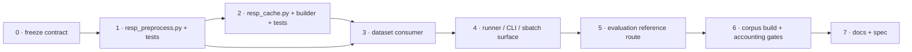

# Respiration Session Preprocessing — Implementation Plan

Status: **IMPLEMENTED (2026-10-31)** — phases 0–7 landed; the gates below were run
on Lichtenberg (`G1` suite green, `G2` analytic, `G3` `--check 20` PASS, `G4`
1399 shards / 1 skipped, `G5` data path `[3,100,112,112]` + `[1,800]`, `G6`
fail-loudly diff covered by tests). Measured numbers and the accounting delta:
`code/notes/eval/tir_resp/resp_preprocess_impact.md`. No GPU time was spent: this
plan ends at "data pipeline verified", as planned.

> **Validity parameters revised by the design on 2026-10-31** — `sat_min_s`
> 2 s → **1 s** and `flat_ptp_v` 0.05 V → **0.5 V**, then **0.3 V** the same day
> after measuring what 0.5 V removed. The numbers in this file and in the code
> follow the final revision (1 s / 0.3 V); what each step cost (0.5 V:
> 145 sessions fully invalidated, 7 subjects lost; 0.3 V: 103 and 6, with 42
> sessions rescued) is in the impact note §1.2. All superseded artefacts are
> still on scratch for A/B.
Scope: the **TIR-ROI / RESP lineage** only — `data/tir_resp_dataset.py`, a new
`data/resp_preprocess.py` + `data/resp_cache.py`, a new
`runners/run_build_resp_cache.py`, the 8 `configs/*/…tir_roi*.yaml` runs and the TIR
sbatch drivers. The RGB+BP lineage and the plain (non-ROI) `resp` dataset keep the
current label path untouched.

Contract of record: `code/notes/design/RESP_session_preprocess.md`. Where that
document and the shipped code disagree, **the design wins** — the conflicts are
enumerated in §2 so nothing is retired by accident.
Upstream spec: `code/notes/spec/01_data_pipeline.md` §3 (hand-apply, see §10).
Measured baseline: `code/notes/eval/tir_resp/resp_data_quality.md`,
`…/resp_rail_touch_filter_results.md`, and
`code/notes/eval/dataset_inspection/corpus_accounting_140_vs_138.md`.

Paths are relative to `code/` unless they start with `code/`.

---

## 1. What this lands

Today the respiration label is *selected per window* by two whole-corpus rules
(`rail_touch_v`, `min_signal_spread`) applied to a `np.interp`-resampled copy of the
raw 1000 Hz file, and the DC offset is left in the signal for `physio_norm` to
absorb over the whole file. This plan replaces that with the design's **per-sample
validity mask decided on the raw signal**, a **per-run DC removal**, an
**anti-aliased resample onto one fixed output grid**, and a **cached whole-session
artefact** (`signal` + `mask`, invalid = `NaN`) that the dataset slices instead of
re-reading `Resp_Volts.txt` every epoch. Clip length, hop, split and normalisation
stay downstream, so one artefact serves Stage 2 and Stage 3.

Two consequences worth stating up front: (a) the label space changes (volts are
replaced by run-mean-removed volts), so **every existing number is a different
lineage** and any retrain needs a new run prefix; (b) the *selection* rule becomes
strictly more permissive (a brief rail graze no longer drops a window) and strictly
more local (a ≥ 1 s saturation hole drops any window covering it).

---

## 2. Conflicts with the shipped pipeline (design wins)

| # | topic | shipped (`data/tir_resp_dataset.py`) | design (`RESP_session_preprocess.md`) | action |
|---|---|---|---|---|
| C1 | rail rule | `rail_touch_v` (shipped `9.9`): **one** sample at `abs(x) >= 9.9 V` drops the whole window | validity is **per sample**; a sample is invalid only when it sits in a **saturation event of ≥ 1 s** at `abs(V) > 9.95` | replace in the ROI lineage; keep the old flag for the legacy path (§4 D6) |
| C2 | flat rule | `min_signal_spread` (shipped `0.1 V`): window `ptp < 0.1 V` drops the window | a sample is invalid when it lies in **any 5 s window with `ptp < 0.3 V`** | replace; the artefact records the cause per sample |
| C3 | unit of validity | a *window* is valid/invalid (recomputed per hop, per run) | a *sample* is valid/invalid, decided once on raw volts | the window test becomes `mask[s:s+n].all()` |
| C4 | DC | none; raw volts kept, `physio_norm: session` z-scores over the **whole file** (railed seconds dominate the mean) | per **run** mean subtracted before resampling; nothing estimated across a break | base dataset returns run-mean-removed values; session stats computed on valid samples only |
| C5 | resampling | `_resp_clip` → `np.interp` to 1000 Hz, then `TirRoiResp*.__getitem__` → `np.interp` to `fs` — **point sampling, no anti-alias** | one anti-aliased resample to the output grid at build time | aliasing (30 Hz noise folding into 0.1–0.6 Hz) disappears; per-epoch interpolation becomes an integer slice |
| C6 | gaps | a "break" is invisible: interpolation runs straight through it | breaks are holes: invalid samples are `NaN`, no window may straddle one | new mask-dilation rule (§3.4) |
| C7 | session outcome | `resp_too_short` / `all_clips_dropped` skip the session during `_build_entries` | every session with a readable `Resp_Volts.txt` gets a shard; only a **consumer** may rule it unusable | build never skips on label content; the dataset reports `all_clips_dropped: no valid run …` |
| C8 | evaluation reference | `run_evaluate_session.read_raw_series` reads raw volts at `--raw_fs` (a different preprocessing than the labels) | reference and label must be the same artefact | `read_reference` gains a cache route (§5 Phase 5) |
| C9 | contract surface | `run_waveform` corpus note lists `min_signal_spread`, `rail_touch_v` | those knobs no longer belong to the TIR run | note lists `resp_cache_key` (+ `physio_norm`, `clip_stride`, task keys) instead |

Nothing in C1–C9 touches the **raster** side: `missing_frame_mask`, `max_sway_px`,
`crop_rule`, `roi_padding` and the ROI cache stay exactly as shipped. The two
caches are orthogonal (different keys, different format versions) and are joined on
the session name `<SUBJECT>_<TASK>`.

---

## 3. Frozen artefact contract

### 3.1 Key fields (`params.json`, hashed into the directory name)

| field | default | why it changes the stored bytes |
|---|---|---|
| `format_version` | `1` | shard schema |
| `corpus` | `rc.corpus_digest()` | session identity set |
| `fs_in` | `1000` | source grid (nominal, see risk R4) |
| `fs_out` | `100` | output grid — **must equal the run's `--fs`** |
| `sat_v` | `9.95` | rail threshold (volts, magnitude) |
| `sat_min_s` | `1.0` | a saturation event shorter than this is **kept** |
| `flat_window_s` | `5.0` | flatline probe length |
| `flat_ptp_v` | `0.3` | flatline peak-to-peak threshold |
| `min_run_s` | `8.0` | valid runs shorter than this are holes |
| `resample` | `poly` (`half_taps`) | filter shape → the stored values |
| `mask_rule` | `conservative-support` | §3.4 |
| `dtype` / `store` | `f4` / `grid+mask` | representation |

**Deliberately NOT in the key** (they select or rescale, never change a stored
sample): `clip_seconds`, `clip_stride`, `task_set`/`tasks`/`task_groups`, the
subject split, `physio_norm`, `input_size`, `max_entries`, and every ROI-side knob.
That is what lets ONE artefact serve Stage 2 (2.0 s hop) and Stage 3 (1.0 s hop).

> **Consequence to state in the docstring** — `min_run_s` *is* in the key, so the
> design's "any clip length" holds for `clip_seconds <= min_run_s`. The dataset
> must therefore raise when `clip_seconds > params['min_run_s']`, with the rebuild
> command in the message.

Directory name (mirrors `tirroi_…_v3_<hash>`):

```
respgrid_src1000_fs100_sat9.95-1s_flat0.3-5s_run8s_v2_<sha1(params)[:10]>
    params.json            # the frozen parameters (--init)
    tasks/F001_T1.npz      # THE SOURCE OF TRUTH (≈0.3 MB mean)
    skipped/F082_T1.json   # {"session","reason"} — missing/unreadable only
    manifest.json          # derived index (--index)
```

### 3.2 Shard members (`np.savez`, uncompressed — 65 k float32 is 260 kB)

| member | dtype | meaning |
|---|---|---|
| `signal` | `float32 [N_out]` | run-mean-removed volts; **`NaN` exactly where `mask` is False** |
| `mask` | `bool [N_out]` | `True` = usable |
| `cause` | `uint8 [N_out]` | `0` valid, `1` saturation, `2` flatline, `3` short run, `4` non-finite — restores the per-rule accounting the dataset prints today |
| `n_src`, `fs_in`, `fs_out` | int | grid identity, self-verifying without the raw file |
| `n_runs`, `valid_frac`, `n_nonfinite` | scalar | build statistics |
| `session`, `resp_file` | str | provenance |

### 3.3 Grid mapping (the consumer's contract)

```
N_out = floor((N_src - 1) * fs_out / fs_in) + 1          # never reads past the file
s     = round(t_start * fs_out)  ,  n = round(clip_seconds * fs_out)
usable(t_start) <=> mask[s : s + n].all()
thermal frame f  ->  respiration sample round((f / fps) * fs_out)
```

`resp_len` in the dataset becomes `n` above (800 for 8 s @ 100 Hz), and
`_resp_start_limit()` is fed the shard's `N_out` instead of counting file lines.

### 3.4 Mask derivation (per stage, all on the RAW grid)

1. `nonfinite = ~isfinite(x)` → cause `4`.
2. `sat = |x| > sat_v`; group into maximal contiguous runs; a run with
   `len/fs_in >= sat_min_s` marks **all of its samples** invalid (cause `1`).
   Shorter contacts stay **valid** — this is the behaviour change of C1.
3. Flatline: `bad_start[j] = ptp(x[j : j+n_w]) < flat_ptp_v` for
   `n_w = round(flat_window_s * fs_in)`; a sample is invalid iff **any** window
   containing it is bad, i.e. `valid &= ~dilate(bad_start, n_w)` (cause `2`).
4. Runs = maximal `True` stretches of the result; `len/fs_in < min_run_s` →
   invalid (cause `3`). Runs themselves are never stored — they are an internal
   device, exactly as the design says.
5. Per run: `y = x[run] - mean(x[run])`, then `resample_poly(y, up=fs_out/g,
   down=fs_in/g)`, `g = gcd(fs_in, fs_out)`, applied after **replicating the run's
   own edge values** by `half_taps` samples (no transient, no edge guard — the
   design's reason, applied to the anti-alias filter). Replicated samples are
   discarded from the result.
6. **Conservative grid mask** (C6): a grid sample is valid only if every source
   sample in its resampling support is valid *and in the same run* —
   implemented as `grid_valid[k] = ~dilate_invalid_src[round(k*fs_in/fs_out)]`
   with `dilate_invalid_src` grown by `fs_in/(2*fs_out) + half_taps`. Without this
   a break shorter than one output period would vanish and a window could straddle
   it.
7. Write `NaN` outside the mask; assert `np.isnan(signal) == ~mask` on the way out.

---

## 4. Decisions

| # | decision | value |
|---|---|---|
| D1 | module split | `data/resp_preprocess.py` = **pure** numpy/scipy (`validity_mask`, `contiguous_runs`, `preprocess_session`) with no IO; `data/resp_cache.py` = key, params, shard IO, `find_cache` (mirrors `roi_cache.py`) |
| D2 | artefact is one step of the pipeline | it decides "which volts are trustworthy at which instant" and nothing else — no window, hop, split, normalisation or clip length may enter it |
| D3 | one validity statement | the mask is the ONLY validity rule in the ROI lineage; the dataset never re-tests a window's content |
| D4 | NaN, not 0 | an unmasked read must fail loudly; `np.isnan(signal) == ~mask` is asserted in both the writer and the loader |
| D5 | saturation is event-based | `abs(V) > 9.95` sustained **≥ 1 s**; shorter contacts are kept (measured impact differs from `rail_touch_v 9.9` — gate G4) |
| D6 | `rail_touch_v` / `min_signal_spread` | kept as args and on the **legacy raw path only**; with `resp_cache` attached a non-zero value **raises** (silent double filtering is the failure mode) |
| D7 | `resp_fs` semantics | with a cache, `resp_fs` IS `fs_out` (100) and is verified against `--fs`; without a cache it stays the legacy 1000 Hz nominal path, unchanged |
| D8 | cache key identity, not path | `run_waveform` compares the cache **directory name** (`resp_cache_key`, machine-independent hash), never the absolute path |
| D9 | two caches, independent versions | `RESP_CACHE_FORMAT_VERSION` is separate from `CACHE_FORMAT_VERSION (3)`; a rebuild of one never forces the other |
| D10 | coverage intersection | the dataset uses sessions present in **both** caches; a missing `tasks/<S>_<T>.npz` in either is an ERROR (incomplete build), while a `skipped/*.json` entry is a legitimate exclusion |
| D11 | build cost | whole corpus is ≈1399 files × 65 k samples — seconds to a minute, single process. No array job is required; the `--array_index/--array_count` flags still exist for parity with the ROI builder |
| D12 | lineage | label space changes ⇒ new run prefixes (`…_respgrid`); the legacy path stays intact so old numbers remain reproducible with `--resp_cache ''` |

---

## 5. Phases



Phases 1 and 2 are sequential (2 wraps 1); 3 needs both. 5 can start once 2 exists
(it reads shards without the dataset). Nothing in 1–5 changes a tensor shape, so
the suite must stay green at every step.

### Phase 0 — freeze the contract

**Step 1 — `data/resp_preprocess.py` module docstring** carries the §3 tables
(key fields, grid mapping, mask derivation, "no window/hop/split/normalisation
enters the artefact"). This docstring is the code-side copy of the design; the
design stays the authority.

**Step 2 — fixtures.** No binary fixture in the repo: a helper builds a synthetic
session (0.3 Hz sine + a 1.5 s rail block + a 6 s flat block + a 40 ms gap) so every
threshold and boundary is exact and the test states its own intent. Real
`Resp_Volts.txt` files are used only by the `--check` parity gate.

### Phase 1 — pure preprocessing (`data/resp_preprocess.py`)

**Step 3 — constants** next to the module header, one per key field:

```python
FS_IN = 1000.0; FS_OUT = 100.0
SAT_V = 9.95; SAT_MIN_S = 2.0
FLAT_WINDOW_S = 5.0; FLAT_PTP_V = 0.5
MIN_RUN_S = 8.0
RESAMPLE_HALF_TAPS = 20          # x up/down, applied on both run edges
CAUSE_VALID, CAUSE_SAT, CAUSE_FLAT, CAUSE_SHORT, CAUSE_NONFINITE = 0, 1, 2, 3, 4
```

**Step 4 — `validity_mask(x, fs_in, …) -> (mask, cause)`** implements §3.4 steps
2–4. Two implementation notes to keep in the docstring:

* the saturation grouping must use maximal contiguous runs of `|x| > sat_v`, NOT a
  rolling duration — a 1 s *total* rail fraction spread over the file is not an
  event (`resp_data_quality.md` §3.1 shows files with 40–80 % rail fraction made of
  many short grazes);
* the flatline window statistic is `minimum_filter1d`/`maximum_filter1d`
  (`size=n_w`, `mode='nearest'`) followed by a dilation over the window starts;
  pin the equivalence against a brute-force `sliding_window_view` loop on a
  5 000-sample synthetic (it is the one place an off-by-one would silently change
  the mask).

**Step 5 — `preprocess_session(x, fs_in, fs_out, …) -> dict`** implements §3.4
steps 5–7 and returns `{'signal','mask','cause','n_runs','valid_frac',…}` — the
exact shard payload minus provenance. Requirements:

* `resample_poly` with `up=fs_out//g`, `down=fs_in//g`; validate `fs_in`, `fs_out`
  are integral (`ValueError` otherwise);
* DC is `mean` of the run **in float64**, subtracted before resampling, so
  `|mean(signal[mask])|` over a single-run synthetic is `< 1e-6` V;
* no high-pass filter, no detrend, no scaling — amplitude must survive
  (`std` of a 1 V 0.3 Hz sine out = 0.707 ± 1 %).

### Phase 2 — cache (`data/resp_cache.py`, `runners/run_build_resp_cache.py`)

**Step 6 — `resp_cache.py`** is a structural clone of `roi_cache.py`: 
`RESP_CACHE_FORMAT_VERSION = 1`, `build_params()`, `cache_key()` (readable slug +
`sha1(params)[:10]`), `write_params/read_params`, `COMPARE_KEYS`,
`loader_params()`, `find_cache()` (fail loudly with a field-by-field diff, refuse an
ambiguous match), `write_shard` (staging dir + `os.replace`, PID-named temp),
`write_skip`, `read_shard`, `shard_path`. `corpus_digest` is **imported from
`roi_cache`**, not copied — one digest for both caches.

**Step 7 — `build_task(spec, …)`**: `Resp_Volts.txt` → `trd._load_1d` →
`preprocess_session` → payload. Returns `(None, reason)` **only** for
`missing_resp_volts`, `unreadable_resp_volts` and `empty_resp_volts`. It must never
skip on label content (design §3, C7) — a session whose every sample is invalid is
still a shard, with `valid_frac == 0`.

**Step 8 — `runners/run_build_resp_cache.py`**: modes `--init`, `--build`
(default), `--status`, `--index`, `--check`; `--array_index/--array_count`,
`--subjects`, `--limit`, `--out_root`, plus the five validity knobs (they are key
fields, so a non-default value produces a different cache rather than editing one).
`--check N` re-runs `preprocess_session` from raw for N sessions and asserts the
shard is **bit-identical** (`np.array_equal`, plus `NaN`-position equality) — the
parity gate that caught the ROI cache's two bugs.

**Step 9 — build the corpus** and record `valid_frac`, `n_runs`, per-cause
invalid share in `manifest.json`.

### Phase 3 — dataset consumer (`data/tir_resp_dataset.py`)

**Step 10 — attach** — `_attach_resp_cache(out_root)` next to `_attach_cache`
(1079–1116): build the loader half of the key from `(raw_root, unfiltered
discovery, fs_in, fs_out=args.fs)` + defaults for the validity knobs, call
`find_cache`, print `<dir name>, fs_out, sat/flat/run rules, valid_frac`, store
`self.resp_cache_root`, `self._resp_params`. Assert
`clip_seconds <= params['min_run_s']` and `fs_out == self.fs` **before** any entry
is built.

**Step 11 — label read** — `_resp_full(session)` (1052–1059) returns the shard's
`(signal, mask, cause)`; `_resp_clip(entry)` (1061–1067) becomes an integer slice
`signal[s:s+L]` (`L = resp_len = round(clip_seconds*fs_out)`), no `np.interp`.
`_norm_cache` uses `np.nanmean/np.nanstd` over the stored signal (= valid samples
only — C4). `respiration_clip()` (1245) keeps its signature.

**Step 12 — window validity** — in `_build_entries` (816–1013) replace the
`y_raw`/`rail`/`flat` block (873–925) with

```python
if self.resp_cache_root is not None:
    ok = bool(mask[s:s + self.resp_len].all())     # s = round(t_start*fs_out)
```

and attribute the cause from `cause[s:s+resp_len]` (first non-zero) so
`clips_dropped_invalid_sat / _flat / _short / _nonfinite` keep the reporting the
run logs have always had. Keep the legacy branch byte-identical for
`resp_cache is None`.

**Step 13 — bookkeeping** — `self.sessions[sess]` gains
`resp_valid_frac`; `stats` gains `resp_cache`, `resp_cache_key`, `resp_fs`,
`resp_valid_fraction`, the four new drop counters, and
`clips_dropped_rail/flat` become 0/absent on the cache path. `describe()` (1353)
and `_log_corpus_cleaning()` (1858) print the validity contract, and the
`resp_too_short` skip becomes `no valid run >= min_run_s` derived from the shard
(keeping the distinct reason name for the corpus accounting note).

**Step 14 — coverage intersection** — after both caches are attached, filter
`discovered` to sessions with an ROI shard **and** a resp shard; record
`sessions_without_roi` / `sessions_without_resp`. A `skipped/*.json` session is
excluded silently; a missing `tasks/*.npz` raises with the builder command.

### Phase 4 — runner / CLI / sbatch surface

**Step 15 — flags** — `--resp_cache` (default `''`) on `run_pretrain.py`,
`run_finetune.py`, `run_waveform.py`, `run_inspect_tir_resp.py`,
`run_survey_tir_resp.py`; threaded through
`build_tir_roi_{pretrain,finetune}_dataset` (1878–1976) into the dataset
constructors (`resp_cache=`, `resp_cache_lru=8`). No YAML key — `roi_cache` is
env/CLI only and the two must behave the same.

**Step 16 — checkpoint note** — `run_waveform.py` (116–266): drop
`min_signal_spread`, `rail_touch_v` from the corpus-note tuple when the cache is
active and add `resp_cache_key` (+ `physio_norm` stays); `stage3_compat_probe.py`
`CORPUS_KEYS` (70) updated the same way. A Stage-2 checkpoint that predates this
change has no `resp_cache_key` → print the WARN (never abort), following the
`crop_rule`/`max_sway_px` precedent.

**Step 17 — drivers** — `RESP_CACHE` env (default
`${WORK_SCRATCH:-$OUTPUT_DIR}/resp_cache`, `RESP_CACHE=''` disables) plus the
`args+=(--resp_cache "$RESP_CACHE")` line in `submit_pretrain.sbatch`,
`submit_waveform_tir_roi.sbatch`, `submit_waveform_eval.sbatch`,
`submit_stage3_kfold.sh`, `bench_batch_sweep.sbatch`, `bench_stage3_step.sbatch`;
a `RESP_CACHE` echo next to the existing `roi_cache` echo.

### Phase 5 — evaluation reference (`runners/run_evaluate_*`)

**Step 18 — `read_reference`** (`run_evaluate_session.py`, 61–95) gains a route:
`(resp_cache_root, session) -> (t, y, mask)` reading the shard at `--fs`, so the
reference and the label share one preprocessing. `--resp_cache` on
`run_evaluate_session.py`, `run_evaluate_subject.py`, `run_evaluate_kfold.py`,
`plot_task_waveforms.py`.

**Step 19 — scoring** — the session/`kfold`/`subject` scorers already exclude
uncovered samples via `assemble_session`'s `covered` mask; add the reference mask
as a **second** restriction (`scored = covered & ref_mask`), so a reference hole is
never scored as zero. `entries.json` records `resp_cache`,
`resp_cache_key`, `reference_source: resp_cache` (was `raw_resp_volts`).

**Step 20 — retire the cross-space MAE note** — with both sides in artefact space,
`session_tier1.mae/rmse` are no longer `|DC|`-dominated (`eval/tir_resp` memory
note); `_figure_metrics` keeps printing `pearson`, `psd_mae`, `mae_aff_V`.

### Phase 6 — corpus build, gates, measurement

**Step 21** — build `$WORK_SCRATCH/resp_cache` (≈1 min), `--status`, `--index`,
`--check 20`.

**Step 22** — corpus accounting: dataset over all 140 subjects (8 s / 2 s hop) →
sessions / clips / drop-cause table vs
`eval/dataset_inspection/corpus_accounting_140_vs_138.md`
(138 subjects / 1260 sessions / 21 231 clips). Report the **delta** honestly; the
two directions are structural, not a bug: brief grazes return to the corpus, ≥1 s
holes remove windows. `F004` is the test case — its 40–80 % rail fraction is made
of many short grazes, so it may now yield clips; if it does, that is a data-quality
finding for `notes/eval/`, not a success criterion.

**Step 23** — write `code/notes/eval/tir_resp/resp_preprocess_impact.md` with the
tables from Steps 9/22 and the analytic gate (G2).

### Phase 7 — docs

**Step 24** — `code/notes/spec/01_data_pipeline.md` §3 hand-applied (NOT
regenerated: `scripts/project/write_specs.py` is stale and reverts four hand
edits — edit the script's text in the same commit, then `git checkout --` every
unintended file). Update `TirROI_Resp_plan.md` §3 (precomputation), §4 (code map),
§9 (doc map), `code/README.md` (data section), `code/notes/spec/04_configs_and_execution.md`
(`rail_touch_v` row → superseded note). Then `grep -rn "code/notes/" code/` must
still resolve every path.

---

## 6. Test plan

New files:

| file | cases |
|---|---|
| `tests/test_resp_preprocess.py` | saturation event < 1 s kept; ≥ 1 s invalidates exactly the event; 0.6 V ripple stays valid, 0.4 V over 2 s does not; the `minimum_filter1d` implementation equals a brute-force window loop; run < 8 s becomes a hole; per-run mean removed to `< 1e-6` V; 0.3 Hz amplitude within 1 %; 30 Hz tone attenuated ≥ 40 dB; a 40 ms invalid gap leaves ≥ 1 `False` on the 100 Hz grid and no window straddles it; `np.isnan(signal) == ~mask`; second call is bit-identical |
| `tests/test_resp_cache.py` | key changes iff a frozen field changes; `clip_stride`/`clip_seconds`/`physio_norm`/`input_size` do NOT; `find_cache` diff message + ambiguous refusal; shard round-trip incl. `cause`; atomic write leaves no temp; `write_skip` on a missing file; **every session with a readable file gets a shard, including an all-invalid one**; `--check` parity |
| `tests/test_resp_window_contract.py` | window inside a valid run kept; window over a saturation hole dropped with the right counter; 0.5 s graze kept (C1 headline); `fs_out != --fs` raises; `min_signal_spread>0` with a cache raises; missing resp shard raises with the builder hint; `skipped/` session excluded quietly; intersection accounting |

Updated: `tests/test_tir_resp_rail_filter.py` (retarget at the **legacy** path only,
marked as such so it does not imply the ROI rule), `tests/test_rail_rule_plumbing.py`
(drop the two knobs from the TIR-config contract, add `resp_cache` plumbing; keep
`EXPECTED_STRIDE_S` and the `len(TIR_CONFIGS)` count in sync),
`tests/test_config_loading.py`, `tests/test_physio_norm.py` (session stats now over
valid samples). `tests/test_roi_cache.py`, `test_roi_square_rule.py`,
`test_roi_motion_gate.py`, `test_tir_resp_sentinel.py` must pass unchanged —
they are the proof that the raster side was not touched.

Run: `cd code && ../.env/bin/python -m pytest -q` (HPC venv is `.env`, not `.venv`).

---

## 7. Gates

| # | gate | pass condition |
|---|---|---|
| G1 | suite | `pytest -q` green, ROI/sentinel tests unchanged |
| G2 | analytic | 0.3 Hz sine + 30 Hz tone: band-limited Pearson vs the clean sine `== 1.000`, HF leakage `< 1e-3`; `np.interp` on the same input must FAIL this (proves C5 is real) |
| G3 | parity | `--check 20`: shard bit-identical to a fresh in-memory preprocess, `NaN` positions equal |
| G4 | corpus | 1399 shards / 1 skipped (`F082_T1`, no file); every shard non-empty; accounting table + delta published in `notes/eval/tir_resp/` |
| G5 | data path | synthetic 8 s clip → `[3,100,112,112]` + `[1,800]`; ms/sample **improves** vs the 1000 Hz path (the per-epoch `np.interp` disappears) |
| G6 | no silent drift | a run pointed at a cache with a different `fs_out`/`sat_min_s` aborts with a field diff, never trains |

---

## 8. Risks and open items in the design

| # | item | treatment |
|---|---|---|
| R1 | `sat_min_s` semantics ("invalid if it touches the rail **and lasts 2 s**") is ambiguous between "the sample" and "the event" | **Resolved in design**: D5 fixes it as event-based; a sample is invalid only when it sits in a saturation alarm window lasting at least 1 second. |
| R2 | a 0.05 Hz (very slow) breath can trip the 2 s flatline probe | **Resolved in design**: flatline window increased to 5 seconds to safely clear 0.05 Hz breaths. |
| R3 | run-edge filter transient | edge replication + the G2 analytic gate; if the gradient at a run edge exceeds 1e-3 V, add a `half_taps/decim` invalid guard at the run edges and note the deviation from the design |
| R4 | the corpus is not exactly 1000 Hz (F001_T1: 64 597 samples / 64.48 s = 1001.8 Hz) | keep the nominal `fs_in = 1000` (the frame↔sample mapping is a corpus-wide convention); record `fs_in_measured` per session in the manifest and WARN above 0.5 % — changing it would re-define alignment with the thermal frames and is a separate lineage |
| R5 | `physio_norm: session` statistics change meaning (valid-only, run-mean-removed space) | documented in D7/Step 11; the Stage-2 `target_norm` pin is unaffected |
| R6 | a retrain is required for any comparable number | D12; the plan stops at "data pipeline verified", it does **not** spend GPU time |

Out of scope: any change to `max_sway_px` / sentinel / ROI-crop behaviour; the RGB+BP
label path; a chest/body ROI; re-tuning losses.

---

## 9. Run recipes

```bash
# 0. build the artefact (once per validity contract; seconds)
python runners/run_build_resp_cache.py --init --build \
    --out_root "$WORK_SCRATCH/resp_cache" --raw_root "$RAW_DATA_PATH"
python runners/run_build_resp_cache.py --status --out_root "$WORK_SCRATCH/resp_cache"
python runners/run_build_resp_cache.py --check 20 --out_root "$WORK_SCRATCH/resp_cache"

# 1. smoke (local, single process)
RESP_CACHE="$WORK_SCRATCH/resp_cache" bash scripts/local/waveform_local.sh   # + --resp_cache

# 2. training: the two caches are independent env vars
GPU_TYPE=rtx6000 GPUS=4 RESP_CACHE="$WORK_SCRATCH/resp_cache" \
  bash scripts/hpc/submit.sh scripts/hpc/submit_waveform_tir_roi.sbatch

# 3. evaluation re-reads the SAME artefact on the reference side
python runners/run_evaluate_session.py --pred_dir <OUT_DIR> --resp_cache "$WORK_SCRATCH/resp_cache" \
    --waveform resp --fs 100 --tier 1,2
```

---

## 10. Doc impact

| document | change |
|---|---|
| `code/notes/design/RESP_session_preprocess.md` | authority; add the §8 resolutions (R1–R4) once decided |
| this file | build order of record |
| `code/notes/plan/TirROI_Resp_plan.md` | §3 precomputation (second cache), §4 code map (2 modules + builder), §9 doc map rows |
| `code/notes/spec/01_data_pipeline.md` §3 | hand-applied paragraph: validity mask replaces `rail_touch_v`/`min_signal_spread`; artefact layout; hand-apply the same text to `scripts/project/write_specs.py` |
| `code/notes/spec/04_configs_and_execution.md` | `rail_touch_v` row → "legacy path only, superseded by the resp validity mask" |
| `code/notes/eval/tir_resp/resp_preprocess_impact.md` | **new**: artefact statistics, accounting delta, G2 analytic table |
| `code/README.md` | data section: `--resp_cache`, `--resp_fs` semantics |
| `code/notes/eval/dataset_inspection/corpus_accounting_140_vs_138.md` | add a dated "re-measured under the validity mask" block rather than overwriting the old numbers |

---

## 11. BDD Use Cases

**Feature 1: Saturation Event Masking**
*   **Given** a raw respiration signal sampled at 1000 Hz
*   **And** the signal contains a continuous block of values `> 9.95 V` lasting for `0.5` seconds
*   **And** the signal contains another continuous block of values `< -9.95 V` lasting for `1.5` seconds
*   **When** the validity mask is computed
*   **Then** the samples in the `0.5`-second block are marked as **valid** (cause `0`)
*   **And** the samples in the `1.5`-second block are marked as **invalid** (cause `1` - saturation)

**Feature 2: Flatline Detection**
*   **Given** a raw respiration signal sampled at 1000 Hz
*   **And** the signal contains a 6-second stretch where the peak-to-peak amplitude is `0.3 V`
*   **When** the validity mask is computed with a `5.0` second flatline window and `0.3 V` threshold
*   **Then** the samples within that 6-second stretch are marked as **invalid** (cause `2` - flatline)
*   **And** the invalid mask is dilated to cover any 5-second window that overlaps this stretch

**Feature 3: Short Run Exclusion**
*   **Given** a raw respiration signal
*   **And** the saturation and flatline rules have partitioned the valid samples into two contiguous runs
*   **And** the first run lasts for `10.0` seconds
*   **And** the second run lasts for `6.0` seconds
*   **When** the contiguous runs are evaluated against the `8.0` second minimum run length
*   **Then** the first run is kept as **valid**
*   **And** the second run is marked entirely as **invalid** (cause `3` - short run)

**Feature 4: DC Offset Removal and Resampling**
*   **Given** a valid contiguous run of respiration data
*   **And** the run has a mean DC offset of `4.5 V`
*   **When** the run is preprocessed for the cache
*   **Then** `4.5 V` is subtracted from every sample in the run
*   **And** the run is anti-alias resampled to `100 Hz`
*   **And** the resulting 100 Hz signal has a mean of `< 1e-6 V`

**Feature 5: Conservative Grid Masking (No Straddling)**
*   **Given** a raw respiration signal with a `40 ms` invalid gap (e.g., a brief flatline or non-finite sample)
*   **When** the signal is resampled to the `100 Hz` output grid
*   **Then** the output mask contains at least one `False` value at the gap's location
*   **And** the invalid region is dilated by the resampling filter's support (`half_taps`)
*   **And** no valid 100 Hz window can be drawn that straddles the original 40 ms gap

**Feature 6: Cache Key Independence**
*   **Given** a built respiration cache directory
*   **When** a consumer requests a dataset with `clip_seconds=4.0` and `clip_stride=1.0`
*   **And** another consumer requests a dataset with `clip_seconds=8.0` and `clip_stride=2.0`
*   **Then** both consumers successfully load from the **same** cache directory without triggering a rebuild
*   **And** the cache key remains unchanged
