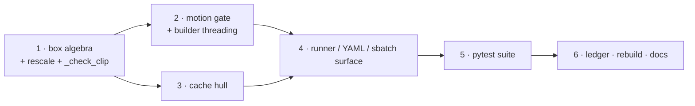

# ROI Crop Implementation Plan — Square Box, Isotropic Rescale, Motion Gate, Cache Hull

Status: **PLANNED, not implemented** (2026-10-29).
Scope: the TIR lineage — `data/tir_resp_dataset.py` and `data/roi_cache.py`.
The RGB lineage keeps the legacy geometry in this change but is bound to the same
contract when it is ported (*Deferred: the RGB port*).

Contract of record: `code/notes/design/ROI_crop_and_rescaling.md`.
Upstream spec: `code/notes/spec/01_data_pipeline.md` §3.3.
Measured behaviour: `code/notes/eval/tir_resp/`.

Paths are relative to `code/` unless they start with `code/`.

## What this lands

The contract has two load-bearing properties: the box is **squared before** the
rescale, so there is exactly one scale factor and the anatomy is never deformed;
and a clip whose head travels too far inside the window is **excluded** rather than
absorbed into an ever-larger crop. This plan implements both in the TIR lineage,
replaces the cache's stored crop with a square hull over the valid windows, and
threads the two knobs (`crop_rule`, `max_sway_px`) through runners, configs and job
scripts. Rationale and measurements live in the design doc; this file is the build
order.

## Decisions

| # | decision | value |
|---|---|---|
| 1 | scope | **TIR only in this change**; `data/rgb_roi_dataset.py` and `data/rgb_features.py` are untouched. Enforced structurally: `roi_box_from_landmarks` keeps `crop_rule='box'` as its own default. **A future RGB+ROI study implements the identical contract** (*Deferred: the RGB port*) — one ROI doctrine, no per-modality exception |
| 2 | cache | **new storage rule**: window-hull, `CACHE_FORMAT_VERSION = 3`, rebuild + parity gates planned here |
| 3 | defaults | dataset class defaults `crop_rule='square'`, `max_sway_px=40.0`, set explicitly in all 8 TIR-ROI configs |
| 4 | RGB motion gate | deferred, not waived: same `sway` statistic, same placement, same drop semantics; only the threshold is modality-specific (`40 * 1392/726` ~ 77 px) |
| 5 | geometry failure | a box that would clip the landmark envelope or exceed the frame is a **clip drop** (exception + counter), never a silent clamp |
| 6 | cache key | `crop_rule`, `clip_seconds`, `fps` join the key; `input_size`, `clip_stride`, `task_set`, `temporal_stride` stay out (I3) |
| 7 | checkpoint check | a Stage-2 checkpoint recording none of the new contract keys makes the Stage-3 check **WARN loudly** — it cannot abort on a value it does not have |
| 8 | `union_box` | **replaced** by `hull_box`; no alias, all callers updated in the same change |

## Phase map and dependencies



Phases 1 and 3 are independent after step 1; phase 4 needs both, because
`ROI_CONTRACT_KEYS` and the cache key must agree on the same fields.

---

## Phase 1 — geometry core

**Step 1 — box algebra** (`code/data/tir_resp_dataset.py`, `roi_box_from_landmarks`
382–418).

New module constants next to `DEFAULT_ROI_PADDING` (134):

| name | value |
|---|---|
| `CROP_RULE_BOX` | `'box'` — legacy unsquared geometry, the function's own default |
| `CROP_RULE_SQUARE` | `'square'` — the contract |
| `DEFAULT_CROP_RULE` | `'square'` — the **dataset** default |
| `DEFAULT_MAX_SWAY_PX` | `40.0` |

Signature grows one keyword: `roi_box_from_landmarks(pts, width, height,
padding=DEFAULT_ROI_PADDING, min_size=2, crop_rule=CROP_RULE_BOX)`. Keeping
`'box'` as the *function* default is what leaves `data/rgb_roi_dataset.py:831,858`
and every existing probe on the legacy rule without edits.

`'square'` branch, in order:

1. finite-filter the points, take the unpadded envelope `(xlo, xhi, ylo, yhi)` and
   keep it — I6/I7 are checked against it, not against the padded box;
2. pad per side by that axis' own extent (unchanged, P1: `p=0.2` ⇒ 1.4x);
3. `side = max(x1 - x0, y1 - y0)`; centre `c = ((x0+x1)/2, (y0+y1)/2)`;
4. `n = max(min_size, ceil(side))` — **one** integer side for both axes;
5. `ix0 = floor(cx - n/2)`, `ix1 = ix0 + n`; same for `y`. This guarantees
   `x1 - x0 == y1 - y0` exactly (I6). Doing `floor/ceil+1` per axis does not — it
   can differ by 1–2 px and would silently reintroduce an anisotropic scale;
6. **translate** to fit `[0, W)` / `[0, H)` (shift both edges by the same delta),
   never shrink. Raise `RoiBoxOutOfFrame` when `n > W` or `n > H`;
7. after translation require `ix0 <= floor(xlo)` and `ix1 >= ceil(xhi) + 1`
   (likewise `y`); otherwise raise `RoiBoxOutOfFrame` — the square never cuts the
   landmark envelope (design §3.2, BDD Feature 1).

`RoiBoxOutOfFrame(ValueError)` is a new module-level exception; the `'box'` path
never raises it and keeps `_clamp_box`, which is now used only there. The docstring
must state per-side padding (P1), that the square rule supersedes `min_extent`
(P3), and that a caller passing `crop_rule='square'` must handle the raise.

**Step 2 — rescale** (`_roi_patches`, 1065–1097, resize at 1090–1096).

For `'square'` assert `x1 - x0 == y1 - y0` before the resize and choose the kernel
from the single side (`INTER_AREA` when `s <= x1 - x0`, else `INTER_LINEAR`). One
`cv2.resize(crop, (s, s))` call with `sx = sy = s/ell` — no second resample
anywhere in the chain (I5). The existing origin-subtracted bounds check stays.

**Step 3 — `_check_clip`** (1753–1875; box block 1815–1843, resize block 1846–1858).

Replace the independent min/max replica with, in this order:

- property assertions: box inside the frame, `x1-x0 == y1-y0`, box covers every
  finite target landmark of the clip, box area <= 50 % of the frame (keep);
- an **independent** recomputation of the unpadded envelope min/max and of
  `n = ceil(max(padded extents))`, to catch an off-by-one in steps 4–5;
- tensor equality against `cv2.resize(frames[0][y0:y1, x0:x1], (s, s))` with the
  same kernel, plus the explicit `sx == sy` assertion (I4–I6).

`check_view_parity` (1877–1962) needs no logic change; it must keep passing, which
is the Stage-2/Stage-3 half of the same guarantee.

---

## Phase 2 — motion gate

**Step 4 — the gate** (`code/data/tir_resp_dataset.py`).

New pure helper:

```python
def landmark_sway(pts: np.ndarray, target_idx) -> float:
    """Max head excursion inside a window: ``[T, |L|, 2]`` -> float (px)."""
```

Per-frame centroid `c_t = mean over the target landmarks`, `med = component-wise
median over t`, `sway = max_t ||c_t - med||_2` (design §3.4). It reads the landmark
track only — no decode, no cache, no signal.

Two facts to keep in the docstring: it is deliberately **not** box width
(`rho(sway, face width) = +0.15`, so a width rule discards large-faced subjects),
and the scale-free alternative `infl <= 1.6` correlates `rho = +0.86` with it —
pick one, do not stack them.

Dataset surface: `BP4DPlusTIRRespDataset.__init__` (549–652) gains
`max_sway_px: float = DEFAULT_MAX_SWAY_PX` and `crop_rule: str = DEFAULT_CROP_RULE`;
`0` or negative disables the gate; an unknown `crop_rule` fails fast.

Placement inside `_build_entries`' clip loop (712–762): **immediately after** the
sentinel test and **before** the rail/spread block. Both reasons belong in a
comment: sway needs no interpolation of the respiration series, and the ordering
decides which rule gets credit when a clip fails several — the same reasoning that
already puts the rail test before the flat test.

Counters, mirroring the sentinel/flat/rail triple:

| where | change |
|---|---|
| clip-loop locals | `dropped_motion`, `dropped_envelope` |
| per-session record (766–770) | `clips_dropped_motion`, `clips_dropped_envelope` |
| `all_clips_dropped` reason (773–782) | an `N window(s) exceed max_sway_px=…` clause |
| `self.stats` (789–828) | `clips_dropped_motion`, `clips_dropped_envelope`, `max_sway_px`, `crop_rule` |
| `describe()` (1142–1183) | extend the `clips` line; extend the `roi` line (1156–1157) to `crop {crop_rule} … max_sway {max_sway_px:g} px` |

`clips_dropped_envelope` exists so a future padding or landmark change cannot make
clips vanish silently; the design does not name it because it does not arise at
`p=0.2` on the current corpus.

**Step 5 — thread the two knobs.**

`TirRoiRespPretrainDataset.__init__` (1233–1318),
`TirRoiRespFinetuneDataset.__init__` (1412–1583),
`build_tir_roi_pretrain_dataset` (1710–1751) and `build_tir_roi_finetune_dataset`
(1657–1708) each take and forward `crop_rule` / `max_sway_px`, read as
`getattr(args, 'crop_rule', DEFAULT_CROP_RULE)` and
`float(getattr(args, 'max_sway_px', DEFAULT_MAX_SWAY_PX))`.

---

## Phase 3 — cache hull

**Step 6 — `code/data/roi_cache.py`.**

| item | line | change |
|---|---|---|
| `CACHE_FORMAT_VERSION` | 69 | `2` -> `3`; the bump note says the stored rectangles change shape, not merely padding |
| `BOX_RULE` | 73 | `'window-hull'` (storage rule); `crop_rule` stays a separate geometry field |
| `build_params` | 190–213 | `+ crop_rule: str`, `+ clip_seconds: float`, `+ fps: float` |
| `cache_key` | 216–226 | slug `tirroi_{name}_pad{p:.2f}_{crop_rule}_hull_src{W}x{H}_native_v3_{sha1[:10]}` |
| `COMPARE_KEYS` | 249–252 | `+ 'crop_rule'`, `+ 'clip_seconds'`, `+ 'fps'` (the loader can compute all three) |
| `loader_params` | 256 | forward the three new fields |
| `union_box` | 395–410 | **replaced** by `hull_box(...)` |

`hull_box(landmarks, target_labels, padding, w, h, crop_rule, clip_seconds, fps)`
returns the bounding box of the boxes of **every sentinel-valid stride-1 window** of
the task, computed with the same `roi_box_from_landmarks` the loader uses, so
containment holds by construction rather than by a re-implementation — the reasoning
that made `valid_rows` delegate to `missing_frame_mask`:

```text
pts  -> valid_rows() -> bad = ~valid mask
cf   = max(1, round(clip_seconds * fps))
for start in range(0, n - cf + 1):           # stride 1, never the clip hop
    if bad[start:start+cf].any(): continue
    try: boxes.append(roi_box_from_landmarks(win, w, h, padding, crop_rule=...))
    except RoiBoxOutOfFrame: continue        # unreachable window, skip
return None if not boxes else (min x0, max x1, min y0, max y1)
```

`build_task` (428–560, hull call at 486) passes the three parameters through and
checks `--max_task_gb` against the larger hull. The shard schema is unchanged:
`frames`, `box`, `landmarks`, `n_frames`, `src_hw`.

**Step 7 — loader** (`data/tir_resp_dataset.py`).

- `_attach_cache` (896–929) passes `crop_rule`, `clip_seconds` and `fps` to
  `rc.loader_params`; `self.clip_seconds` / `self.fps` already exist and the
  pretrain view forwards `clip_seconds=self.clip_duration` (1301), so a
  `--clip_duration` change now invalidates the cache — state that in the error
  message (design §9 item 4).
- `_clip_frames` (976–995) / `_roi_patches` (1065–1097) add the explicit
  `rc.box_contains(shard_box, clip_box)` check raising `IndexError` (I2). Keep the
  numeric bounds check too; it catches a different failure (frame overflow).

**Step 8 — `code/runners/run_build_roi_cache.py`.**

`--crop_rule` (default `square`), promote `--clip_seconds` (393, currently
`--check`-only) to a build parameter, add `--fps` (default `25.0`). `make_params`
(120–136) forwards them. `mode_check` (245–329) is re-pointed: it hardcodes
`temporal_stride=2` and `input_size` from `--input_size`, and must now also assert
`box_contains(hull, box)` for every sampled clip at every hop in `--hops` — the
artifact-level form of I2/I3.

**Step 9 — probe callers.**

`code/notes/eval/tir_resp/cache_parity_probe.py` (`_union_box` 71–90, used 157/244)
switches to `rc.hull_box` with the new parameters; every other `rc.union_box` caller
goes in the same commit (`grep -rn "union_box" code/`).

---

## Phase 4 — runner / config / script surface

**Step 10 — the two flags.** `--crop_rule` (choices `box|square`, default `square`)
and `--max_sway_px` (float, default `40.0`, `0` = off) on
`runners/run_pretrain.py` (next to `--roi_padding` ~108), `runners/run_waveform.py`
(~420), `runners/run_inspect_tir_resp.py` (~498) and
`runners/run_survey_tir_resp.py` (~108). `runners/_common.py:96
_check_config_keys` rejects any YAML key the parser does not define, so the parser
lands before any config edit.

Help text carries: the value changes WHICH PIXELS (and, for `max_sway_px`, which
CLIPS exist), it is a Stage-2/Stage-3 contract key, and the gate is task-biased
(T4 keeps 80 % at 40 px).

**Step 11 — the contract check** (`runners/run_waveform.py`).

```python
ROI_CONTRACT_KEYS = ('roi_landmarks', 'roi_padding', 'input_size',
                     'crop_rule', 'max_sway_px')
```

`_read` (156–167) gains a `str` branch for `crop_rule`, keeps `int` for
`input_size` and `float` for the rest. The existing `None` -> `continue` already
tolerates an older checkpoint; add an explicit WARNING when a TIR-ROI Stage-2
checkpoint records **none** of `crop_rule` / `max_sway_px`, naming the geometry
change, so a square Stage-3 on a legacy encoder is never silent. These keys must not
move into the corpus-level warn list (203–214): they change the pixels, which is
exactly the abort case.

**Step 12 — configs.** Edit the 8 TIR-ROI configs (do not add new ones —
`tests/test_rail_rule_plumbing.py` pins `len(TIR_CONFIGS) == 8`):
`configs/pretrain/stage2_hpc_tir_roi_resp.yaml`, `stage2_local_tir_roi_resp.yaml`,
`stage2_local_tir_roi_crossmae.yaml`; `configs/finetune/resp_tir_roi_hpc.yaml`,
`resp_tir_roi_hpc_smoothl1.yaml`, `resp_tir_roi_local.yaml`,
`resp_tir_roi_local_matched.yaml`, `resp_tir_roi_crossmae.yaml`:

```yaml
crop_rule: square
max_sway_px: 40
```

Explicit rather than implicit, because `check_stage2_roi_contract` compares
*recorded* args and because a reader must see that the corpus changed.

**Step 13 — job scripts.** `scripts/hpc/submit_roi_cache.sbatch` gains
`CACHE_CROP_RULE` (default `square`), `CACHE_CLIP_SECONDS` (default `8`) and
`CACHE_FPS`, and prints the resulting cache dir so the follow-up `--index` /
`--check` commands carry the right key. That root becomes the `ROI_CACHE` default in
`submit_pretrain.sbatch`, `submit_waveform_tir_roi.sbatch`,
`submit_waveform_eval.sbatch`, `submit_stage3_kfold.sh`, `bench_batch_sweep.sbatch`
and `bench_stage3_step.sbatch`. The existing cache directory is left in place and
untouched (decision 2).

---

## Phase 5 — tests

| file | content |
|---|---|
| `tests/test_roi_square_rule.py` **(new)** | the four BDD scenarios of design §11 Feature 1: elongated set grown about the centre, collinear set (`100x5` -> `100x100`), safe edge clamp (does NOT drop), envelope-cutting clamp (DOES drop); plus `x1-x0 == y1-y0` on fractional centres, `crop_rule='box'` reproducing the legacy geometry byte-exactly, and a frame narrower than `n` raising. Synthetic clouds only (no decode), so a future RGB port inherits the module unchanged |
| `tests/test_roi_motion_gate.py` **(new)** | design §11 Feature 2 (45 px dropped, 35 px kept at `max_sway_px=40`), `clips_dropped_motion` counted per session and globally, `max_sway_px=0` disables, `describe()` surfaces the count, gate independent of the rail/spread rules |
| `tests/test_roi_cache.py` | `union_box` -> `hull_box` in the existing 6 call sites; slug prefix `tirroi_nose_mouth_pad0.20_square_hull_src726x480_native_v3_`; the hull contains every stride-1 window box AND every 1 s-hop box; changing `crop_rule` / `clip_seconds` / `fps` changes the key; a box escaping the hull raises; `set(loader_params(...)) == set(COMPARE_KEYS)` adapts automatically |
| `tests/test_tir_resp_sentinel.py` | unchanged semantics; may need the new ctor kwargs. Keep the explicit expected counts (a parity assertion against the mask alone is tautological) |
| `tests/test_physio_norm.py` | `test_roi_box_is_computed_per_clip:308` recomputes via `roi_box_from_landmarks`; pass `crop_rule='square'` to match the dataset default |
| `tests/test_config_loading.py` | `test_stage2_hpc_resolves_the_intended_values:113` asserts the new keys; `test_stage2_and_stage3_agree_on_the_roi_contract:143` iterates `ROI_CONTRACT_KEYS`, so it covers them once both configs set them |
| `tests/test_rail_rule_plumbing.py` | confirm the config count/stride table still matches (no new configs) |

Baseline is 345 tests; the two new modules add ~15–20. Run
`cd code && ../.env/bin/python -m pytest -q` (this host's venv is `.env/`).

---

## Phase 6 — measurement, rebuild, docs

**Step 18 — geometry ledger.** Promote the probe that produced the design's numbers
to `code/notes/eval/tir_resp/roi_geometry_ledger.py`, with a short note
`code/notes/eval/tir_resp/roi_geometry_ledger.md`. It emits side percentiles
(median/p95/max, before and after the gate), the sigma distribution and
down/upsample share at `s in {64, 112, 128}` for `p in {0.1, 0.2}`, and **per-task
clip attrition** at `max_sway_px in {30, 40, 60, 100}`. It reads the raw
`IRFeatures` tree, not the cache, so it runs before the rebuild.

Acceptance: reproduces the design's ledger — median side 111 / p95 153 / max 413 px
pre-gate, 110 / 145 / 202 px at 40 px; 96.8 % of clips kept, 1238/1260 sessions,
138/138 subjects, T4 the worst task at 80 %.

**Step 19 — HPC rebuild and gates** (`scripts/hpc/submit_roi_cache.sbatch`):

1. build -> `--status` (expect 1385 cached / 15 skipped, ~120 GB);
2. `--index` -> `manifest.json` carries the new key;
3. `--check --hops 1.0,2.0 --clip_seconds 8 --input_size 112` -> PASS;
4. `notes/eval/tir_resp/cache_parity_probe.py --tasks 12` -> `VERDICT PASS`
   (T2 byte-identical cached-vs-decoded, T3 frame-identical);
5. one smoke train: `--max_sessions 2 --max_entries 8 --epochs 1 --warmup_epochs 0`
   reading the new cache.

**Step 20 — docs.**

| doc | change |
|---|---|
| `code/notes/design/ROI_crop_and_rescaling.md` | status header -> implemented (dated); add one line that the RGB lineage is bound to this contract |
| `code/scripts/project/write_specs.py:244,256` | embedded ROI text gains the square rule + motion gate; then regenerate |
| `code/notes/spec/01_data_pipeline.md` §3.2–3.3 | regenerate with `python scripts/project/write_specs.py`, then **diff for lost hand edits** (the script overwrites) |
| `code/notes/eval/tir_resp/hpc_precomputation.md` §9 | the hull contract, the three key fields, the rebuild cost |
| `code/data/rgb_features.py` | delete the dead `roi_box_2d` wrapper (214–240), drop it from `__all__` (60–62) and the `min_extent` mention at 89 |
| `code/README.md` | one line if it lists the ROI knobs |

---

## Deferred: the RGB port (contract-locked)

**The contract is modality-independent** (design R6). A future RGB+ROI study is a
*port* of it, not a second design: RGB may differ only in the landmark source, the
frame size, the lost-frame gate and the decode-side coordinate transform. A
square-isotropic-with-a-motion-gate crop is not optional there, and "the RGB frames
are larger" is not grounds for a different rule.

**Fixed for both modalities — copy verbatim, do not re-derive:**

| item | rule |
|---|---|
| box algebra | envelope over all `T` source frames of the window, per-side padding, then `side = max(w_b, h_b)`, `n = ceil(side)`, centre-preserving, translate-to-fit, `RoiBoxOutOfFrame` on envelope loss (I6, I7) |
| granularity | one box per clip, spanning the window **before** `temporal_stride` decimation (I9) |
| rescale | one scale `sigma = s / ell`, `sx == sy`, `INTER_AREA` when `s <= ell` else `INTER_LINEAR`, at load time only (I4, I5) |
| motion gate | same statistic `sway = max_t \|\|c_t - median_tau(c_tau)\|\|_2`, same placement (entry building, before the box is sized), same drop semantics and counter (I10) |
| contract keys | `crop_rule` and `max_sway_px` join `ROI_CONTRACT_KEYS` on the RGB path too |
| storage | if RGB ever gets a cache it uses the same window-hull rule and the same `crop_rule` / `clip_seconds` / `fps` key fields — not a third rule |

**Modality-specific and legitimately different:**

| item | RGB value |
|---|---|
| landmark track | `2DFeatures`, 49 points, 1-indexed (design §3.1) |
| source frame | `1392 x 1040` |
| lost-frame gate | the `unusable` jpg/mat count gate at discovery plus the per-window non-finite drop; `missing_frame_mask` must **not** be reused (RGB stores lost frames as empty fields, not `(0,0)`) |
| `decode_scale` | a box *coordinate transform* in source pixels applied before the integer crop — never a second resampling decision |
| motion threshold | width-scaled: `40 * 1392/726` ~ 77 px, recorded next to the TIR value with its reason |

Two guard rails:

1. **One algebra.** The RGB path calls `roi_box_from_landmarks(..., crop_rule=
   'square')` — the same function. Do not grow a second implementation in
   `data/rgb_features.py`; its `roi_box_2d` wrapper is deleted in step 20 exactly
   because a per-modality fork is how the lineages would drift apart.
2. **One test.** `tests/test_roi_square_rule.py` and `tests/test_roi_motion_gate.py`
   are modality-parametric, so the RGB port inherits them; add a parity case that
   pushes both landmark geometries through the same assertion set.

Scope reminder (2026-10-09 decision): the RGB arm is a **face** ROI motion control.
No `chest` / `torso` presets and no body ROI — the off-face argmax is a confound to
exclude, not a region to exploit.

## Verification

| # | check | gate |
|---|---|---|
| 1 | `cd code && ../.env/bin/python -m pytest -q` | 345 baseline green + the new modules |
| 2 | `python -m compileall code`; import `data.tir_resp_dataset`, `data.roi_cache`, `runners.run_waveform` | no error |
| 3 | synthetic raw tree (`_stub_video` / `_FakeReader` pattern of `tests/test_tir_resp_rail_filter.py`, no decode): square box, envelope containment, `clips_dropped_motion`, `describe()` shows `crop square … max_sway 40 px` | assertions pass |
| 4 | `python -m data.tir_resp_dataset --check_views` on the stub tree | Stage-2 == Stage-3 tensors and boxes |
| 5 | `roi_geometry_ledger.py` | matches the design's ledger (step 18) |
| 6 | `run_build_roi_cache.py --check --hops 1.0,2.0` + `cache_parity_probe.py` | PASS / PASS |
| 7 | Stage-3 run with `crop_rule: box` against a `square` Stage-2 checkpoint | `SystemExit` naming `crop_rule` |
| 8 | Stage-3 run against a checkpoint that predates these keys | WARNING naming the missing keys, not silence |

## Rollback

Every step is inert until Phase 4: `crop_rule='box'` + `max_sway_px=0` on any config
reproduces the legacy pixels and the legacy corpus exactly. Gate 6 must pass before
the existing cache directory is touched. If the square build is abandoned, revert
the 8 YAMLs and the geometry resolves to the legacy rule without a code revert.

## Open questions carried into implementation

1. **Motion threshold.** 40 px as designed (96.8 % of clips, T4 80 %) vs 30 px
   (94.0 %, T4 71 %) vs the scale-free `infl <= 1.6` (94.1 %). The plan implements
   40 and prints per-task attrition; the other two stay measurable from the ledger.
2. **`input_size`.** 112 is sigma ~ 1.01 at the median (native), 128 gives ~1.15
   and +31 % tokens. Staying at 112 keeps the geometry change single-variable; the
   64 px local lineage is unaffected.
3. **A/B protocol.** The gate removes 3.2 % of clips, so a new run is not
   comparable clip-for-clip with any earlier one. One fold (legacy vs square) before
   committing to a 5-fold re-run.
4. **`run_inspect_tir_resp.py --roi_padding` defaults to `0.1`** while every shipped
   config uses `0.2`. Pre-existing mismatch, not fixed here — but the two new flags
   must default to the training values so inspection does not drift further.
