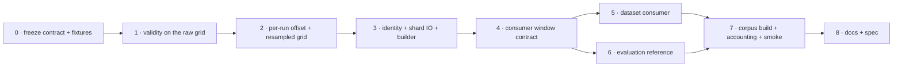

# ADR-003 — respiration session artefact implementation plan

> **Authority.** `code/notes/design/ADR-003-resp-session-cache-artefact.md` is the contract.
> This file only fixes *build order, module boundaries and gates*. Where the two disagree the
> ADR wins; a disagreement is listed in §3 and resolved in the ADR's favour.
>
> **Scope.** One decision is implemented: clean each session **once, offline**, into a cached
> artefact holding a **whole-session signal grid** plus a **per-sample validity mask** in
> absolute session time, and make every consumer read that artefact instead of the raw trace.
> The fixed inputs are the ADR's numbers (9.95 V / 1 s rail, 5 s / 0.3 V flatline, 8 s minimum
> run, 1000 Hz nominal source rate). None of them is re-opened here.
>
> **Explicitly outside this plan.** Clip length, hop, stride, split, fold, task subset,
> label normalisation, model geometry, losses, tokenisation, the pixel/ROI cache, and any
> retraining. The ADR forbids every one of those from entering the artefact (§2.4), and a
> change to them must leave stored bytes untouched (Criterion 5).
>
> **State: new implementation, no compatibility target.** Existing respiration code, configs,
> runners and on-disk caches are **not** preserved, not adapted and not migrated. The artefact
> lineage starts here at `format_version: 1`; any artefact built by an earlier pipeline is
> invalid and unreadable by this code (different directory, different key, same `NaN` contract
> check that fails on a foreign file). No stage of this plan spends GPU time; it stops at
> "data pipeline verified".
>
> Paths are relative to `code/` unless they start with `code/`.
>
> **Implementation status (2026-11-20). Phases 0–4 and 6–8 landed; Phase 5 wired
> through `resp_window`; the corpus build of Phase 7 is pending raw data.**
> `data/resp_preprocess.py`, `data/resp_cache.py`, `data/resp_window.py`,
> `runners/run_build_resp_cache.py` and `analysis/tir_resp/measure_resp_rate.py`
> are the new implementation (the previous respiration modules and their tests
> were deleted, not adapted). Gates G0–G4b, G9, G13, G14 are green: 68 new tests
> in `tests/test_resp_validity.py`, `test_resp_preprocess.py`,
> `test_resp_cache.py`, `test_resp_window.py`; the full suite is **664 passed**.
> Measured, and now pinned in the tests: 130 Hz interior residual **RMS 1.3e-4 V /
> max 2.9e-4 V** (ADR 2.4e-4 V used as the RMS bound); run-edge second difference
> **4.7e-4 V** at the start and **7.9e-5 V** at the end, against **2.3e-2 /
> 1.2e-1 V** for zero padding; interior phase error **3.5e-5 V**, against
> **2.2e-2 V** for a slice-local resample; per-session build **0.01–0.03 s**.
> The builder was exercised end-to-end on a synthetic corpus (`--init --build
> --status --index --check`), including a session of exactly 8.0 s, which yields
> **800/800 usable samples** and passes `--check` bit-identically. Three points
> were resolved during implementation and are recorded here rather than silently
> absorbed: **(i)** the flatline probe uses ``round(5 s × fs_in)`` rounded up to an
> odd sample count (5001 at 1 kHz) so the rolling min/max filter can align to the
> window START — 0.02 % longer, and the only alignment SciPy permits; **(ii)** the
> "a 0.05 Hz breath survives" claim is amplitude-dependent — the spread over 5 s at
> the extremum is `0.293·A`, so the probe spares 0.05 Hz only for **A > 1.02 V**
> (`resp_preprocess` says so at the constant, and a test pins the limit);
> **(iii)** `find_cache` distinguishes a **mismatch** (candidate exists, wrong
> fields → `ValueError` with the diff) from an **absence** (nothing there →
> `FileNotFoundError`), because only the first means "you asked for another grid".
> **Outstanding:** nothing in the plan. The corpus build landed on 2026-11-20:
> `respgrid_src1000_fs100_sat9.95-1s_flat0.3-5s_run8s_v1_aedd3ff84e`, **1399
> shards / 1 skip** (`F082_T1`) from 1400 discovered sessions in **33.7 s**,
> 41.7 MB, `--check 200` **PASS**. Step 27a is also done and returned a NEGATIVE
> result: the thermal timeline is a **bimodal** duration source (≈390 Hz for ~75 %
> of sessions, ≈1000 Hz for ~23 %), so it cannot fix the reopening tolerance,
> which therefore **stays `[TODO: verify]`**; respiratory physiology arbitrates
> for the nominal rate (median spectral peak 14.6 bpm at 1000 Hz vs 5.7 bpm at
> 390 Hz, 100 % vs 10.5 % of sessions inside 8-30 bpm). Numbers, tables and the
> "what must not be read from this" list: `notes/eval/resp/resp_artefact_build.md`
> §"build accounting (2026-11-20)".

---

## 1. Definition of done

1. `resp_preprocess.preprocess_session(x, fs_in, fs_out, …)` is a pure function from one raw
   trace to one artefact payload, with no IO, no config object and no globals.
2. Validity is decided **once**, on raw volts, **before** offset removal and normalisation,
   and the emitted mask is the only statement of validity anywhere in the lineage.
3. Every readable session in a subset build produces a shard, including a session whose whole
   grid is invalid; only missing or unreadable files produce a skip record.
4. `np.isnan(signal) == ~mask` holds on every shard, asserted by both writer and loader — an
   invalid sample is `NaN`, never `0`.
5. A consumer verifies the artefact's identity before cutting a window, refuses a mismatch, and
   derives `s` and `n` from `fs_out` arithmetic rather than from any stored window table.
6. Rebuilding with only a different `clip_seconds` or `clip_stride` produces byte-identical
   shards.
7. Gates G0–G14 of §6 pass; G8 leaves a per-cause accounting table in the ADR's evidence
   artifact, `code/notes/eval/resp/resp_artefact_build.md` (modality-neutral — the artefact
   serves every `resp` consumer, not the TIR dataset alone).

---

## 2. Target layout

| piece | new file | responsibility (and only this) |
| :--- | :--- | :--- |
| decision | `data/resp_preprocess.py` | `validity_mask`, `contiguous_runs`, `preprocess_session` — pure NumPy/SciPy, no IO |
| identity + storage | `data/resp_cache.py` | params, cache key, shard read/write, skip records, `find_cache`, identity verification |
| consumer contract | `data/resp_window.py` | window arithmetic, `usable()`, masked slicing, the `clip_seconds <= min_run_s` rule |
| builder | `runners/run_build_resp_cache.py` | `--init` / `--build` / `--status` / `--index` / `--check` |
| provenance measurement (**not** part of the build) | `analysis/tir_resp/measure_resp_rate.py` | measured source rate against the paired timeline → CSV in `notes/eval/`; never reads or writes a shard |
| tests | `tests/test_resp_validity.py`, `tests/test_resp_preprocess.py`, `tests/test_resp_cache.py`, `tests/test_resp_window.py` | the gates of §6, case list in §6.1 |
| consumers | `data/tir_resp_dataset.py`, `runners/run_evaluate_session.py` (+ subject/kfold) | attach, cut, account, refuse — all through `resp_window` |

Three rules on the boundaries:

- **`resp_preprocess` never knows a window exists.** If a function in it takes
  `clip_seconds`, `clip_stride`, a split, a task list or a normalisation flag, it belongs
  downstream.
- **`resp_window` is the only place the window rule is written.** The dataset and the
  evaluation reference both call it, so I5 and I8 are enforced by construction rather than by
  two implementations agreeing by inspection.
- **`resp_cache` stores identity, never meaning.** It does not decide validity and does not
  interpret the mask.

---

## 3. ADR points that need a reading before code exists

| # | point | reading used here |
| :--- | :--- | :--- |
| A1 | §2.1 and §2.3 say a shard records "both rates" | read as `fs_in` (**nominal 1000**) and `fs_out`; §2.3's third bullet is explicit that the **measured** rate is not recorded. A measured `fs_in` must not enter the shard, the key or a log line that a consumer could act on. `[TODO: verify: confirm this reading with the ADR author, since §2.3 also asks for the measured rate to be recorded per session]` |
| A2 | §2.3 keeps the reopening tolerance undefined | the measured spread is published in the ADR's evidence artifact, `code/notes/eval/resp/resp_artefact_build.md`, and never enters the artefact; the tolerance stays `[TODO: verify]` and is not invented. The measurement procedure is §5 Phase 7, step 27a. **The path moved on 2026-11-20** (it was `eval/tir_resp/resp_preprocess_impact.md`): the artefact is modality-independent, so its evidence does not belong under a visual lineage — the ADR's §5 was amended first, not bypassed, and the TIR-only clip accounting stays where it is. |
| A3 | §2.1 lists causes as "rail, flatline, run too short, non-finite" without precedence | precedence is fixed as **non-finite → rail → flatline → short run**, first match wins, so a sample inside two rules still has one cause. Documented in `resp_preprocess`'s docstring and asserted in G1a. |
| A4 | §2.6 fixes the filter only indirectly ("anti-alias resample") and lists neither `resample` nor `store` | both are **additive identity fields**, declared here as a deliberate extension: they change stored bytes, and §2.6 requires the artefact to record the quantities it is built under. The record is `resample: {kind, taps_per_phase, up, down, kernel_radius_src}` plus `store`; see A7. Changing either is a new artefact. |
| A5 | §2.6 does not name a default `fs_out` | `--fs_out` is a required build parameter with a documented default (`100`), recorded in every shard; a consumer's `--fs` must equal it or the run aborts (G10). |
| A6 | Criterion 1 says a window overlapping a hole is unusable, but a hole narrower than one output period can fall **between** grid instants; the ADR also forbids testing a sample again after the mask is written (§2.2 step 4) and forbids an edge guard (Criterion 4) | the grid mask is the Phase-1 verdict **sampled** at `k·D`, with **no support dilation**: resampling is per run and padded with the run's own edge values, so no invalid volt ever enters an output, and `mask[k] = mask_src[k·D]`, `cause[k] = cause_src[k·D]` (§5 Phase 2, step 8). The sub-period case is handled by **widening the hole** to contain at least one grid instant (cost: ≤ 1 grid sample per hole), never by shrinking runs. Dilating by `R_src` was rejected: it costs 10 samples at *every* run edge, so an exactly 8 s run would yield 780 usable samples and no 8 s clip could ever fit, contradicting §2.4. Recorded as a deviation; gated by G9 and G1b. |
| A7 | §2.2 fixes "anti-alias resample" without naming a filter radius; a fixed 20-sample heuristic is smaller than the filter's real support | the radius is **derived from the filter actually used**: `resample_poly` designs `half_len = 10·max(up, down)` taps, i.e. `R_src = taps_per_phase·max(1, down/up)` **source** samples (`R_src = 100` at 1000→100 Hz). Edge replication and the discarded output count use `R_src`; the grid mask is **sampled, not dilated** (A6), so the radius never costs a run sample. `taps_per_phase` is a key field exposed as `--resample_taps_per_phase` (default `10`, refused below `10`). §5 Phase 2, steps 7–8. |
| A8 | §2.6 allows any output rate, but a run starting at a source index that is not a multiple of `D = fs_in/fs_out` would otherwise be placed with a sub-sample phase error of up to one output period (~9 ms) | the builder requires `fs_in % fs_out == 0` and aligns every resampled run to **exact master grid instants**: with `t = (k0·D − a) mod D`, `pad_left = R_src + (D − t) mod D`, drop `j_first = R_src/D + (t > 0)` leading outputs; output `j` then sits at grid `k0 + j − j_first`. §5 Phase 2, steps 5–7, gated by G4b. A non-divisor `--fs_out` is refused with a named error at `--init`. `pad_left` is **never** reduced for a run near sample 0: the pad is built in memory from the run's own edge values, so a virtual start below index 0 is harmless — every output it produces is discarded. |

---

## 4. Frozen artefact contract (transcribed from the ADR, not negotiated here)

### 4.1 Identity fields — hashed into the directory name and compared by every consumer

| field | value at defaults | why it changes stored bytes |
| :--- | :--- | :--- |
| `format_version` | `1` | shard schema |
| `corpus` | digest of the discovered session set | which shards exist |
| `fs_in` | `1000` (**nominal**) | grid mapping |
| `fs_out` | build parameter (default `100`) | the grid consumers address |
| `sat_v` | `9.95` | mask |
| `sat_min_s` | `1.0` | mask (a shorter contact is **kept**) |
| `flat_window_s` | `5.0` | mask |
| `flat_ptp_v` | `0.3` | mask |
| `min_run_s` | `8.0` | mask + holes |
| `resample` | `{kind, taps_per_phase, up, down, kernel_radius_src}` | stored values (A4, A7) |
| `store` | `signal+mask+cause`, `float32` | stored representation (A4) |

### 4.2 Deliberately **not** in the identity — may never enter a shard

`clip_seconds`, `clip_stride`, `task_set` / `tasks` / `task_groups`, the subject split or fold,
`physio_norm` and every normalisation statistic, `input_size`, `max_entries`, and every
raster-side knob. These select or rescale windows; they do not change a stored sample.

### 4.3 Shard members

| member | dtype | meaning |
| :--- | :--- | :--- |
| `signal` | `float32 [N_out]` | run-mean-removed volts on the output grid; **`NaN` exactly where `mask` is `False`** |
| `mask` | `bool [N_out]` | `True` = usable; the sole authority |
| `cause` | `uint8 [N_out]` | `0` valid, `1` rail, `2` flatline, `3` short run, `4` non-finite (precedence A3) |
| `n_src`, `fs_in`, `fs_out` | int | self-verifying grid identity, no raw file needed |
| `n_runs`, `valid_frac`, `n_nonfinite` | scalar | build statistics |
| `session`, `resp_file` | str | provenance |

### 4.4 Grid arithmetic — the whole consumer contract in three lines

$$N_{\text{out}} = \left\lfloor (N_{\text{src}} - 1)\,\frac{f_{s,\text{out}}}{f_{s,\text{in}}} \right\rfloor + 1,
\qquad s = \operatorname{round}(t_{\text{start}} f_{s,\text{out}}),
\qquad n = \operatorname{round}(\ell_{\text{clip}} f_{s,\text{out}})$$

$$\text{usable}(t_{\text{start}}) \iff \texttt{mask}[s{:}s{+}n].\text{all}()$$

A thermal frame $f$ maps to respiration sample $\operatorname{round}(f/\text{fps} \cdot f_{s,\text{out}})$.
The first formula never reads past the file; the third is the only validity test any consumer
may apply.

---

## 5. Phases



Phases 1→2→3 are sequential. Phase 4 needs only 3's shard format. Phases 5 and 6 are
independent of each other and both need 4. No phase changes a tensor shape, so the existing
suite must stay green at every step.

### Phase 0 — freeze the contract

1. `data/resp_preprocess.py` module docstring carries §4.1–§4.4 verbatim (it is the code-side
   copy of the ADR; the ADR stays the authority).
2. Constants live next to the header, one per key field, so the key is derived from them and
   never restated: `FS_IN = 1000.0`, `SAT_V = 9.95`, `SAT_MIN_S = 1.0`, `FLAT_WINDOW_S = 5.0`,
   `FLAT_PTP_V = 0.3`, `MIN_RUN_S = 8.0`, `RESAMPLE_TAPS_PER_PHASE = 10`, `RESAMPLE_KIND`, and the
   five cause codes. `R_src` is **computed** from `taps_per_phase` and `up/down` (A7), never a
   second constant that could disagree with the filter.
3. **No binary fixture is committed.** A `synthetic_session()` helper builds a trace with a
   known answer at every boundary: a 0.3 Hz breathing sine, one 0.5 s rail graze, one 1.5 s
   rail block, one 6 s frozen stretch, one sub-sample gap, one 6 s tail run. Every gate below
   states its own window of that trace, so an off-by-one cannot hide.

**Gate G0 is automated, not a human diff.** `tests/test_resp_cache.py::test_identity_schema`
asserts that `build_params()` returns **exactly** the canonical key set of §4.1 (a frozen
literal in the test) and that **none** of §4.2's consumer fields is present. Adding, renaming or
removing a key field therefore fails the suite until the test and §4.1 are updated together. A
one-time human diff of §4 against ADR §2.1/§2.6, including the additive fields declared in A4,
is recorded in the PR that lands Phase 3 — after that, the test is the gate.

### Phase 1 — validity on the raw grid (`data/resp_preprocess.py`)

`validity_mask(x, fs_in, …) -> (mask, cause)`, in exactly this order:

1. `nonfinite = ~isfinite(x)` → cause `4`.
2. **Rail is event-based.** `rail = |x| > sat_v`; group into **maximal contiguous runs**; a run
   with `len / fs_in >= sat_min_s` invalidates all of its samples (cause `1`). Shorter contacts
   stay valid. A rolling *duration* or a *fraction of the file* is wrong here by construction:
   files exist with 40–80 % rail fraction made of many sub-second grazes.
3. **Flatline is a window probe, dilated back onto samples.** With
   `n_w = round(flat_window_s * fs_in)`, mark every window start `j` whose
   `ptp(x[j : j+n_w]) < flat_ptp_v`, then invalidate every sample lying in **any** such window
   (cause `2`). Implementation: `min/max` filters of size `n_w` (or `sliding_window_view`) plus a
   dilation over the window starts — the two must be pinned equal on a 5 000-sample synthetic,
   because this is the one place an off-by-one silently changes the mask.
4. `contiguous_runs(mask)`: maximal `True` stretches; a run shorter than `min_run_s` becomes a
   hole (cause `3`). **Runs are internal and are never stored.**

**Gates:** G2 (Criterion 2), G3 (Criterion 3), G1a (cause precedence of A3). A 0.05 Hz breath
(two samples per 10 s period) must survive the 5 s probe — the probe length exists precisely so
it cannot mistake slow breathing for a dead channel.

### Phase 2 — per-run offset and the output grid

`preprocess_session(x, fs_in, fs_out, …) -> dict` returning the shard payload minus provenance:

5. **Exact grid alignment (A8).** `D = fs_in / fs_out` must be integral (`--init` refuses
   anything else). Master grid index `k` then sits at source index `k·D` **exactly**, so nothing
   is ever interpolated onto a shifted timebase. For a run covering source indices `[a, b]`,
   `k0 = ceil(a/D)` and `k1 = floor(b/D)`; a run starting at `a = 1503` contributes grid sample
   `151` at source `1510` — it does not resample its own slice from index 0, which would place
   the run 3 ms early.
6. **Per-run offset.** `y = x[a:b+1] - mean(x[a:b+1])` in `float64`. **No high-pass filter, no
   detrend, no scaling** — the ADR's reason is that a constant subtraction introduces no
   transient, so no guard band is needed and waveform shape and amplitude must survive.
7. **Resample over the filter's real support (A7).** Pad `y` **in memory** with the run's own edge
   values — `pad_left = R_src + (D − t) mod D` and `pad_right = R_src`, with
   `t = (k0·D − a) mod D` — call `resample_poly(padded, up, down)`, then drop the first
   `j_first = R_src/D + (t > 0)` and the last `R_src/D` output samples. Output `j` lands on grid
   `k0 + j − j_first`, an **integer** relation, so the run contributes to the master grid with
   zero phase error and truncates rather than shifts when it ends off-grid.
   `pad_left` is **never** reduced, whatever `a` is. The pad is constructed from `y` in memory and
   never reads a file index, so a virtual start at a negative source index is harmless: the
   outputs it produces are exactly the discarded `j < j_first`, and every retained output has
   `k >= k0 >= 0`. Trimming the pad instead would hand `resample_poly` its own zero padding and
   reintroduce the edge transient Criterion 4 forbids.
8. **Grid mask and cause — sampled, not dilated (A6).** `mask[k] = mask_src[k·D]` and
   `cause[k] = cause_src[k·D]`: one source sample per grid sample. The filter never sees an
   invalid volt — the run is sliced at the validity boundary and padded with its own edge values
   — so no output can be contaminated by a rail, a flatline or a `NaN`, and a dilation by `R_src`
   would protect against nothing while costing 10 samples at every run edge. `mask ⇔ cause`
   therefore holds **structurally** (Phase 1 sets `cause = 0` exactly where the sample is valid)
   and the writer asserts it rather than repairing it.
   The one thing sampling cannot see is a hole **narrower than one output period**: it can fall
   between two grid instants and let a window span two runs whose means differ, i.e. a step of
   arbitrary size inside a window the mask calls valid. Such a hole is **widened** until it
   contains at least one grid instant — extending it on the side whose extension is shorter, left
   on a tie — at a cost of at most one grid sample per hole; then runs are recomputed and
   `min_run_s` applied. The loop terminates because widening is monotone: each step either
   registers the hole on a grid instant or turns the adjacent run into a hole, and converted runs
   only merge into it. Widening is chosen over mask dilation because it costs nothing at run
   edges that are bounded by wider holes, which is what keeps `clip_seconds <= min_run_s`
   satisfiable (§2.4).
9. Write `NaN` outside the mask and assert `np.isnan(signal) == ~mask` **and**
   `(cause != 0) == ~mask` on the way out.

**Gates:** G4 (Criterion 4: 130 Hz aliasing residual $\le 2.4\times10^{-4}$ V and run-edge
gradient $< 10^{-3}$ V, both asserted in `tests/test_resp_preprocess.py`), G4b (zero phase
error, A8), G13 (analytic: 0.3 Hz preserved within 1 %), G9 (sub-period holes are widened, runs
are not shrunk), G1b (`mask ⇔ cause`).

### Phase 3 — identity, shard IO, builder

10. `data/resp_cache.py`: `RESP_CACHE_FORMAT_VERSION = 1`, `build_params()`, `cache_key()`
    (readable slug + `sha1(params)[:10]`), `write_params` / `read_params`, `COMPARE_KEYS`,
    `find_cache()` (field-by-field diff, refuse an ambiguous match), `write_shard` (staging
    directory + `os.replace`, never a partially written shard), `write_skip`, `read_shard`,
    `shard_path`. Failure messages name the differing field and the rebuild command.
11. Layout, mirroring the ADR's "one shard per session":
   ```
   respgrid_src1000_fs100_sat9.95-1s_flat0.3-5s_run8s_v1_<sha1(params)[:10]>/
       params.json          # the frozen contract (--init writes it; build refuses a mismatch)
       tasks/<SUBJECT>_<TASK>.npz
       skipped/<SUBJECT>_<TASK>.json   # {"session","reason"} — missing/unreadable ONLY
       manifest.json        # derived index (--index)
   ```
12. `runners/run_build_resp_cache.py` with `--init`, `--build` (default), `--status`,
    `--index`, `--check N`, plus `--out_root`, `--raw_root`, `--subjects`, `--limit`,
    `--fs_out`, `--resample_taps_per_phase` and the five validity knobs. **Every knob is a key
    field**, so a non-default value produces a *different artefact*, never an edit of the
    existing one. `--fs_out` must divide `fs_in` and `--resample_taps_per_phase` must be
    `>= 10`; both are refused at `--init` with the reason in the message (A7, A8).
13. `build_task()` returns `(None, reason)` **only** for `missing_resp_volts`,
    `unreadable_resp_volts`, `empty_resp_volts`. It must never skip on label content.

**Gates:** G5 (Criterion 5: clip/hop change ⇒ identical bytes), G6 (Criterion 6: nominal
`fs_in` recorded, measured rate absent from key and shard), G7 (Criterion 7), G10 (identity
mismatch aborts), G11 (I7: independent version from the pixel artefact).

### Phase 4 — consumer window contract (`data/resp_window.py`)

14. `window_indices(t_start, clip_seconds, fs_out) -> (s, n)` — the two `round()` calls of
    §4.4, and a `ValueError` when `n == 0`. It does **not** assert `s + n <= N_out`: a
    window-generating loop must be able to probe the end of the session and reject cleanly, not
    crash on an `AssertionError`.
15. `usable(mask, s, n) -> bool` — bounds **first**, slice second:
    `n > 0 and 0 <= s and s + n <= len(mask) and bool(mask[s:s+n].all())`. The order matters:
    `mask[s:s+n]` truncates silently, so a window running past the end whose remaining samples
    are all `True` would otherwise be reported usable.
16. `read_window(shard, s, n) -> np.ndarray` — returns the slice, and **raises** if the window
    is out of bounds or holds any `NaN`, so an unmasked read fails loudly instead of training on
    a hole or on a silently shortened window.
17. `assert_clip_fits(clip_seconds, params)` — raises when `clip_seconds > min_run_s`, with the
    rebuild command in the message (§2.4: clip flexibility is bounded by the minimum run).
18. `verify_identity(cache_root, expected_params)` — a consumer's only entry point.

**Gates:** G9, G10, G14 (window arithmetic round-trip against a brute-force index walk).

### Phase 5 — dataset consumer

19. `_attach_resp_cache(out_root)` beside the existing raster attach: derive the loader half of
    the key from `(raw_root, discovered sessions, fs_in, fs_out = args.fs)` plus the defaults,
    call `find_cache`, print the directory name, `fs_out` and the validity contract, then
    `assert_clip_fits` **and** `fs_out == self.fs` before any entry is built.
20. Label read becomes an integer slice through `resp_window`: no `np.interp`, no per-epoch
    re-reading of `Resp_Volts.txt`. Normalisation stays a downstream per-clip operation and is
    computed over valid samples only.
21. Window validity is `usable(mask, s, n)` — the dataset never re-tests a window's content and
    never inspects volts. Drop counters are attributed from `cause[s:s+n]` (first non-zero) so
    the per-rule accounting survives the change.
22. Coverage is the **intersection** of the two artefacts, joined on session name: a
    `skipped/*.json` session is excluded quietly, a missing `tasks/*.npz` raises with the
    builder hint (§2.5 I7).

**Gate:** G12a — a synthetic corpus where one session is wholly invalid, one has a 6 s tail run
and one is valid throughout yields exactly the expected clip counts, with zero volts read.

### Phase 6 — evaluation reference

23. `read_reference(resp_cache_root, session, fs)` reads the **same** shard as the label
    (I8), returning `(t, y, mask)`.
24. Scoring applies the reference mask as a **second** restriction on top of the existing
    coverage mask (`scored = covered & ref_mask`), so a reference hole is never scored as zero.
25. `entries.json` records `resp_cache`, `resp_cache_key` and `reference_source: resp_cache`.

**Gate:** G12b — reference and label bit-identical for the same window; a hole in either side
removes the sample from the score instead of contributing a residual.

### Phase 7 — corpus build, accounting, smoke

26. Build a small subset (`--limit`), then the full corpus (single process, minutes, no GPU),
    then `--status`, `--index`, `--check 20`.
27. Publish, in the ADR's evidence artifact `code/notes/eval/resp/resp_artefact_build.md`
    (modality-neutral; appended to as builds land, never overwritten): shards written, skips by
    reason, per-cause invalid share, `valid_frac` distribution, the sessions with
    `valid_frac == 0`, and **the measured-rate spread** of step 27a — recorded in the note,
    not in the artefact.
27a. **Measure the source rate (provenance only).** `analysis/tir_resp/measure_resp_rate.py`
     computes `f_meas = N_src / duration_s` per session from the raw sample count and the paired
     thermal timeline of the same session (`duration_s = num_frames / fps`) and writes
     `code/notes/eval/resp/resp_rate_spread.csv` (`session, n_src, duration_s, f_meas`) plus
     min / median / IQR / max. It runs on CPU, reads raw files only, is **never** invoked by
     `--build`, and writes nothing into the artefact — which is what keeps phases 1–2 pure and
     keeps `fs_in` nominal (A1). `[TODO: verify: confirm that the thermal frame count at nominal
     fps is the session duration of record, or name the metadata field that is]`
28. Smoke a data path end-to-end on the subset and record the clip/sample timing against the
    previous per-epoch interpolation path.

**Gates:** G8 (Criterion 8), G7 (Criterion 7 at corpus scale).

### Phase 8 — docs

29. `code/notes/spec/01_data_pipeline.md` gains the artefact section (hand-applied; if
    `scripts/project/write_specs.py` regenerates it, the same text is added to the script in the
    same commit). `code/notes/GLOSSARY.md` §8 keeps the canonical field names
    (`sat_v`, `sat_min_s`, `flat_window_s`, `flat_ptp_v`, `min_run_s`, `fs_out`) and drops
    `rail_touch_v` / `min_signal_spread` from the respiration path. `code/README.md` documents
    `--resp_cache` and the `resp_fs == fs_out` rule. Then `grep -rn "code/notes/" code/` must
    still resolve every path.

---

## 6. Gates

| # | gate | pass condition | ADR |
| :--- | :--- | :--- | :--- |
| G0 | contract schema (**automated**) | `build_params()` equals the frozen canonical key set of §4.1 and contains none of §4.2's consumer fields (`test_identity_schema`); the one-time §4 ↔ ADR diff is recorded in the PR that lands Phase 3 | §2.4 |
| G1 | mask is the sole authority | `mask[s:s+n].all()` is the only window test in the lineage; `np.isnan == ~mask` on every shard; no `0` substituted anywhere | Criterion 1 |
| G1a | cause precedence | a sample inside a rail block that is also non-finite carries exactly one cause, by A3's order | §2.1 |
| G1b | mask and cause agree | `mask[k] == False ⇔ cause[k] != 0` on every shard; with sampled (never dilated) arrays this is structural, and the writer asserts it rather than trusting it | §2.1 / A6 |
| G2 | rail is event-based | 0.5 s graze: 0 rejected samples; 1.5 s block: 0 surviving samples | Criterion 2 |
| G3 | flatline spares slow breathing | 0.05 Hz breath stays valid; a frozen/barely-ringing channel does not | Criterion 3 |
| G4 | no per-run transient | 130 Hz aliasing residual $\le 2.4\times10^{-4}$ V **and** `max\|∇y\|` over the first/last outputs of every run $< 10^{-3}$ V — both asserted in `tests/test_resp_preprocess.py`, the gradient case as its own test | Criterion 4 |
| G4b | no sub-sample phase error | a run starting at `a` with `a mod D ≠ 0` lands at lag 0: cross-correlation against an independently evaluated reference peaks at lag 0 and `y[k·D]` matches a direct `float64` sinc evaluation to `1e-6` V | A8 / Criterion 1 |
| G5 | artefact holds no consumer choice | rebuild with a different `clip_seconds`/`clip_stride` ⇒ byte-identical shards; a shard stores no window, stride, split or normalisation field | Criterion 5 |
| G6 | source rate | `fs_in = 1000` nominal in every shard and in the key; measured rate absent from both | Criterion 6 |
| G7 | nothing is ruled unusable | every readable session has a shard, including `valid_frac == 0`; skips are missing/unreadable only | Criterion 7 |
| G8 | subset build | one shard per readable session; every shard loads and passes G1; no GPU time | Criterion 8 |
| G9 | holes are resolvable, runs are not shrunk | a hole narrower than one output period is widened so at least one grid instant is `False`, while a run bounded by wider holes keeps **every** grid sample: an exactly 8 s run yields 800 usable samples and an 8 s clip fits (the §2.4 bound, asserted) | Criterion 1 / I5 / §2.4 |
| G10 | bounded clips, loud mismatch | `clip_seconds > min_run_s` raises with the rebuild hint; a foreign key aborts with a field diff | §2.4 / I5–I6 |
| G11 | two independent artefacts | respiration and pixel keys are disjoint, versions independent, join by session name only | I7 |
| G12 | one space for label and reference | dataset and evaluator read the same shard; `scored = covered & ref_mask` | I8 |
| G13 | anti-alias is real | a 130 Hz tone (which folds to 30 Hz on the 100 Hz grid) leaves a residual $\le 2.4\times10^{-4}$ V, while content between 30 and 50 Hz — legitimately **in band** at `fs_out = 100` — is not attenuated by design; 0.3 Hz amplitude within 1 %; band-limited Pearson vs the clean sine `== 1.000` | Criterion 1 / §2.2 |
| G14 | suite | `cd code && ../.env/bin/python -m pytest -q` green | — |

### 6.1 Test map — where each gate is asserted

| file | cases |
| :--- | :--- |
| `tests/test_resp_validity.py` | 0.5 s rail graze kept, 1.5 s block removed (G2); 0.05 Hz breath valid, frozen channel invalid (G3); `min/max`-filter probe equals a brute-force `sliding_window_view` loop on 5 000 samples; 6 s run → hole, 10 s run → kept; cause precedence (G1a) |
| `tests/test_resp_preprocess.py` | per-run mean removed to `< 1e-6` V; 0.3 Hz amplitude within 1 %; 130 Hz residual $\le 2.4\times10^{-4}$ V; **run-edge gradient** `max\|∇y\| < 10^{-3}` V over the first and last three outputs of every run (G4); **grid alignment** — a run starting at `a mod D ≠ 0` lands at lag 0 and matches a direct sinc evaluation (G4b); **run near sample 0** — `a = 3` keeps the full pad and shows no transient (finding 1); a hole narrower than one output period is widened so $\ge 1$ grid instant is `False` (G9); **an exactly 8 s run yields 800 usable samples** and an 8 s window fits (G9); `mask ⇔ cause` structural (G1b); `np.isnan == ~mask`; second call bit-identical |
| `tests/test_resp_cache.py` | `test_identity_schema` — key set equals the frozen §4.1 literal, no consumer field (G0); any key field change alters the key while `clip_seconds`/`clip_stride`/`physio_norm`/`input_size` do not (G5); `find_cache` field diff and ambiguous refusal (G10); shard round-trip incl. `cause`; atomic write leaves no temp; skip only for missing/unreadable and an all-invalid session still writes a shard (G7); `fs_in` nominal only, no measured rate in key or shard (G6); `--check` parity |
| `tests/test_resp_window.py` | `s`/`n` round-trip against a brute-force index walk; `usable` rejects `n == 0`, `s < 0`, `s + n > len(mask)` and a truncated all-`True` slice; `read_window` raises on `NaN` and on out-of-bounds; `assert_clip_fits` raises above `min_run_s`; identity mismatch aborts (G9, G10, G14) |

---

## 7. Implementation choices inside the ADR's bounds

These are decided here because the ADR fixes the outcome but not the mechanism. Each one is a
key field or a documented default, never a silent constant.

| # | choice | value | why it is safe |
| :--- | :--- | :--- | :--- |
| D1 | storage format | `np.savez`, uncompressed, `float32` | ~0.3 MB per session; no compression knob to drift |
| D2 | filter | polyphase anti-alias resample; `taps_per_phase` (default `10`, `--resample_taps_per_phase`) is a key field and `R_src = taps_per_phase·max(1, down/up)` is **derived** | the shape is in the key (A4/A7), and the padding can never be smaller than the filter it pads for |
| D3 | edge handling | replicate the run's own edge values in memory by `pad_left = R_src + (D − t) mod D` / `pad_right = R_src`, filter, then drop `j_first = R_src/D + (t > 0)` leading and `R_src/D` trailing outputs; the pad is never trimmed | the pad covers the filter's **full** support for every run, including one starting at sample 0 (it is built from `y`, never from file indices), and lands the output on exact master grid instants (A8); verified by G4 and G4b |
| D4 | skip records | `skipped/<session>.json` for missing/unreadable/empty only | keeps Criterion 7 auditable without a shard-shaped placeholder |
| D5 | downstream knobs | `rail_touch_v` / `min_signal_spread` do not exist on this path | a second validity rule is the one failure the ADR calls out by name |
| D6 | writer atomicity | staging directory + `os.replace`, PID-named temp | an interrupted build cannot leave a readable half-shard |
| D7 | builder parallelism | single process by default, `--array_index/--array_count` for parity | minutes of CPU; no job-size threshold |

---

## 8. Risks and open items

| # | risk / open item | treatment |
| :--- | :--- | :--- |
| R1 | "both rates" is ambiguous (A1) | record `fs_in` nominal + `fs_out` only; confirm the reading before the first corpus build; `[TODO: verify]` otherwise |
| R2 | the measured-rate tolerance stays undefined (Criterion 6) | measure and publish the corpus spread in `code/notes/eval/archive/tir_resp/resp_preprocess_impact.md` (step 27a), do **not** put it in the key, do **not** invent a tolerance |
| R3 | 0.3 V flatline is a policy, not a measurement | recorded as a key field; changing it is a new artefact and a retrain, never an in-place edit |
| R4 | short valid tails are lost (8 s minimum run) | accepted by the ADR; G12a counts the loss on a synthetic so it is visible |
| R5 | a wholly invalid session stays in the corpus | accepted (Criterion 7); every consumer must tolerate `valid_frac == 0` and report it |
| R6 | label space changes to run-mean-removed volts | every earlier number is a different lineage; this plan spends no GPU time and states that explicitly |
| R7 | the grid cannot represent invalidity finer than one output period (10 ms) | a sub-period hole is widened to one grid instant (≤ 1 sample per hole); no run edge is invalidated, so the "8 s run ⇒ 8 s usable window" guarantee of §2.4 survives — asserted by G9 |
| R8 | config/cache drift is silent by nature | identity, not path, is compared (I6); every mismatch raises with a field diff |
| R9 | `fs_in % fs_out == 0` is a build constraint this plan adds (A8) | refused at `--init`; `1000` has the divisors actually used (`100`, `200`, `125`, `50`), so the ADR's grid costs nothing, and the alternative is a phase error invisible in the mask |

**Reopen** (per the ADR's rollback clause) if the measured-rate spread changes window
arithmetic, if a consumer needs a window longer than `min_run_s`, or if the thresholds stop
describing the sensor's failure modes. Any of those is a new artefact **and** a retrain.

---

## 9. Run recipes

```bash
# 0. freeze and build the artefact (once per contract; minutes, no GPU)
python runners/run_build_resp_cache.py --init \
    --out_root "$WORK_SCRATCH/resp_cache" --raw_root "$RAW_DATA_PATH" \
    --fs_out 100 --resample_taps_per_phase 10
python runners/run_build_resp_cache.py --build --limit 8 \
    --out_root "$WORK_SCRATCH/resp_cache" --raw_root "$RAW_DATA_PATH"
python runners/run_build_resp_cache.py --status --index \
    --out_root "$WORK_SCRATCH/resp_cache"
python runners/run_build_resp_cache.py --check 20 \
    --out_root "$WORK_SCRATCH/resp_cache" --raw_root "$RAW_DATA_PATH"

# 0b. provenance only (never enters the artefact, never called by --build)
python analysis/tir_resp/measure_resp_rate.py --raw_root "$RAW_DATA_PATH" \
    --out code/notes/eval/resp/resp_rate_spread.csv   # repo-root-relative

# 1. consumer smoke, single process, one clip cap
RESP_CACHE="$WORK_SCRATCH/resp_cache" bash scripts/local/waveform_local.sh --max_clips 16

# 2. evaluation re-reads the SAME artefact on the reference side
python runners/run_evaluate_session.py --pred_dir <OUT_DIR> \
    --resp_cache "$WORK_SCRATCH/resp_cache" --waveform resp --fs 100

# 3. gates
cd code && ../.env/bin/python -m pytest -q tests/test_resp_*.py
```

---

## 10. Doc impact

| document | change |
| :--- | :--- |
| `code/notes/design/ADR-003-resp-session-cache-artefact.md` | authority — the decision, the contract, the criteria |
| this file | build order of record; supersedes any earlier respiration-preprocessing build plan |
| `code/notes/spec/01_data_pipeline.md` | new artefact section: validity mask replaces per-window filtering; layout; grid arithmetic |
| `code/notes/spec/04_configs_and_execution.md` | `rail_touch_v` row → "not on the respiration artefact path"; add `--resp_cache` / `--fs_out` |
| `code/notes/GLOSSARY.md` §8 | canonical key fields; `resp_fs == fs_out` rule |
| `code/notes/eval/resp/resp_artefact_build.md` | **the artefact's own record** (modality-neutral): build accounting, per-cause invalid share, measured-rate spread (A2) |
| `code/notes/eval/resp/resp_rate_spread.csv` | **new**: per-session `N_src`, `duration_s`, `f_meas` from step 27a |
| `code/notes/eval/archive/tir_resp/resp_preprocess_impact.md` | unchanged in content — it holds the **TIR dataset's** clip accounting, which depends on that dataset's hop and geometry |
| `code/README.md` | data section: `--resp_cache`, clip-length bound, identity refusal |

---

## 11. BDD use cases

**Feature 1 — rail rejection is event-based**
- **Given** a raw trace at 1000 Hz containing a 0.5 s block above 9.95 V and a 1.5 s block below −9.95 V
- **When** the validity mask is computed
- **Then** the 0.5 s block is **valid** (cause `0`)
- **And** every sample of the 1.5 s block is **invalid** (cause `1`)

**Feature 2 — the flatline probe spares breathing**
- **Given** a 0.05 Hz sine of 1 V amplitude
- **When** the mask is computed with a 5 s / 0.3 V probe
- **Then** every sample is valid
- **And** a frozen channel of the same length is invalid over the dilated probe support

**Feature 3 — short runs become holes, not missing clips**
- **Given** valid runs of 10 s and 6 s separated by a rail block
- **When** the runs are tested against the 8 s minimum
- **Then** the 10 s run is kept and the 6 s run is invalid (cause `3`)
- **And** the session still produces a shard

**Feature 4 — per-run offset leaves no transient**
- **Given** a valid run with a 4.5 V DC offset
- **When** the run is offset-removed and resampled
- **Then** the stored mean is `< 10^{-6}` V
- **And** the 130 Hz residual is $\le 2.4\times10^{-4}$ V and the run-edge gradient $< 10^{-3}$ V

**Feature 5 — one artefact, two hops**
- **Given** a built artefact
- **When** a consumer rebuilds after changing only `clip_seconds` or `clip_stride`
- **Then** every shard is byte-identical
- **And** no shard contains a window, stride, split or normalisation field

**Feature 6 — a hole narrower than the grid is widened, not ignored**
- **Given** a raw hole of 5 ms, narrower than the 10 ms output period
- **When** the shard is built
- **Then** the hole is widened to cover at least one grid instant, which is `False`
- **And** a window containing that instant is unusable, while the neighbouring runs lose no samples
- **And** an unmasked slice raises instead of returning zeros

**Feature 7 — a run that starts off the grid is not shifted**
- **Given** a valid run whose first source sample is `a = 1503` with `D = 10`
- **When** the run is offset-removed and resampled
- **Then** its first output sample corresponds to grid index `151` at source index `1510`
- **And** the cross-correlation with an independently evaluated reference peaks at lag `0`

**Feature 8 — an invalid output sample always carries a cause**
- **Given** a raw hole of 5 ms, widened to one grid instant
- **When** the shard is written
- **Then** that grid sample has `mask == False`
- **And** it has `cause != 0`, so `mask[k] == False ⇔ cause[k] != 0` holds for every sample

**Feature 9 — a window past the end is rejected, not truncated**
- **Given** a shard with `N_out = 100` and a window request with `s + n = 108`
- **When** `usable(mask, s, n)` is called
- **Then** it returns `False` without raising
- **And** `window_indices` itself raises only for `n == 0`

**Feature 10 — the minimum run still yields a full-length clip**
- **Given** a run of exactly 8.0 s bounded by holes wider than one output period
- **When** the shard is built at `fs_out = 100`
- **Then** the run contributes exactly `800` usable grid samples
- **And** `assert_clip_fits(8.0, params)` passes, so the ADR's §2.4 bound is satisfiable at the bound itself

**Feature 11 — cause precedence under compounding defects**
- **Given** a raw trace containing a 2.0 s rail block ($|V| > 9.95$ V) with isolated `NaN` values inside it
- **When** the validity mask and cause codes are evaluated
- **Then** the `NaN` samples carry `cause = 4` (`CAUSE_NONFINITE`)
- **And** the surrounding finite samples in the block carry `cause = 1` (`CAUSE_SAT`)

**Feature 12 — all-invalid session produces a valid shard, not a skip record**
- **Given** a session whose raw trace is pinned at $-10.0$ V throughout its entire duration
- **When** the cache builder processes the session
- **Then** a shard `<SUBJECT>_<TASK>.npz` is written under `tasks/` with `valid_frac == 0.0`
- **And** `mask.all() == False` and `np.isnan(signal).all() == True` hold on the shard
- **And** no record is added to `skipped/`

**Feature 13 — missing or unreadable source file produces a skip record**
- **Given** a session entry with a missing or unreadable `Resp_Volts.txt`
- **When** the cache builder processes the session
- **Then** no `.npz` shard is written under `tasks/`
- **And** a JSON record is written to `skipped/<SUBJECT>_<TASK>.json` recording `session` and `reason`

**Feature 14 — consumer cache verification rejects parameter mismatches**
- **Given** an existing built cache with `fs_out = 100`
- **When** a consumer initializes with an incompatible expectation (`fs = 50` or `sat_v = 9.0`)
- **Then** `verify_identity` aborts execution with a field-by-field diff
- **And** the error message provides the exact rebuild CLI command

**Feature 15 — dual-source evaluation uses the identical shard space**
- **Given** an evaluation run reading reference targets from `--resp_cache`
- **When** `read_reference(resp_cache_root, session, fs)` retrieves ground truth for a window $[s : s+n]$
- **Then** the reference waveform values are bit-identical to `read_window()` on the training side
- **And** scoring evaluates `scored = covered & ref_mask`, so no invalid sample is scored as zero

**Feature 16 — run starting near sample 0 preserves full padding without edge transient**
- **Given** a valid run starting at source index $a = 3$ ($a < R_{\text{src}}$)
- **When** the run is padded in memory by `pad_left = R_src + (D − t) mod D` and resampled
- **Then** `pad_left` is not truncated and all retained outputs have grid index $k \ge 0$
- **And** the run-edge gradient satisfies $\max |\nabla y| < 10^{-3}$ V over the leading outputs
